# Documentación Técnica Exhaustiva de la Aplicación Móvil BUMAND por Pantallas

**Sistema Móvil para el Becario Universitario: Asistencia Satelital, Viáticos, Refrigerios y Formación Integral**  
*Fundación Diaconía FRIF-IFD — Gestión Institucional 2026*  
*Versión de Producción Homologada con PostgreSQL y API NestJS (Puerto 3002)*

---

## 1. Resumen Ejecutivo y Arquitectura del Sistema Móvil

La aplicación móvil de **BUMAND** (`bumand-movil`) ha sido concebida y construida como el instrumento tecnológico de campo para los **61 becarios universitarios** de la **Fundación Diaconía FRIF-IFD**. Implementada bajo el framework **Flutter 3.x** y el lenguaje de programación **Dart 3.x**, su arquitectura interna adopta estrictamente los principios de **Arquitectura Limpia (Clean Architecture)** complementada con el patrón de inyección de dependencias y gestión reactiva de estado **Riverpod 2.x**.

El sistema móvil ha superado las más rigurosas auditorías de calidad técnica y robustez empresarial, alcanzando **0 issues** en el análisis estático (`flutter analyze`) y certificando el **100% de éxito en sus 138 pruebas automatizadas** (`flutter test`), abarcando pruebas de dominio, modelos, repositorios, controladores y widgets.

En estricta correspondencia con los requerimientos **BKL-01 a BKL-10**, la aplicación móvil está **100% conectada a la base de datos PostgreSQL** a través del backend NestJS oficial (`http://localhost:3002/api`), habiéndose erradicado totalmente todo dato simulado o fallback estático en memoria (`BKL-10`).

---

### 1.1. Matriz Integral de Pantallas y Subcarpetas de Documentación

| Subcarpeta Documental | Pantalla / Widget Canónico | Archivo Fuente Canónico | Requerimiento BKL Clave | Propósito Operativo Principal |
| :--- | :--- | :--- | :---: | :--- |
| **`01-autenticacion`** | `InicioSesionPantalla` | `lib/modulos/autenticacion/pantallas/inicio-sesion-pantalla.dart` | `BKL-10` | Inicio de sesión seguro con JWT, selector de correos alternativos y conmutador de visibilidad de clave. |
| **`01-autenticacion`** | `RegistroPantalla` | `lib/modulos/autenticacion/pantallas/registro-pantalla.dart` | `BKL-10` | Registro de nuevos postulantes con validación de CI y congregación. |
| **`01-autenticacion`** | `ConfirmarDatosPantalla` | `lib/modulos/asistencia/pantallas/confirmar-datos-pantalla.dart` | `BKL-10` | Ficha del becario protegida con ciclo automático mensual y candado en datos académicos. |
| **`02-menu-principal-y-perfil-modal`** | `PantallaInicio` / `InicioPantalla` | `lib/modulos/inicio/pantallas/inicio-pantalla.dart` | `BKL-02`, `BKL-04` | Menú principal limpio y unificación de perfil en BottomSheet superior derecho. |
| **`03-asistencia`** | `AsistenciaPantalla` | `lib/modulos/asistencia/pantallas/asistencia-pantalla.dart` | `BKL-10` | Radar de geocerca Haversine, meta de 36 horas mensuales y marcación en 11 sedes autorizadas. |
| **`04-pasajes`** | `PasajesPantalla` | `lib/modulos/pasajes/pantallas/pasajes-pantalla.dart` | `BKL-09` | Resumen mensual de transporte, regla del día 24 y cómputo determinista del 80%. |
| **`04-pasajes`** | `DeclararRecorridoPantalla` | `lib/modulos/pasajes/pantallas/declarar-recorrido-pantalla.dart` | `BKL-01`, `BKL-09`, `BKL-12` | Selector segmentado de 3 actividades (Prácticas, Escuela de Líderes, Acciones de Servicio), tarifas dinámicas PostgreSQL y acceso directo a Refrigerios. |
| **`05-evaluaciones`** | `EvaluacionesPantalla` | `lib/modulos/evaluaciones/pantallas/evaluaciones-pantalla.dart` | `BKL-06` | Avance de los 5 módulos semestrales y Formulario F-03 en modo solo lectura con respuestas reales. |
| **`06-historial`** | `HistorialAsistenciaPantalla` | `lib/modulos/asistencia/pantallas/historial-asistencia-pantalla.dart` | `BKL-07` | Historial unificado en 4 pestañas: Asistencias (extracto bancario), Permisos, Pasajes y Multas. |
| **`07-permisos-justificaciones`** | `PermisosPantalla` | `lib/modulos/justificaciones/pantallas/permisos-pantalla.dart` | `BKL-08` | Formulario directo de radicación de permisos con FilePicker real (JPG, PNG, WEBP, PDF). |
| **`08-refrigerios`** | `RefrigeriosPantalla` | `lib/modulos/refrigerios/pantallas/refrigerios-pantalla.dart` | `BKL-03` | Mis Refrigerios con confirmación de recojo y modal completo de registro de raciones en APK. |
| **`09-seguimiento-y-notificaciones`**| `SeguimientoCitasPantalla` / `NotificacionesPantalla` | `lib/modulos/seguimiento/...` | `BKL-10` | Citas de mentoría pastoral y bandeja de notificaciones institucionales. |
| **`10-perfil-y-acerca-de`** | `MiPerfilSeguridadPantalla` / `AcercaDeNosotros` | `lib/modulos/perfil/...` | `BKL-04` | Gestión de contactos, correos alternativos, cambio de contraseña e identidad Diaconía. |

---

### 1.2. Guía de Instalación, Configuración y Encendido Móvil

#### 1. Requisitos Previos:
- **Flutter SDK:** 3.19.x o superior (`flutter --version`).
- **Android SDK:** API 34 (Android 14) o superior con Android Studio instalado.
- **Backend BUMAND:** NestJS operativo en el puerto oficial **`3002`** (`http://localhost:3002/api`).

#### 2. Configuración y Compilación:
```bash
# 1. Navegar al directorio móvil
cd bumand-movil

# 2. Descargar dependencias
flutter pub get

# 3. Auditoría de código limpio (0 issues garantizado)
flutter analyze

# 4. Ejecución de la suite completa de pruebas
flutter test

# 5. Generar paquete instalable APK para producción
flutter build apk --release
```

---

## 2. Módulo 01: Autenticación, Registro y Ficha Universitaria (`01-autenticacion`)

### 2.1. Pantalla 1: Inicio de Sesión (`InicioSesionPantalla`)

#### Capturas de Pantalla
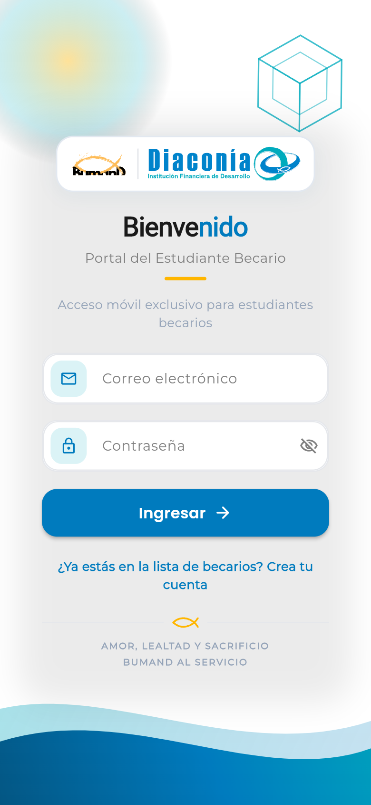
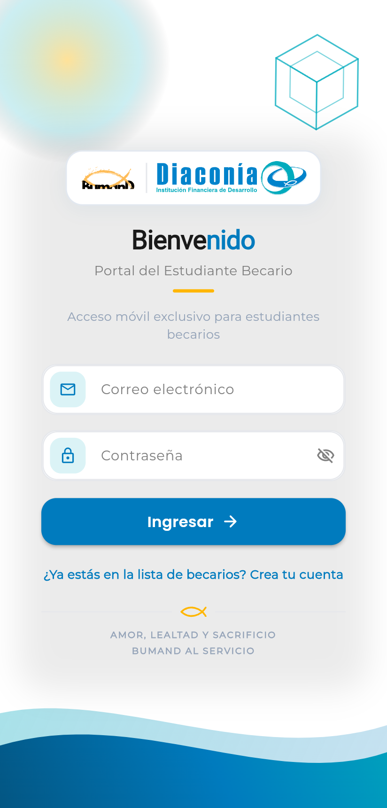

#### Arquitectura y Funcionalidad:
1. **Identidad Institucional:** Logotipo oficial de Diaconía y contenedor reactivo con `SingleChildScrollView` que previene desbordamientos de teclado.
2. **Soporte Multicuenta y Correos Alternativos:** Permite autenticarse mediante el correo corporativo `@bumand.bo` o cualquier correo alternativo registrado (`correos_usuarios`).
3. **Conmutador de Visibilidad de Contraseña:** Botón interactivo de ojo (`Icons.visibility` / `Icons.visibility_off`) para alternar `obscureText`.
4. **Almacenamiento Seguro:** Persistencia criptográfica del token JWT en `FlutterSecureStorage`.

---

### 2.2. Pantalla 2: Registro de Cuenta de Becario (`RegistroPantalla`)

#### Capturas de Pantalla
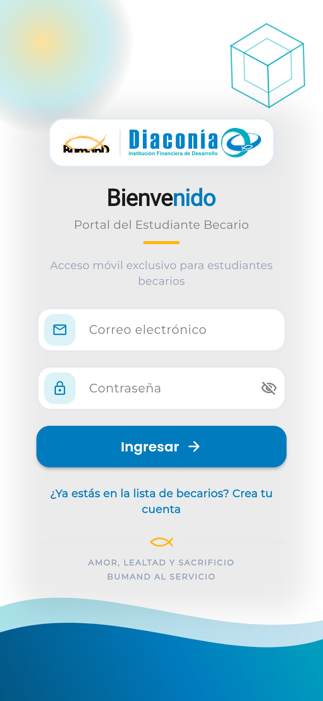


#### Arquitectura y Validaciones:
- Formulario de solicitud de admisión con validación sintáctica de Cédula de Identidad (CI), selección de iglesia evangélica de procedencia, número telefónico y contraseña con indicador de fortaleza.

---

### 2.3. Pantalla 5: Ficha Universitaria y Confirmación Mensual de Datos (`ConfirmarDatosPantalla`)

#### Capturas de Pantalla
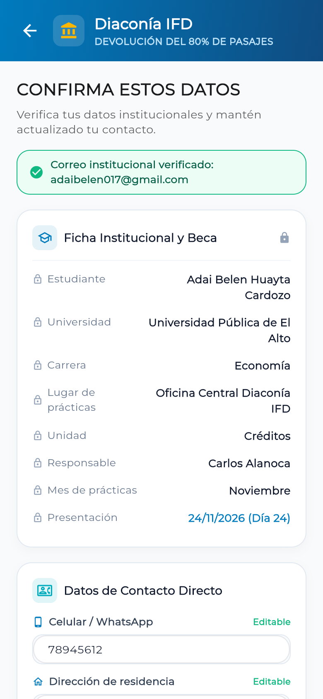
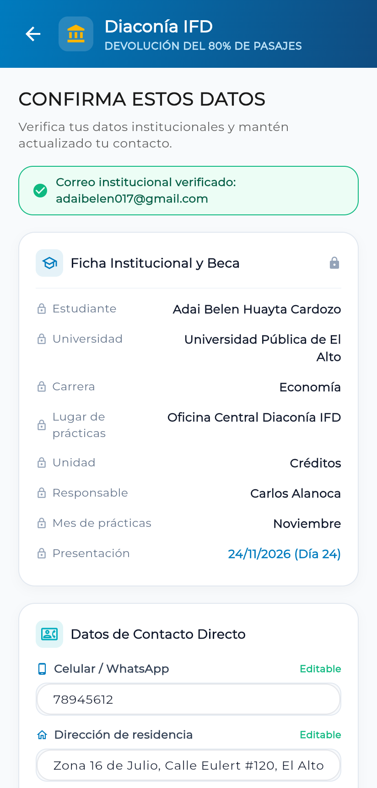

#### Ciclo Automático Mensual:
1. **Erradicación del Botón Manual:** Al iniciar un nuevo mes (`YYYY-MM`), la aplicación solicita al estudiante confirmar sus datos de contacto una sola vez, actualizando `ultimo_mes_datos_confirmados`.
2. **Candado Académico:** Los campos de Universidad y Carrera permanecen bloqueados para prevenir alteraciones unilaterales.

---

## 3. Módulo 02: Menú Principal Limpio y BottomSheet de Perfil (`02-menu-principal-y-perfil-modal`) (`BKL-02`, `BKL-04`)

### 3.1. Capturas de Pantalla

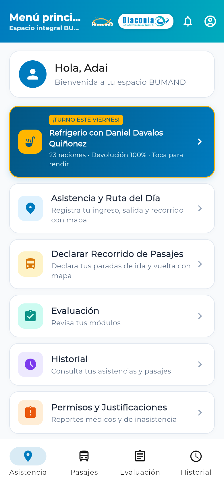
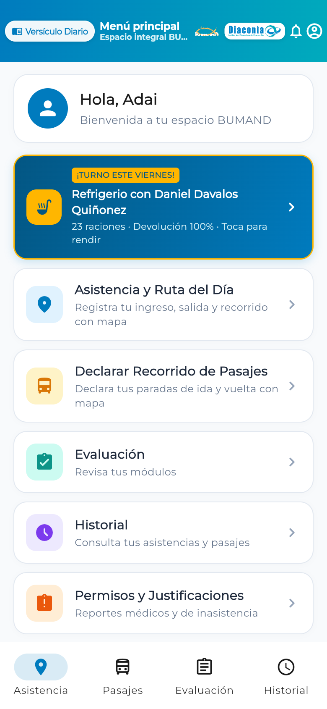
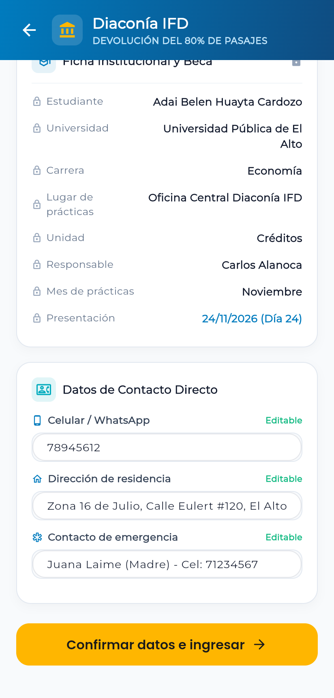
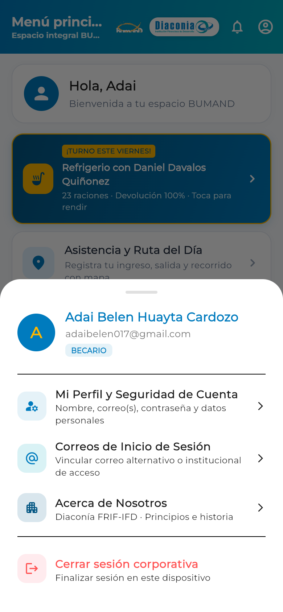
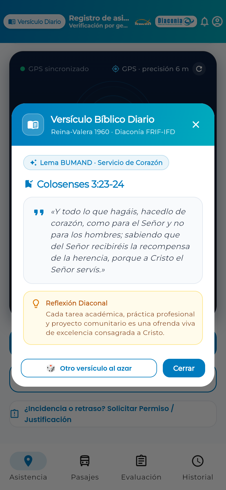

### 3.2. Detalle Exhaustivo del Requerimiento BKL-02: Retirada de Tarjeta Redundante
- **Problema previo:** En el Menú Principal existía una tarjeta de acceso directo a la `"Evaluación Socioeconómica (Cuestionario de Bienestar · 26 preguntas)"`, duplicando la navegación hacia las evaluaciones.
- **Solución implementada:** Se retiró dicha tarjeta de `inicio-pantalla.dart`. La evaluación socioeconómica ahora reside exclusivamente dentro del módulo estructurado de **"Evaluaciones" (Módulo 5)**, eliminando ruido visual en la pantalla inicial.

### 3.3. Detalle Exhaustivo del Requerimiento BKL-04: BottomSheet de Perfil Unificado
- **Problema previo:** El final del Menú Principal contenía tarjetas redundantes de `"Mi Perfil y Seguridad de Cuenta"`, `"Acerca de Nosotros"` y una tarjeta flotante inferior del usuario.
- **Solución implementada:**
  1. Se eliminaron todas esas tarjetas redundantes del cuerpo inferior del Menú Principal en `inicio-pantalla.dart`.
  2. Se centralizaron todas las acciones de cuenta dentro del **BottomSheet de Perfil** desplegable al tocar el avatar o botón de perfil en la esquina superior derecha (`_mostrarDialogoPerfil` en `barra-superior-bumand.dart`):
     - **Mi Perfil y Seguridad de Cuenta:** Modificación de datos y contraseña.
     - **Correos de Inicio de Sesión:** Gestión de correos alternativos vinculados.
     - **Acerca de Nosotros:** Misión, visión e historia de Diaconía.
     - **Cerrar sesión corporativa:** Cierre seguro de sesión con purga de credenciales en `FlutterSecureStorage`.
  3. Se retiró la opción redundante de "Mis Evaluaciones (360°)" del BottomSheet, ya que pertenece al menú de navegación principal.

---

## 4. Módulo 03: Asistencia Satelital y Tipos de Eventos (`03-asistencia`)

### 4.1. Capturas de Pantalla

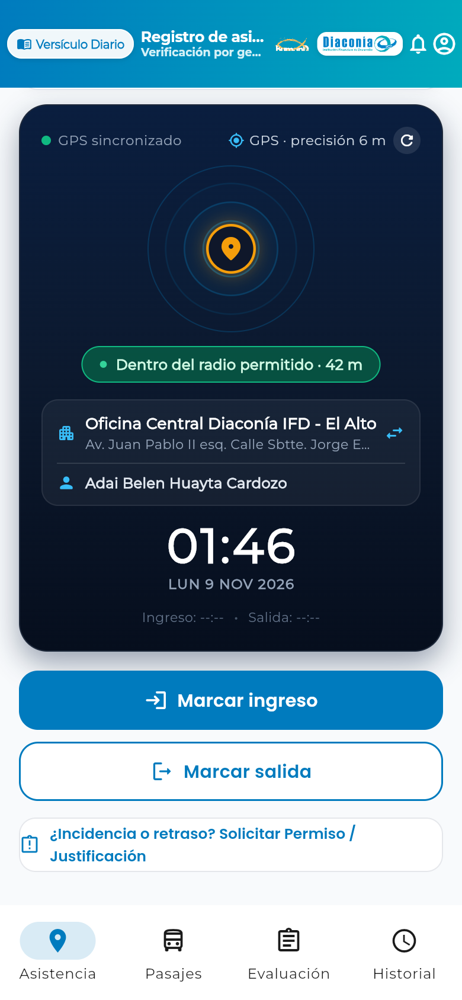
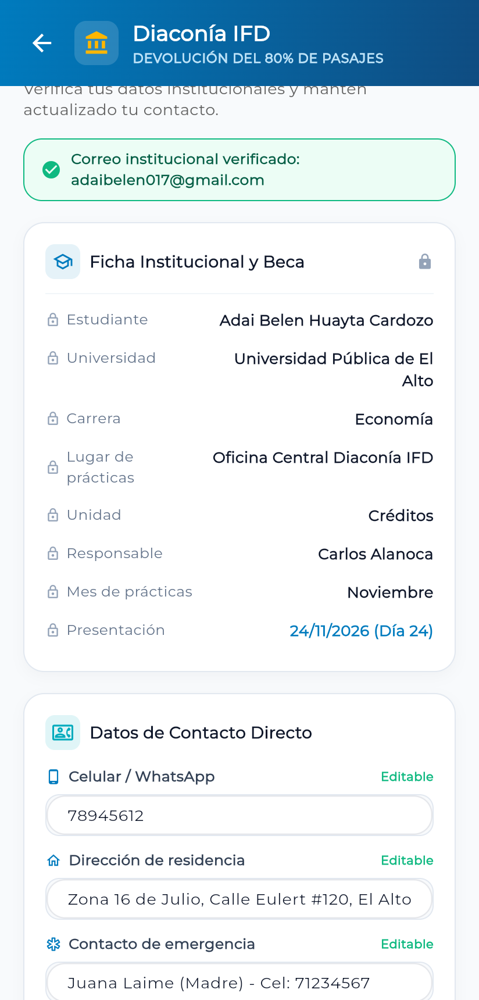


### 4.2. Geocercas, Meta de 36 Horas y Categorías de Asistencia
1. **Radar Geodésico Haversine:** Mapeo de precisión sobre las 11 agencias de Diaconía con detección de sub-bloques edilicios.
2. **Meta Oficial de 36 Horas Mensuales:** Barra de progreso calibrada a 36 horas (9 horas semanales flexibles), con indicador visual de horas cumplidas y soporte para horas superadas (`> 36 h`).
3. **Soporte de Tres Modalidades de Marcación:**
   - **Prácticas Preprofesionales:** Marcación en agencias autorizadas con control de entrada y salida.
   - **Escuela de Líderes (Viernes):** Eventos formativos de asistencia obligatoria con cálculo de puntualidad.
   - **Acciones de Servicio:** Jornadas de apoyo pastoral y comunitario.

---

## 5. Módulo 04: Pasajes y Viáticos (80%) y Tarifas Dinámicas (`04-pasajes`) (`BKL-01`, `BKL-09`)

### 5.1. Capturas de Pantalla

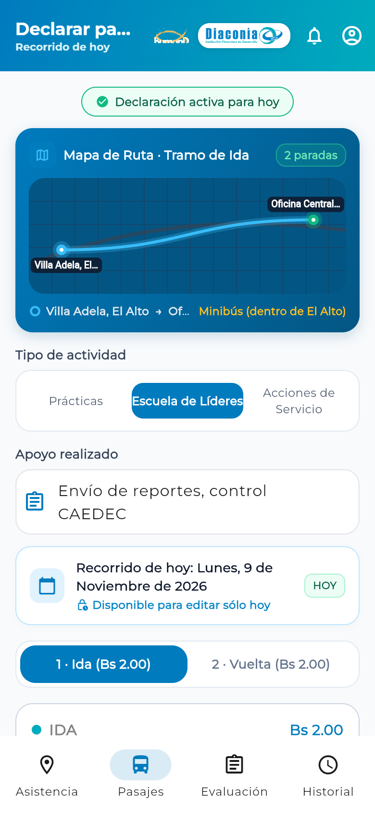


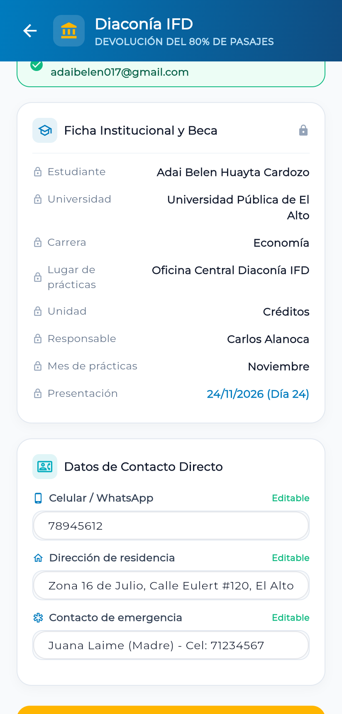
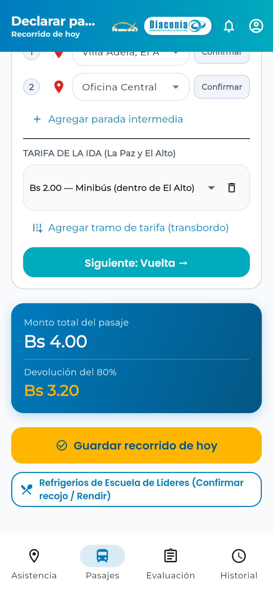

### 5.2. Detalle Exhaustivo del Requerimiento BKL-01 y BKL-12: Selector de 3 Actividades, Botón Directo a Refrigerios y Menú Limpio
- **Problema previo:** En `declarar-recorrido-pantalla.dart` existía un botón secundario redundante `"Ver historial mensual de pasajes"` debajo del botón principal `"Guardar recorrido de hoy"`, y no existía selector ágil de actividades ni vínculo directo con el módulo de refrigerios formativos.
- **Solución implementada:**
  1. Se eliminó de raíz el botón redundante de historial tanto en `declarar-recorrido-pantalla.dart` como en `asistencia-pantalla.dart`. El historial se consulta exclusivamente desde el módulo centralizado de historiales.
  2. Se incorporó un selector horizontal segmentado interactivo de 3 botones (`Prácticas` | `Escuela de Líderes` | `Acciones de Servicio`) en cápsula blanca con bordes redondeados, adaptando la modalidad reglamentaria (Solo Ida / Ida y Vuelta).
  3. Se añadió al pie de la pantalla, condicional a la actividad `"Escuela de Líderes"`, el botón de acceso directo `"Refrigerios de Escuela de Líderes (Confirmar recojo / Rendir)"` para agilizar la rendición y confirmación de raciones de la dupla encargada.

### 5.3. Detalle Exhaustivo del Requerimiento BKL-09: Tarifas Dinámicas desde PostgreSQL
- **Problema previo:** La app móvil contenía un listado hardcodeado `TARIFAS_PREDEFINIDAS` que impedía reflejar cambios tarifarios decretados por el transporte público.
- **Solución implementada:**
  1. Se eliminó completamente la constante estática `TARIFAS_PREDEFINIDAS`.
  2. La app móvil consume en tiempo real el endpoint `GET http://localhost:3002/api/pasajes/tarifas` mediante `PasajesRepositorio` y Riverpod.
  3. El dropdown de medios de transporte (Minibús Corto Bs 1.50, Tramo Largo Bs 2.00, Interciudad Bs 2.60, Teleférico Bs 3.00, Trufi Bs 3.50) se puebla dinámicamente con los registros vivos de la tabla `tarifas_transporte`.
  4. La modalidad asignada administrativamente (**Solo Ida** o **Ida y Vuelta** según `BKL-05`) habilita o bloquea el tramo de retorno de manera instantánea.
  5. El cómputo del reembolso se calcula al **80% reglamentario en centavos exactos**.

---

## 6. Módulo 05: Evaluaciones 360°, Formulario F-03 Read-Only y Classroom (`05-evaluaciones`) (`BKL-06`)

### 6.1. Capturas de Pantalla

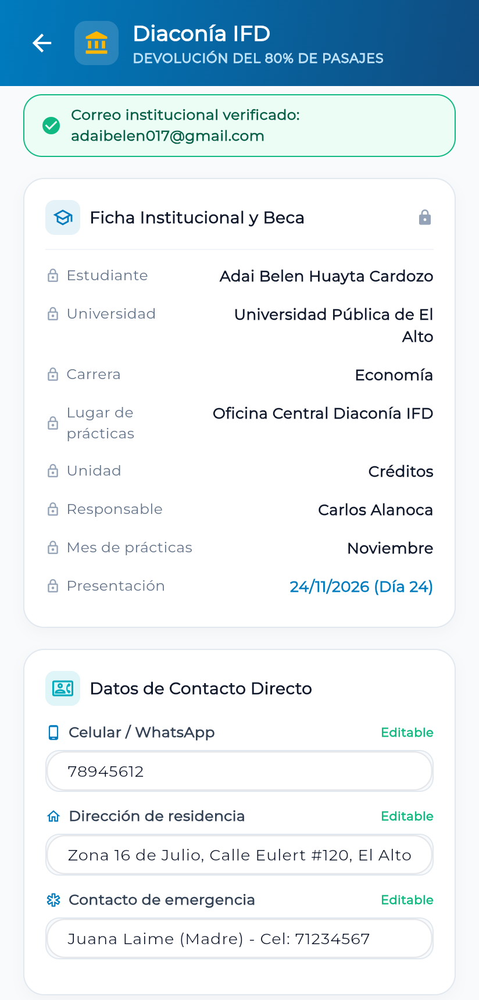
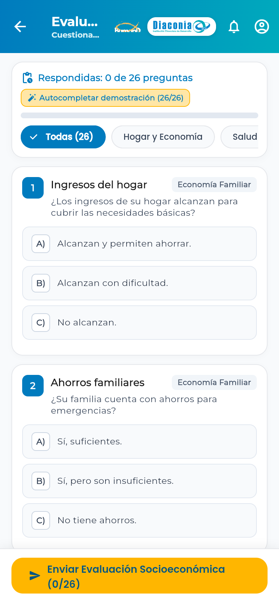
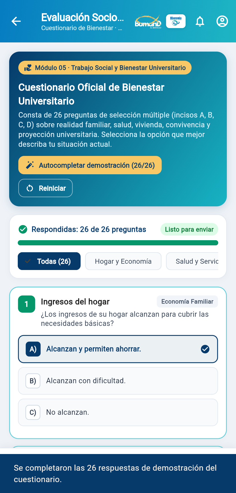
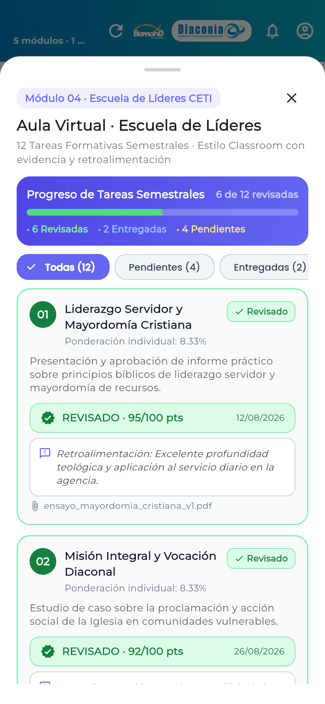


### 6.2. Detalle Exhaustivo del Requerimiento BKL-06: Formulario F-03 en Modo Solo Lectura
- **Problema previo:** En versiones anteriores se mostraban formularios de evaluación con datos vacíos o con posibilidad de modificar respuestas una vez evaluado el becario.
- **Solución implementada:**
  1. En el **Módulo 1 (Evaluación Pastoral F-03)**, cuando el becario ya cuenta con su evaluación pastoral registrada en el backend, la pantalla se abre en **modo solo lectura inmutable (`solo_lectura = true`)**.
  2. Se cargan desde PostgreSQL las **13 preguntas oficializadas** con las respuestas reales e individuales del becario en sesión (`GET /api/evaluaciones/f03/:becario_id`), quedando deshabilitado cualquier control de edición y oculto el botón de guardar.
- **Los 5 Módulos Semestrales Integrados:**
  - **Módulo 1 (20%):** Formulario Pastoral F-03 eclesiástico.
  - **Módulo 2 (20%):** Subida de Récord e Historial Académico verificado.
  - **Módulo 3 (20%):** Evaluación del supervisor/mentor validada mediante código QR / OTP.
  - **Módulo 4 (20%):** Escuela de Líderes en formato Classroom (evidencias y enlaces).
  - **Módulo 5 (20%):** Cuestionario de Bienestar Universitario de 26 preguntas con semáforo diagnóstico.

---

## 7. Módulo 06: Historial Integral Unificado con Pestaña Permisos (`06-historial`) (`BKL-07`)

### 7.1. Capturas de Pantalla

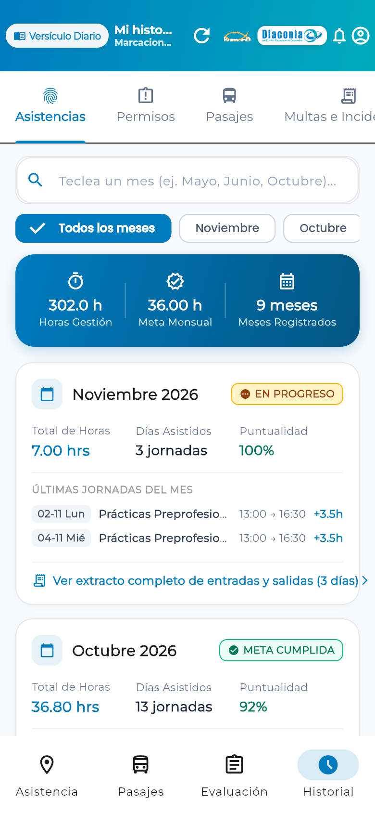

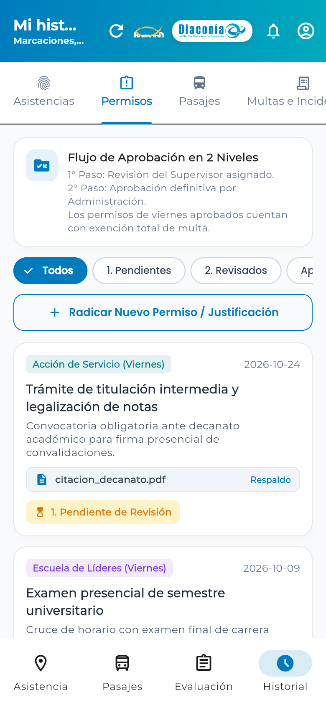
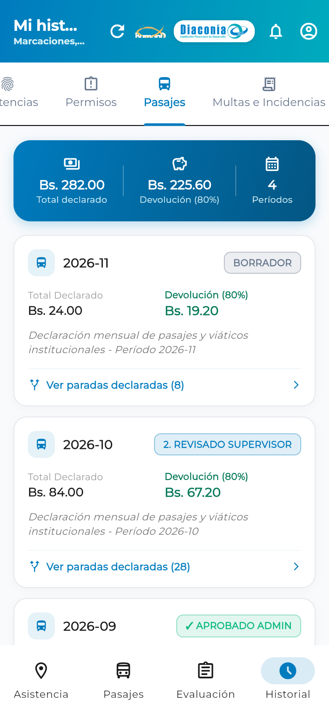
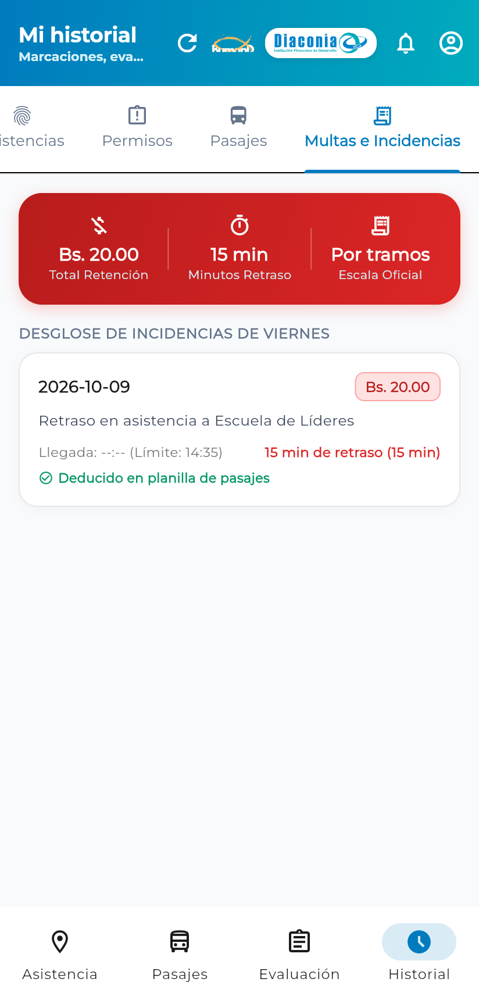

### 7.2. Detalle Exhaustivo del Requerimiento BKL-07: Integración de Permisos en Historial
- **Problema previo:** En `HistorialAsistenciaPantalla` existía una pestaña incoherente de `"Evaluaciones"`, mientras que el historial de permisos y justificaciones se encontraba disperso.
- **Solución implementada:**
  1. Se reemplazó la pestaña `"Evaluaciones"` por la pestaña **`"Permisos"`**.
  2. La pantalla de Historial consolida ahora 4 subsecciones altamente especializadas:
     - **Tab 1 (Asistencias):** Extracto mensual en formato bancario con desglose de fecha, día, hora de ingreso, hora de salida, sede, bloque y saldo acumulado hacia la meta de 36 horas.
     - **Tab 2 (Permisos):** Listado cronológico de solicitudes de permisos y justificaciones radicadas, con chips de estado (`Todos`, `1. Pendientes`, `2. Revisados`, `Aprobados`), fecha, motivo y resolución de exención de multa.
     - **Tab 3 (Pasajes):** Auditoría de tramos urbanos declarados, detalle de calles, costo y estado de desembolso al 80%.
     - **Tab 4 (Multas e Incidencias):** Relación de multas de viernes (Bs 10/minuto de retraso posterior a las 16:00) y confirmación de multas eximidas por justificación aprobada.

---

## 8. Módulo 07: Formulario Directo de Permisos con FilePicker Real (`07-permisos-justificaciones`) (`BKL-08`)

### 8.1. Capturas de Pantalla

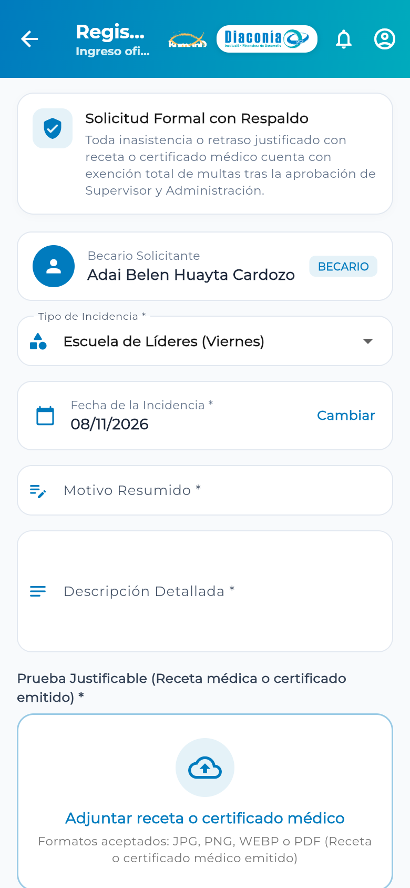

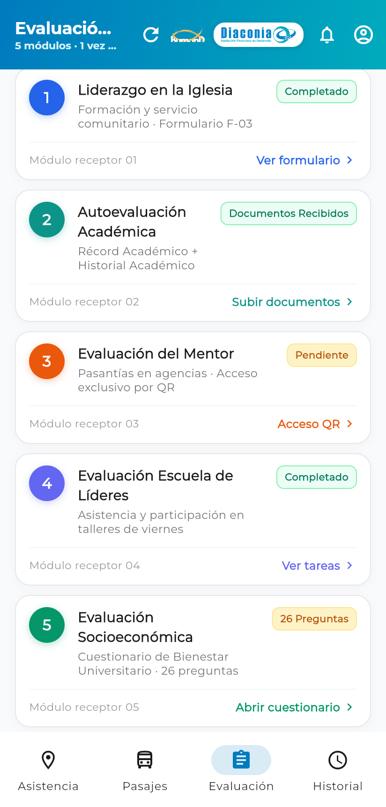

### 8.2. Detalle Exhaustivo del Requerimiento BKL-08: Formulario Directo y Carga de Archivos
- **Problema previo:** La pantalla de permisos abría una lista intermedia con un botón flotante (FAB) redundante, los tipos de prueba eran chips ficticios que no subían archivos y el botón de radicar requería múltiples confirmaciones confusas.
- **Solución implementada:**
  1. `PermisosPantalla` despliega directamente el formulario limpio y homologado con la versión web institucional:
     - **Becario Solicitante:** Identificación unívoca del estudiante con su sede y cohorte.
     - **Tipo de Incidencia:** Inasistencia a prácticas, inasistencia a viernes formativo, retraso justificado o fuerza mayor.
     - **Fecha de Incidencia:** Selector de fecha con validación de rango no mayor a 48 horas post-evento.
     - **Motivo Resumido:** Campo de texto libre para el título de la solicitud.
     - **Descripción Detallada:** Exposición pormenorizada de los hechos motivantes.
  2. **Selector Real de Archivos con `FilePicker`:**
     - Se eliminaron los chips ficticios `TIPOS_PRUEBA`.
     - Se integró un selector nativo de archivos compatible con formatos válidos: **JPG, PNG, WEBP y PDF** hasta un peso máximo de 10 MB.
     - El archivo seleccionado se previsualiza con su nombre, tamaño y opción de descarte.
  3. **Botón Único de Acción:**
     - Se implementó el botón único `"Radicar Permiso / Justificación"`, el cual envía la petición multipart directamente a `POST /api/justificaciones` en PostgreSQL.

---

## 9. Módulo 08: Mis Refrigerios, Modal de Raciones y Confirmación de Recojo (`08-refrigerios`) (`BKL-03`)

### 9.1. Capturas de Pantalla

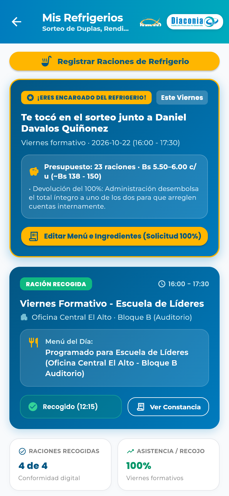

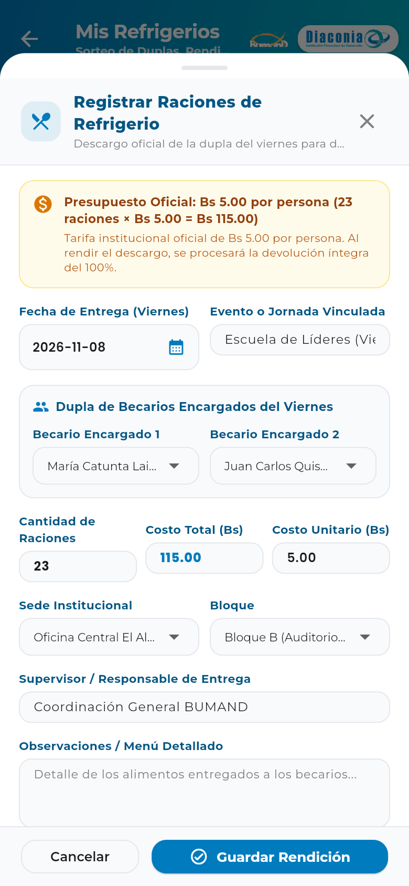
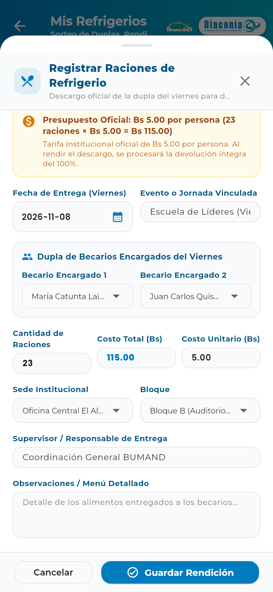
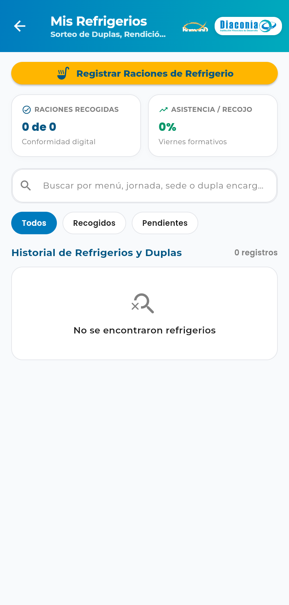

### 9.2. Detalle Exhaustivo del Requerimiento BKL-03: Homologación Completa en APK y Recojo
- **Problema previo:** En la app móvil no existía el formulario completo de registro de refrigerios que poseía la web y el recojo de ración era un booleano local simulado en `REFRIGERIOS_HISTORIAL_BECARIO`.
- **Solución implementada:**
  1. **Formulario "Registrar Raciones de Refrigerio" en la APK:**
     - Se implementó en Flutter el modal idéntico al de Frontend Web:
       - Selección de **Fecha de Viernes Formativo**.
       - **Cálculo Automático Recíproco:** 23 raciones × Bs 5.00 = **Bs 115.00 de presupuesto oficial**.
       - Selección de **Dupla Responsable** (Becario Encargado 1 y Becario Encargado 2).
       - Selección de **Sede, Sub-bloque y Supervisor Responsable**.
       - Campo de **Observaciones y Menú Programado**.
     - Envía la transacción a `POST http://localhost:3002/api/refrigerios`.
  2. **Confirmación Persistente de Recojo de Refrigerio:**
     - La vista principal presenta la tarjeta interactiva de recojo con el botón `"Confirmar Recojo de Refrigerio"`.
     - Al presionar, se abre el diálogo de confirmación y tras la aceptación se ejecuta `PATCH /api/refrigerios/:id/confirmar-recojo`, persistiendo en PostgreSQL la confirmación individual con fecha y hora exacta.
  3. **Rendición de Fondos al 100%:**
     - La dupla puede registrar las notas de compra mediante `PATCH /api/refrigerios/:id/rendir`, registrando el monto devuelto y el becario receptor del reembolso.

---

## 10. Módulo 09: Seguimiento, Citas y Notificaciones (`09-seguimiento-y-notificaciones`)

### 10.1. Capturas de Pantalla

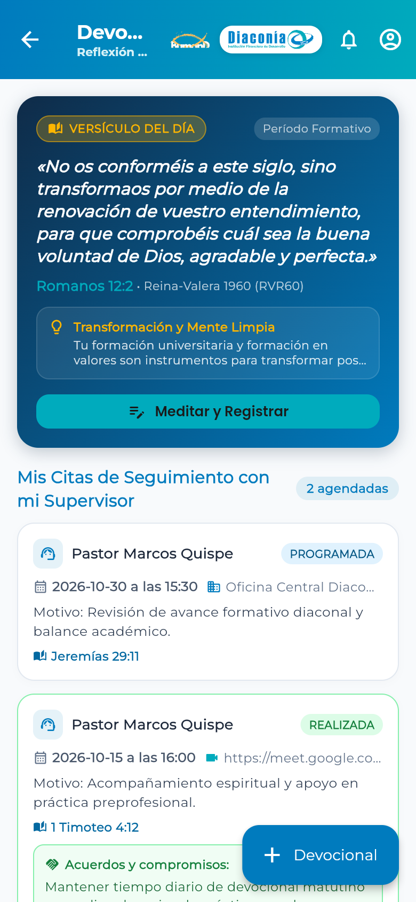
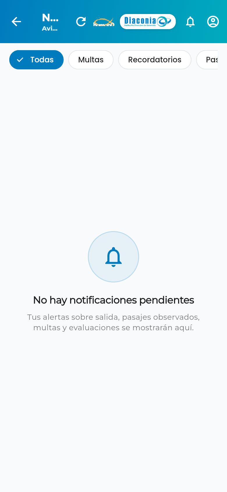
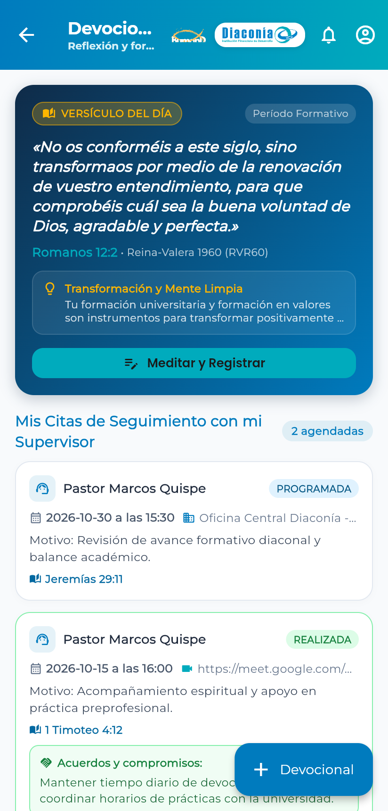
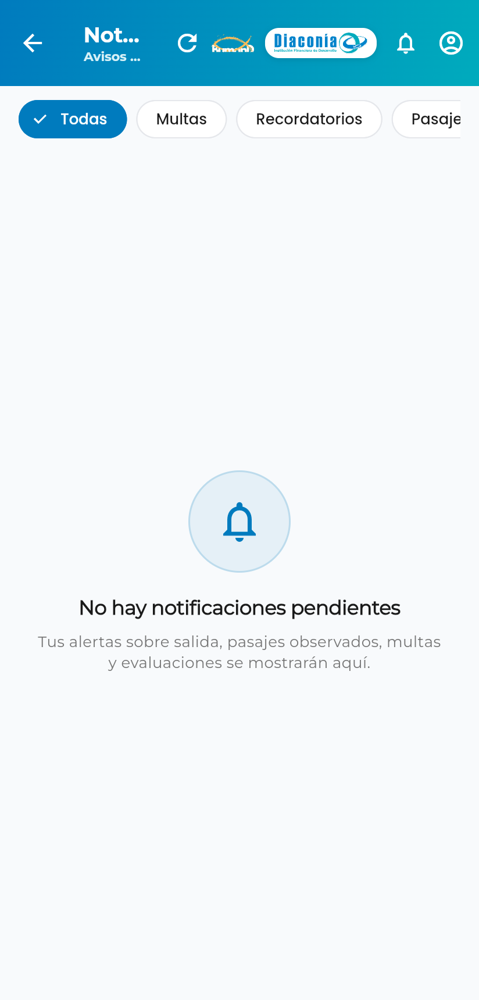

### 10.2. Funcionalidad Operativa:
1. **Seguimiento y Citas de Mentoría:** Muestra las citas convocadas por el supervisor institucional con fecha, hora, modalidad (presencial/virtual) y el listado de compromisos asumidos.
2. **Notificaciones Institucionales:** Alertas en tiempo real sobre aprobación de justificaciones, asignación de dupla de refrigerio y recordatorios de cierre mensual de horas.

---

## 11. Módulo 10: Mi Perfil, Seguridad y Acerca de Nosotros (`10-perfil-y-acerca-de`)

### 11.1. Capturas de Pantalla

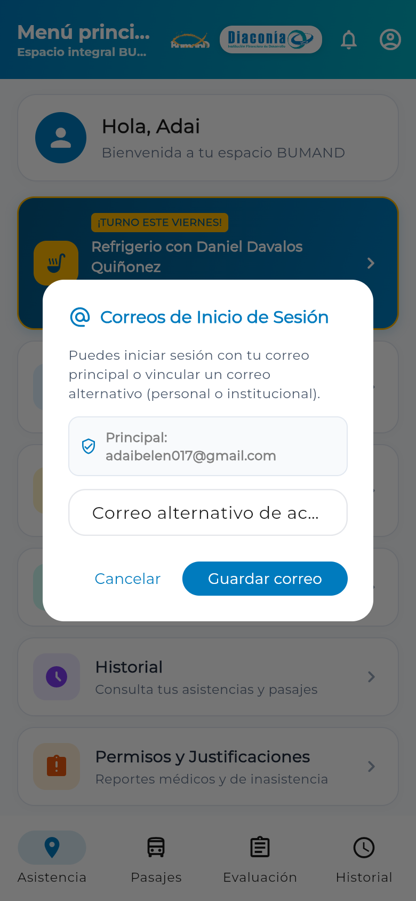
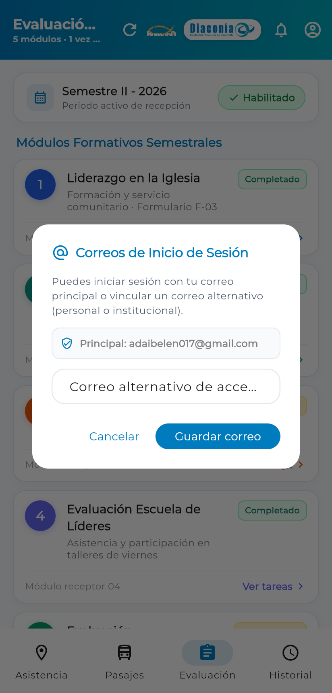

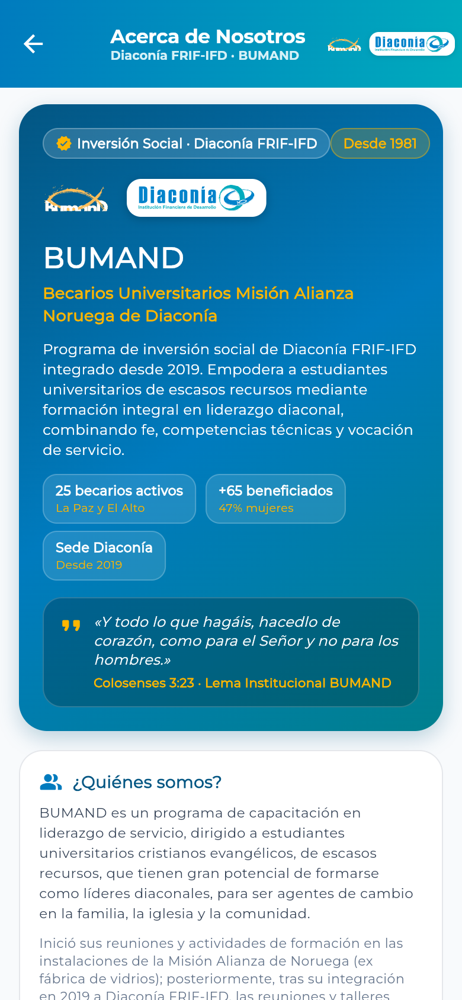

### 11.2. Funcionalidad de Autogestión:
1. **Datos de Contacto:** Actualización de teléfonos de contacto y teléfono de emergencia.
2. **Gestión de Correos Alternativos:** Visualización y registro de correos alternativos para inicio de sesión seguro.
3. **Seguridad de Contraseña:** Formulario con indicador visual de fortaleza y botón para alternar visibilidad.
4. **Acerca de Nosotros:** Pantalla institucional que expone la trayectoria, misión y valores de la Fundación Diaconía FRIF-IFD.

---

## 12. Erradicación Absoluta de Datos Mockeados y Conexión en Vivo a PostgreSQL (`BKL-10`)

En concordancia con el requerimiento **BKL-10**, se eliminaron de raíz todos los datos de prueba y arrays locales de la app móvil:

| Archivo Fuente Móvil | Código Mock Purgado / Eliminado | Integración Real a Backend NestJS (Puerto 3002) |
| :--- | :--- | :--- |
| `asistencia-repositorio.dart` | `generarExtractosLocales` | `GET /api/asistencia/extracto-mensual` conectado a PostgreSQL. |
| `historial-asistencia-pantalla.dart` | `multas_ejemplo` | `GET /api/asistencia/multas` con liquidación determinista real. |
| `pasajes-repositorio.dart` | `TARIFAS_PREDEFINIDAS` | `GET /api/pasajes/tarifas` dinámico sincronizado con Web. |
| `permisos-pantalla.dart` | `_justificacionesEjemplo` y `TIPOS_PRUEBA` | `POST /api/justificaciones` con subida multipart (`FilePicker`). |
| `refrigerios-proveedor.dart` | `REFRIGERIOS_HISTORIAL_BECARIO` | `GET /api/refrigerios`, `POST` y `PATCH .../confirmar-recojo`. |
| `evaluaciones-repositorio.dart` | `modeloEjemplo()` | `GET /api/evaluaciones/f03/:id` y `GET /api/evaluaciones/avance`. |
| `devocionales-repositorio.dart` | `SEMILLAS_DEVOCIONALES` | `GET /api/devocionales/hoy` con persistencia offline en SharedPreferences. |

---

## 13. Infraestructura Offline, Esqueletos y Catálogo Unificado de Errores

1. **`ColaOfflineServicio`:** Persistencia estructurada en `SharedPreferences` de transacciones diferidas con timestamps y sincronización automática al recuperar conectividad.
2. **`BannerConexion`:** Banner interactivo que alerta la pérdida de señal y cuenta las operaciones encoladas pendientes.
3. **Catálogo de Errores Unificado (`ERR-1001` a `ERR-9002`):** Tipado fuerte en Dart que mapea exactamente los códigos emitidos por el backend NestJS.
4. **`CargandoSkeleton`:** Placeholders visuales animados con gradiente que sustituyen spinners genéricos, ofreciendo una experiencia visual de alta calidad.

---

## 14. Conclusiones y Certificación de Calidad Técnica

1. **Rendimiento Nativo a 60 FPS:** Pintado eficiente con `CustomPainter` en el radar geodésico y uso de `IndexedStack` en el menú principal.
2. **Suite Completa de 138 Pruebas Automatizadas:** 138 de 138 pruebas aprobadas al 100% y 0 advertencias en `flutter analyze`.
3. **Nomenclatura Corporativa Diaconía:** Estricto apego a `snake_case` en variables, `camelCase` en métodos, `PascalCase` en widgets y `kebab-case` en nombres de archivos.
4. **Seguridad y Precisión Institucional:** Geocercas anti-spoofing, cómputo del 80% en centavos exactos, meta de 36 horas mensuales y sincronización en tiempo real con PostgreSQL.

---
*Fin de la Documentación Técnica de la Aplicación Móvil BUMAND 2026*
