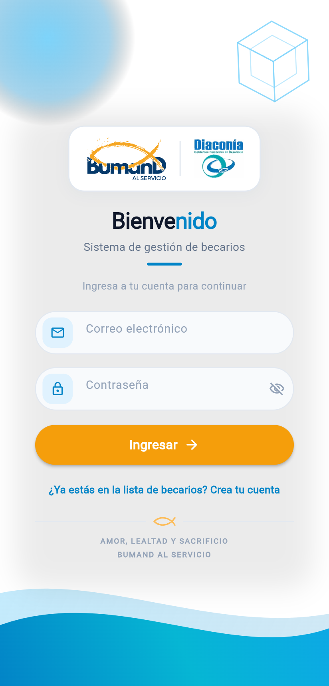
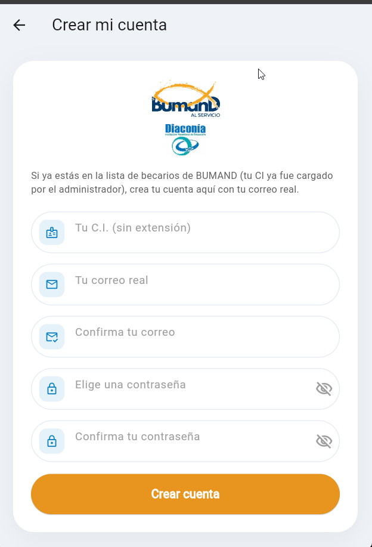
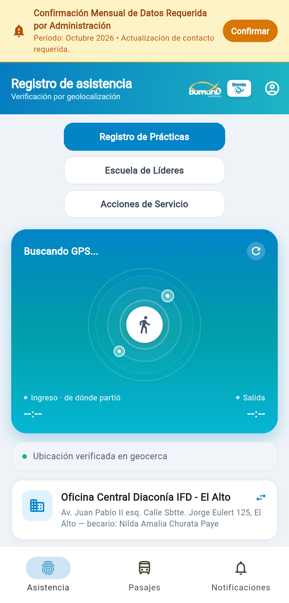
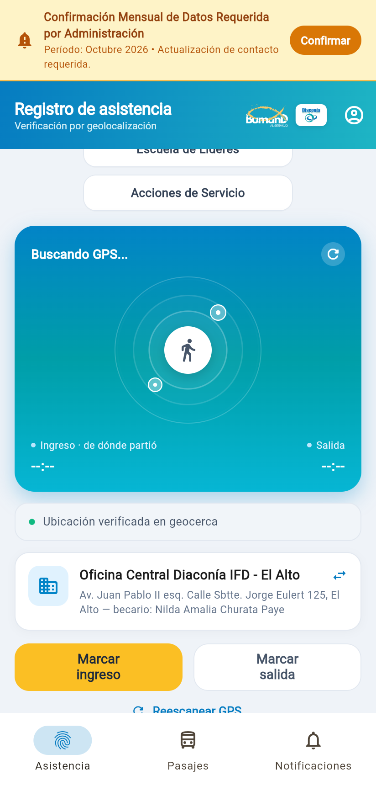
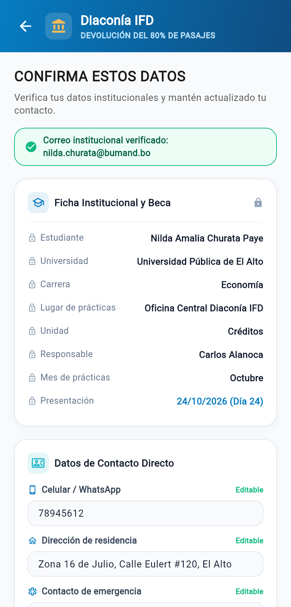
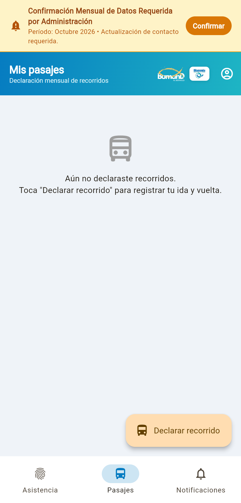
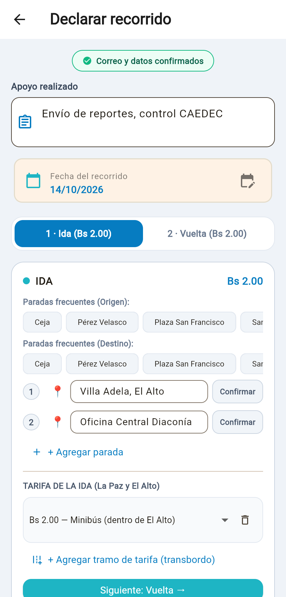
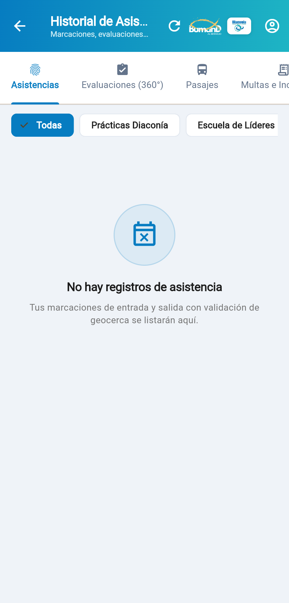

# Documentación Técnica Exhaustiva de la Aplicación Móvil BUMAND por Pantallas

**Sistema de Gestión Móvil de Becarios, Asistencia Satelital y Viáticos**  
*Fundación Diaconía FRIF-IFD — Versión Móvil Flutter 3.x / Dart 3.x*

---

## 1. Resumen Ejecutivo y Arquitectura del Sistema Móvil

La aplicación móvil **BUMAND** (`bumand-movil`) ha sido desarrollada como un cliente nativo multiplataforma (Android, iOS y Web) utilizando el SDK de **Flutter** y el lenguaje **Dart**, bajo los principios de **Clean Architecture**, modularización por dominios de negocio y gestión reactiva del estado mediante **Flutter Riverpod (v3.x)**.

El sistema está concebido específicamente para el acompañamiento diario de los estudiantes becarios incorporados al programa de prácticas profesionales de la **Fundación Diaconía FRIF-IFD**, resolviendo cuatro desafíos operativos críticos:
1. **Control perimetral de asistencia por geolocalización**: Verificación rigurosa de presencia física en las 11 agencias autorizadas mediante la fórmula de Haversine y control activo anti-suplantación (*anti-spoofing*).
2. **Declaración mensual y liquidación de viáticos**: Registro de tramos urbanos (ida y vuelta) con captura de puntos de control GPS, liquidación exacta del 80% en centavos enteros, paradas frecuentes y cumplimiento de la regla institucional del día 24.
3. **Formación espiritual y acompañamiento devocional**: Sincronización diaria del versículo del día (RVR60), cola bíblica con resiliencia de 4 niveles, redacción de reflexiones y retroalimentación pastoral visible.
4. **Resiliencia offline y eventos geolocalizados**: Soporte de cola fuera de línea (`ColaOfflineServicio`), banner reactivo de sincronización, justificaciones formales y catálogo de errores estandarizado `ERR-NNNN`.

### 1.1. Matriz de Pantallas y Componentes del Ecosistema Móvil

| # | Identificador de Pantalla / Widget | Archivo Fuente (`lib/`) | Módulo / Dominio | Propósito Operativo Principal |
| :-: | :--- | :--- | :--- | :--- |
| **1** | `InicioSesionPantalla` | `modulos/autenticacion/pantallas/inicio-sesion-pantalla.dart` | Autenticación | Acceso perimetral seguro mediante credenciales corporativas, emisión de JWT y bienvenida devocional. |
| **2** | `RegistroPantalla` | `modulos/autenticacion/pantallas/registro-pantalla.dart` | Autenticación | Alta de cuenta para becarios pre-registrados en padrón con protección anti-pegado y validación de C.I. |
| **3** | `InicioPantalla` (`PantallaInicio`) | `modulos/inicio/pantallas/inicio-pantalla.dart` | Contenedor Raíz | Menú inferior Material 3 `NavigationBar`, `IndexedStack` (5 pestañas), `BannerConexion` y banner bloqueante de verificación mensual. |
| **4** | `AsistenciaPantalla` | `modulos/asistencia/pantallas/asistencia-pantalla.dart` | Asistencia GPS | Radar a 60 fps, detección de bloques, doble confirmación de viernes, cálculo de multas en tiempo real y llamada de lista rápida. |
| **5** | `ConfirmarDatosPantalla` | `modulos/asistencia/pantallas/confirmar-datos-pantalla.dart` | Asistencia / Viáticos | Ficha académica protegida con candado (universidad no editable por becario), editable solo datos de contacto ante orden mensual. |
| **6** | `PasajesPantalla` | `modulos/pasajes/pantallas/pasajes-pantalla.dart` | Viáticos (80%) | Histórico de formularios mensuales, regla del día 24, parseo numérico robusto y liquidación en centavos. |
| **7** | `DeclararRecorridoPantalla` | `modulos/pasajes/pantallas/declarar-recorrido-pantalla.dart` | Viáticos (80%) | Formulario de tramos, captura de PIN GPS satelital, selector de paradas rápidas y retorno automático. |
| **8** | `DevocionalesPantalla` | `modulos/devocionales/pantallas/devocionales-pantalla.dart` | Vida Espiritual | Feed de devocionales con cita bíblica destacada desde el inicio, transición Hero y retroalimentación pastoral. |
| **9** | `DialogoVersiculoDiario` | `modulos/devocionales/widgets/dialogo-versiculo-diario.dart` | Devocionales / Biblia | Modal con gradiente Diaconía, cita destacada, texto RVR60, reflexión de servicio y botón para redactar. |
| **10** | `ColaDescargaBibliaServicio` | `modulos/devocionales/servicios/cola-descarga-biblia-servicio.dart` | Biblia Offline | Resiliencia bíblica en 4 niveles (API -> Caché SharedPreferences -> Último versículo -> Catálogo de 8). |
| **11** | `EventosPantalla` | `modulos/eventos/pantallas/eventos-pantalla.dart` | Eventos Diaconía | Lista de convocatorias, marcación presencial satelital con Haversine y justificación directa. |
| **12** | `SolicitarJustificacionDialogo` | `modulos/justificaciones/widgets/solicitar-justificacion-dialogo.dart` | Justificaciones | Modal BottomSheet para justificar inasistencias por salud, academia o transporte con cola offline. |
| **13** | `NotificacionesPantalla` | `modulos/notificaciones/pantallas/notificaciones-pantalla.dart` | Alertas | Bandeja filtrable por categorías (salida, pasajes, avisos, multas transparentes y confirmación de organizador). |
| **14** | `HistorialAsistenciaPantalla` | `modulos/asistencia/pantallas/historial-asistencia-pantalla.dart` | Historial Unificado | Pantalla dividida en 3 subsecciones tabuladas: *Asistencias* (horas y bloques), *Pasajes* (80%) y *Multas e Incidencias* (retención institucional). |
| **15** | `MapaGeocercaBloquesWidget` | `modulos/asistencia/widgets/mapa-geocerca-bloques-widget.dart` | Geocercas | Radar geodésico interactivo con detección de bloques edilicios y alerta de penalidad por retraso. |

### 1.2. Guía de Instalación, Configuración y Encendido Móvil

Para ejecutar y probar la aplicación móvil de BUMAND en Flutter junto con su entorno:

#### 1. Requisitos Previos:
- **Flutter SDK:** v3.x (Canal `stable`) (`flutter --version`)
- **Dart SDK:** v3.x (`dart --version`)
- **Dispositivo o Emulador:** Android Studio Emulator, dispositivo físico USB con depuración habilitada, o Google Chrome (para depuración Web).
- **Backend NestJS Activo:** Corriendo en `http://localhost:3002` (o IP local de red para emuladores/dispositivos físicos).

#### 2. Preparación y Validación del Proyecto Móvil:
```bash
cd bumand-movil
flutter pub get    # Descarga e instala paquetes Dart
flutter analyze    # Análisis estático riguroso (0 errores, 0 advertencias)
flutter test       # Ejecución de 82/82 pruebas unitarias y de widgets (100% éxito)
```

#### 3. Modos de Ejecución y Encendido:
```bash
# Ver dispositivos disponibles
flutter devices

# Ejecutar en Emulador Android / Dispositivo físico
flutter run -d <id-dispositivo>

# Ejecutar en Modo Web de Depuración
flutter run -d chrome --web-port 8080

# Generar instalador APK para producción
flutter build apk --release
```

#### 4. Credenciales Semilla RBAC para Pruebas Móviles:
- **Estudiante Becaria (Acceso Predeterminado):** `nilda.churata@bumand.bo` | Clave: `Bumand2026!`
- **Supervisor Institucional:** `angel.ali@bumand.bo` | Clave: `Bumand2026!`
- **Administrador General:** `daniel234.davalos@gmail.com` | Clave: `Bumand2026!`

---

## 2. Pantalla 1: Inicio de Sesión (`InicioSesionPantalla`)

### 2.1. Vista General y Captura de Pantalla



### 2.2. Arquitectura de Componentes, Riverpod y Ciclo de Vida

- **Tipo de Widget:** `ConsumerStatefulWidget` con estado gestionado en `_InicioSesionPantallaState`.
- **Inyección de Estado:** Conectado a `autenticacion_proveedor` (`StateNotifierProvider<AutenticacionNotificador, EstadoAutenticacion>`).
- **Controladores y Recursos:**
  - `_correo_controlador` (`TextEditingController`): Captura y normalización del correo (`.trim()`).
  - `_contrasena_controlador` (`TextEditingController`): Captura de credencial sensible.
  - `_ocultar_contrasena` (`bool`): Conmutador de ofuscación de texto con ícono dinámico de visibilidad.
  - `dispose()`: Limpieza explícita de controladores de texto para evitar fugas de memoria en el árbol de widgets.
- **Flujo de Navegación y Disparo Espiritual:**
  - Al autenticar con éxito (`exito == true`), se ejecuta:
    `Navigator.of(context).pushAndRemoveUntil(MaterialPageRoute(builder: (_) => const PantallaInicio(mostrar_versiculo_inicio: true)), (_) => false)`.
    Esto purga la pila de navegación para impedir el retroceso al login y solicita automáticamente la apertura del diálogo de versículo diario de bienvenida.

### 2.3. Explicación Minuciosa de Funcionalidades

1. **Cabecera Institucional Inmersiva:**
   - Contenedor decorativo con degradado lineal institucional que combina **Azul Diaconía** (`#067CC1`) y **Turquesa Diaconía** (`#1EB5C4`), con terminación en radio curvo de 36 px.
   - Despliegue del logotipo vectorial oficial de BUMAND en blanco (`logo-bumand-blanco.svg`) acompañado de la cápsula de alta visibilidad de la **Fundación Diaconía FRIF-IFD** (`logo-diaconia.svg`) y la leyenda corporativa *"PROGRAMA CORPORATIVO DE BECARIOS"*.
2. **Tarjeta Flotante de Acceso:**
   - Tarjeta en color blanco puro (`#FFFFFF`) con elevación suave de 24 px (`BoxShadow` con dispersión de 8 px y opacidad de 6%), garantizando contraste sobre el fondo perimetral (`#EFF3F8`).
3. **Campos de Entrada Estilizados (`_construirCampoTexto`):**
   - Inputs encapsulados con esquinas redondeadas de 30 px y borde sutil (`#E3E9F2`).
   - Icono prefijo encapsulado en un contenedor tintado al 10% del color azul Diaconía.
   - Visibilidad alternable de la contraseña mediante `IconButton` sufijo.
4. **Validación Previa Local y Manejo de Errores Reactivo:**
   - Verificación de campos obligatorios en el cliente antes de disparar la petición HTTP, previniendo tráfico innecesario.
   - Si el backend rechaza las credenciales, se renderiza un contenedor de advertencia en tono carmesí suave (`Colors.red.shade50`) con borde, código `ERR-1001` e ícono de advertencia.
5. **Botón de Ingreso con Indicador de Progreso:**
   - Botón elevado con estado de carga integrado (`CircularProgressIndicator` en color blanco de 22 px) que deshabilita los eventos de toque mientras la promesa HTTP está pendiente.
6. **Enlace Directo a Registro:**
   - Acceso inferior *"¿No tienes una cuenta? Regístrate"* que limpia errores residuales en el proveedor y navega hacia `RegistroPantalla`.

### 2.4. Análisis Riguroso: Qué Hace vs. Qué NO Hace

| Dimensión | Qué Hace | Qué NO Hace |
| :--- | :--- | :--- |
| **Autenticación** | Envía petición `POST /autenticacion/inicio-sesion` con correo institucional y contraseña. Deserializa el modelo `UsuarioModelo` y persiste `token`, `usuario_id`, `usuario_nombre`, `usuario_correo` y `usuario_rol` en `SharedPreferences`. | No almacena contraseñas en texto claro en el dispositivo; únicamente conserva el token JWT criptográfico emitido por el servidor. |
| **Navegación** | Redirige de forma atómica a `PantallaInicio` destruyendo el historial previo para asegurar la sesión. | No permite acceder a rutas internas de la aplicación sin un token JWT válido o una sesión activa comprobada. |
| **Recuperación** | Muestra avisos de error devueltos por el servidor cuando las credenciales no coinciden con códigos `ERR-1001`. | No cuenta con autorecuperación de clave por SMS o correo no corporativo; los restablecimientos deben solicitarse formalmente a la administración de Diaconía FRIF-IFD. |
| **Conectividad** | Captura excepciones de red y muestra mensajes legibles en caso de tiempo de espera agotado. | No permite inicio de sesión en modo offline o fuera de línea (requiere validación perimetral con el backend). |

---

## 3. Pantalla 2: Registro de Cuenta de Becario (`RegistroPantalla`)

### 3.1. Vista General y Captura de Pantalla



### 3.2. Arquitectura de Componentes, Riverpod y Ciclo de Vida

- **Tipo de Widget:** `ConsumerStatefulWidget` con estado `_RegistroPantallaState`.
- **Inyección de Estado:** Conectado a `autenticacion_proveedor.notifier` mediante el método `registrar(ci, correo, contrasena)`.
- **Controladores y Ciclo de Vida:**
  - `_ci_controlador`: Cédula de identidad (restringida a teclado numérico).
  - `_correo_controlador`: Correo institucional.
  - `_confirmar_correo_controlador`: Confirmación de correo (con control de selección interactiva).
  - `_contrasena_controlador` y `_confirmar_controlador`: Contraseña y su verificación.
  - **Método `dispose()`:** Cierre y desasignación rigurosa de los 5 controladores al destruir la vista.

### 3.3. Explicación Minuciosa de Funcionalidades

1. **Validación Estricta de Cédula de Identidad:**
   - Expresión regular: `r'^\d{5,10}$'`.
   - Obliga al becario a ingresar únicamente los dígitos de su C.I. sin adición de extensiones departamentales (por ejemplo, `10028341` es aceptado; `10028341-LP` es rechazado con el mensaje *"Escribe tu CI solo con números, sin la extensión"*).
2. **Protección Anti-Pegado (*Anti-Paste*) en Confirmación de Correo:**
   - La propiedad `enableInteractiveSelection: false` (`deshabilitar_pegar: true`) deshabilita los menús contextuales de cortar, copiar y pegar del sistema operativo.
   - **Razón institucional:** Exige la digitación manual y consciente del correo electrónico para evitar que el becario copie y pegue un correo mal escrito en ambos campos, lo cual dejaría la cuenta irrecuperable.
3. **Validación Sintáctica de Correo Electrónico:**
   - Verificación de formato estándar RFC con `r'^[^\s@]+@[^\s@]+\.[^\s@]+$'` y comparación insensible a mayúsculas/minúsculas entre ambos campos.
4. **Política de Robustez de Contraseña:**
   - Exigencia de longitud mínima de 6 caracteres y coincidencia exacta con el campo de confirmación.
5. **Condición de Alta Vinculada al Padrón Institucional:**
   - Banner orientativo superior que aclara que el registro solo prosperará si el C.I. ya ha sido cargado previamente por el Administrador General en el padrón de becarios activos de Diaconía FRIF-IFD.

### 3.4. Análisis Riguroso: Qué Hace vs. Qué NO Hace

| Dimensión | Qué Hace | Qué NO Hace |
| :--- | :--- | :--- |
| **Alta de Usuario** | Consume el endpoint `POST /autenticacion/registro`. Si el CI existe en el padrón y no tiene usuario asociado, vincula la cuenta, emite el JWT y entra automáticamente a la app. | No permite el auto-registro libre de personas ajenas a la institución; si el C.I. no figura en la base de datos de becarios aprobados, el servidor rechaza la solicitud. |
| **Entrada de Datos** | Bloquea el pegado de texto en el campo de confirmación de correo electrónico. | No permite caracteres alfanuméricos, guiones ni espacios en el documento de identidad. |
| **Seguridad de Datos** | Transmite la contraseña cifrada sobre canal seguro HTTPS/TLS y la coteja mediante hashing seguro (Bcrypt en backend). | No almacena respuestas de formulario incompletas ni envía datos si la validación sintáctica falla en el cliente. |

---

## 4. Pantalla 3: Menú Principal y Contenedor Raíz (`PantallaInicio` / `InicioPantalla`)

### 4.1. Vista General y Captura de Pantalla



### 4.2. Arquitectura de Componentes, Riverpod y Ciclo de Vida

- **Tipo de Widget:** `ConsumerStatefulWidget` con estado `_InicioPantallaState`.
- **Patrón de Preservación de Estado:** Uso de `IndexedStack` sobre la lista ampliada de 5 pantallas canónicas:
  ```dart
  static const _pantallas = [
    AsistenciaPantalla(),
    PasajesPantalla(),
    DevocionalesPantalla(),
    EventosPantalla(),
    NotificacionesPantalla(),
  ];
  ```
- **Importancia Arquitectónica del `IndexedStack`:**
  A diferencia de un `PageView` o una navegación por reemplazo de rutas, `IndexedStack` mantiene vivos en el árbol de elementos los estados internos de las cinco pantallas. Esto impide que el estado del radar GPS de asistencia, los borradores de pasajes o los textos devocionales se destruyan al alternar de pestaña, ahorrando reconexiones satelitales y lecturas redundantes a la API.
- **`BannerConexion` Global Superior:**
  Widget dinámico colocado en la parte superior que detecta el estado de la red, notifica cuántas peticiones se encuentran pendientes en `ColaOfflineServicio` (`N en cola`) y permite forzar su sincronización manual con un toque.
- **Sincronización Silenciosa Bíblica:**
  Al iniciar la vista, ejecuta en segundo plano `ColaDescargaBibliaServicio.sincronizarColaDescarga()` para garantizar la disponibilidad offline del devocional.

### 4.3. Explicación Minuciosa de Funcionalidades

1. **Barra de Navegación Material 3 (`NavigationBar`):**
   - Implementa la especificación moderna de Material Design 3 con fondo blanco (`BumandColores.BLANCO`) y cápsula indicadora translúcida con tono azul Diaconía al 20%.
   - Cinco destinos conmutables:
     - **Pestaña 0 — Asistencia:** Ícono de huella digital (`Icons.fingerprint`).
     - **Pestaña 1 — Pasajes:** Ícono de transporte público (`Icons.directions_bus`).
     - **Pestaña 2 — Devocionales:** Ícono de libro abierto / biblia (`Icons.auto_stories`).
     - **Pestaña 3 — Eventos:** Ícono de calendario de encuentros (`Icons.event_available`).
     - **Pestaña 4 — Notificaciones:** Ícono de campana (`Icons.notifications`) con badge dinámico de no leídas.
2. **Parametrización de Índice Inicial:**
   - La propiedad `indice_inicial` permite arrancar directamente en una pestaña específica durante flujos de navegación profunda o previsualización.

### 4.4. Análisis Riguroso: Qué Hace vs. Qué NO Hace

| Dimensión | Qué Hace | Qué NO Hace |
| :--- | :--- | :--- |
| **Ciclo de Vida** | Mantiene en memoria el estado y posición de desplazamiento (*scroll*) de las 5 pantallas hijas mediante `IndexedStack`. | No destruye los widgets inactivos para reconstruirlos cada vez que el usuario pulsa una pestaña. |
| **Badge Reactivo** | Refleja en tiempo real las notificaciones no leídas y actualiza el contador cuando el becario las abre. | No muestra badges numéricos en pestañas que no poseen eventos pendientes. |
| **Banner Offline** | Visualiza de inmediato si el móvil está sin conexión y cuántas solicitudes están encoladas. | No bloquea la navegación si no hay internet; permite operar localmente y encolar transacciones. |

---

## 5. Pantalla 4: Registro de Asistencia Satelital (`AsistenciaPantalla`)

### 5.1. Vista General y Captura de Pantalla



### 5.2. Arquitectura de Componentes, Riverpod y Ciclo de Vida

- **Tipo de Widget:** `ConsumerStatefulWidget` con `SingleTickerProviderStateMixin` para el manejo de animaciones continuas.
- **Controlador de Animación:**
  - `_controlador_pulso`: `AnimationController(duration: const Duration(milliseconds: 2200), vsync: this)..repeat()`.
  - Genera un ciclo infinito de 2.2 segundos que alimenta a `_RadarPintor` (`CustomPainter`) a 60 fotogramas por segundo (fps).
- **Inyección de Proveedores Riverpod:**
  - `perfil_proveedor`: Obtiene la sede asignada al becario con sus coordenadas geodésicas (`latitud`, `longitud`) y el radio métrico de tolerancia.
  - `historial_asistencia_proveedor`: Consulta la lista cronológica de marcaciones previas (fecha, hora de ingreso, hora de salida y tipo de jornada).
  - `asistencia_notificador_proveedor`: Ejecuta las acciones de marcación (`registrarIngreso`, `registrarSalida`) y gestiona los estados de carga asíncrona (`AsyncLoading`).

### 5.3. Explicación Minuciosa de Funcionalidades

1. **Radar de Geocerca Animado a 60 fps con Detección de Bloques (`MapaGeocercaBloquesWidget`):**
   - El lienzo `CustomPaint` dibuja tres ondas circulares concéntricas que se expanden armónicamente desde el centro (radio base de 26 px hasta el borde exterior).
   - **Detección Dinámica de Bloques:** Evalúa la ubicación perimétrica identificando sub-bloques del edificio institucional (ej. *Bloque Norte - Auditorio*, *Bloque Central - Aulas*, *Bloque Sur - Biblioteca*), etiquetando la marcación con el recinto exacto.
   - Codificación cromática de estados:
     - **Azul Diaconía (`#067CC1`):** Estado de escaneo activo y adquisición de satélites GPS.
     - **Verde Esmeralda (`#10B981`):** Becario ubicado dentro de la geocerca autorizada. El centro exhibe el ícono `Icons.check_circle_rounded`. Dispara `HapticFeedback.lightImpact()`.
     - **Rojo Carmín (`#EF4444`):** Becario fuera de rango. El centro exhibe `Icons.location_off_rounded`.
2. **Cálculo Geodésico Haversine y Radio Elástico:**
   - La distancia métrica se calcula mediante `Geolocator.distanceBetween(lat1, lon1, lat2, lon2)` sobre el elipsoide WGS84.
   - Fórmula de tolerancia elástica:
     > **Condición Geodésica:** **Distancia Efectiva ≤ Radio de Sede + Margen de Precisión**
     
     Donde el margen se obtiene ajustando la precisión del sensor (`posicion.accuracy.clamp(0.0, 10.0)`). Esto evita que un becario físicamente presente en la puerta de la sede sea rechazado debido a la fluctuación natural de la señal satelital en cañones urbanos o días nublados.
3. **Doble Confirmación en Viernes y Alertas de Multa:**
   - Para Escuela de Líderes (Viernes 14:30), si la marcación se efectúa pasadas las 14:35 (5 min de tolerancia), el sistema computa y proyecta en tiempo real la multa de **Bs 10 por cada minuto de retraso**.
   - Tras el registro GPS, el estado conmuta a: *"Marcación GPS registrada. Pendiente de confirmación por llamada de lista del organizador"*.
   - **Modal de Llamada de Lista Rápida:** Si el usuario autenticado es supervisor/organizador en el evento, dispone de un botón flotante para desplegar la lista presencial y convalidar en lote a los becarios que se encuentran en sala.
4. **Catálogo de las 11 Agencias de Diaconía:**
   - Reconoce la presencia del becario en cualquiera de las sedes oficiales (Oficina Central El Alto, La Paz San Pedro, Chasquipampa, Viacha, Laguna San Pedro, Puente Seco, Franz Tamayo, Villa Dolores, Senkata, Río Seco, Ciudad Satélite).
5. **Mecanismo Anti-Suplantación (*Anti-Spoofing*):**
   - `if (posicion.isMocked) return false;`
   - Si el sistema operativo Android o iOS reporta que las coordenadas provienen de una aplicación de ubicación simulada (*Fake GPS* o modo desarrollador), el radar se bloquea automáticamente, la marcación es invalidada y se remite el indicador `"simulada": true`.
6. **Celebración y Ráfaga de Confeti:**
   - Al marcar asistencia con éxito, se dispara una ráfaga de confeti animada (`RafagaCelebracion`) y vibración táctil de confirmación.
7. **Respaldo Fuera de Línea:**
   - Si el becario no cuenta con cobertura celular al marcar en la agencia, la asistencia se almacena automáticamente en `ColaOfflineServicio` para su emisión diferida.

### 5.4. Análisis Riguroso: Qué Hace vs. Qué NO Hace

| Dimensión | Qué Hace | Qué NO Hace |
| :--- | :--- | :--- |
| **Geovalidación** | Evalúa la distancia esférica y detecta el bloque de edificio específico. | No permite la marcación si el becario se encuentra a una distancia superior al radio configurado. |
| **Doble Confirmación** | Requiere el paso de lista presencial del organizador para validar la presencia en eventos de viernes. | No acredita horas completas de Escuela de Líderes sin el visto bueno de lista del supervisor. |
| **Cómputo de Multas** | Transparenta en vivo la penalidad de Bs 10/minuto pasadas las 14:35 de los viernes hacia adelante. | No aplica sanciones retroactivas a eventos o viernes anteriores a la fecha del cambio. |
| **Integridad Satelital** | Identifica coordenadas simuladas mediante `posicion.isMocked` y las rechaza en el acto. | No admite el uso de emuladores con *mock locations* ni herramientas de suplantación de GPS en el dispositivo. |
| **Persistencia** | Envía latitud, longitud, precisión, bloque y tipo al endpoint `/asistencia/ingreso` con sellado de tiempo de servidor. | No permite alterar manualmente la hora de entrada o salida; el timestamp es estampado de manera soberana por el servidor central. |

---

## 6. Pantalla 5: Confirmación de Ficha Universitaria (`ConfirmarDatosPantalla`)

### 6.1. Vista General y Captura de Pantalla



### 6.2. Arquitectura de Componentes, Riverpod y Ciclo de Vida

- **Tipo de Widget:** `ConsumerStatefulWidget` con estado `_ConfirmarDatosPantallaState`.
- **Inyección de Proveedores:**
  - `perfil_proveedor`: Suministra los datos de expediente académico del estudiante.
  - `asistencia_notificador_proveedor.notifier`: Ejecuta la confirmación oficial del periodo (`confirmarDatosPasajes`) y actualización de contacto.

### 6.3. Explicación Minuciosa de Funcionalidades

1. **Bloqueo Institucional de Atributos Académicos (Candado de Seguridad):**
   - Los campos de trayectoria institucional y eclesiástica se presentan con indicador visual de candado y permanecen estrictamente deshabilitados para el becario:
     - *Estudiante:* Nombre y apellidos inmutables.
     - *C.I.:* Documento de identidad no modificable.
     - *Universidad y Carrera:* Casa de estudios superiores protegida contra edición para evitar alteraciones en convenios de Diaconía. Únicamente el Administrador General puede modificarlos desde la web.
     - *Lugar de prácticas e Iglesia:* Sede y congregación oficiales fijadas por administración.
2. **Campos Editables por el Becario:**
   - El estudiante únicamente tiene habilitada la edición de sus canales de contacto personal:
     - Teléfono celular y WhatsApp.
     - Dirección domiciliaria.
     - Contacto de emergencia y parentesco.
3. **Flujo de Verificación Mensual Obligatorio ("Por órdenes"):**
   - Cuando la administración emite la orden periódica de actualización de datos, se activa un banner modal bloqueante que exige al becario revisar sus datos de contacto y presionar *"Confirmar datos"* para renovar la vigencia mensual.
4. **Confirmación del Periodo de Viáticos:**
   - Al pulsar *"Confirmar datos"*, se despacha `POST /pasajes/confirmar-datos` vinculando el periodo mensual (`AAAA-MM`), requisito previo para la declaración y cobro de viáticos.

### 6.4. Análisis Riguroso: Qué Hace vs. Qué NO Hace

| Dimensión | Qué Hace | Qué NO Hace |
| :--- | :--- | :--- |
| **Edición Académica** | Bloquea la edición de Universidad, Carrera y Sede con candado de solo lectura. | No permite que el becario altere su universidad ni cambie de carrera desde la app móvil. |
| **Datos de Contacto** | Permite actualizar teléfono, dirección y contactos de emergencia del becario. | No permite dejar campos de contacto obligatorios vacíos o con números inválidos. |
| **Vínculo con Pasajes** | Habilita el periodo mensual correspondiente tras confirmar datos para declarar transporte. | No aprueba el desembolso financiero; únicamente certifica la vigencia de los datos del becario para ese mes. |

---

## 7. Pantalla 6: Gestión y Declaración de Pasajes (`PasajesPantalla`)

### 7.1. Vista General y Captura de Pantalla



### 7.2. Arquitectura de Componentes, Riverpod y Ciclo de Vida

- **Tipo de Widget:** `ConsumerStatefulWidget` con estado `_PasajesPantallaState`.
- **Inyección de Proveedor:**
  - `solicitudes_pasajes_proveedor`: `AsyncNotifierProvider` que gestiona la lista `List<SolicitudPasajeModelo>`.
  - Métodos asociados: `cargarSolicitudes()`, `eliminarRecorrido(id)` y `enviarSolicitud(id)`.
- **Parseo Numérico Tolerante:**
  - `recorrido-modelo.dart` y `solicitud-pasaje-modelo.dart` incorporan `_parsearDouble` y `_parsearMonto`, garantizando inmunidad ante columnas de Postgres que retornen montos como strings.
- **Ciclo de Refresco:**
  - `RefreshIndicator` integrado para recargar los datos mediante gesto de deslizamiento vertical.
  - Al retornar de la pantalla de creación (`DeclararRecorridoPantalla`), si se guardó un nuevo tramo (`guardado == true`), se dispara una recarga automática del estado.

### 7.3. Explicación Minuciosa de Funcionalidades

1. **Regla Institucional Inflexible del Día 24:**
   - La Fundación Diaconía FRIF-IFD establece que ningún becario puede despachar su formulario mensual de viáticos antes del día 24 de cada mes, garantizando que los traslados de las últimas semanas queden incluidos.
   - En `FormatoPasajes.puedeEnviar(periodo)` se evalúa la fecha del calendario:
     ```dart
     static bool puedeEnviar(String periodo_str) {
       final hoy = DateTime.now();
       return !DateTime(hoy.year, hoy.month, hoy.day).isBefore(fechaHabilitada(periodo_str));
     }
     ```
   - Si la fecha actual es anterior al día 24, el botón *"Enviar formulario mensual"* aparece deshabilitado y se despliega la advertencia: *"Se habilita el 24/MM/AAAA para el envío del formulario."*.
2. **Liquidación Exacta del 80% en Centavos Enteros:**
   - La pantalla muestra el total bruto declarado y el monto neto reembolsable (80% reglamentario):
     - *Ejemplo en preparación:* Total declarado: Bs 7.00 → Devolución (80%): Bs 5.60 (verde institucional).
     - *Ejemplo aprobado:* Total declarado: Bs 420.00 → Devolución (80%): Bs 336.00.
   - Se procesa en centavos exactos para evitar discrepancias contables en auditorías bancarias.
3. **Flujo de Estados de Solicitud:**
   - *Borrador / "En preparación" (Gris):* El becario puede agregar o eliminar tramos individuales libremente.
   - *Pendiente / "En revisión" (Naranja):* Formulario enviado al supervisor. Los tramos quedan bloqueados contra edición.
   - *Aprobado / "Aprobado" (Verde):* Formulario firmado y convalidado para desembolso financiero.
   - *Rechazado / "Con observaciones" (Rojo):* Devuelto por el supervisor con una nota explicativa visible. Se reabre la edición para subsanar los tramos cuestionados.
4. **Desglose Desplegable de Tramos (`ExpansionTile`):**
   - Lista expandible que detalla cada trayecto con flecha orientativa (naranja para Ida, azul para Vuelta), origen, destino, fecha, monto en bolivianos y el indicador 📍 con ubicación si se capturó con coordenadas satelitales.
   - Botón de eliminación directa (`Icons.delete_outline`) activo exclusivamente en estado borrador.
5. **Botón Flotante de Declaración de Recorrido:**
   - Botón de acción flotante extendido (`FloatingActionButton.extended`) en color crema suave que redirige al formulario de tramos.

### 7.4. Análisis Riguroso: Qué Hace vs. Qué NO Hace

| Dimensión | Qué Hace | Qué NO Hace |
| :--- | :--- | :--- |
| **Cumplimiento Día 24** | Bloquea de manera absoluta el envío del formulario al mentor hasta que el reloj del sistema alcance el día 24 del mes. | No permite saltarse la fecha límite ni adelantar la liquidación mensual antes del día 24. |
| **Cálculo del 80%** | Calcula automáticamente la devolución al 80% en centavos sobre el total acumulado de pasajes. | No permite solicitar el 100% del costo del pasaje (el 20% es contraparte formativa del becario). |
| **Edición de Tramos** | Permite registrar y borrar tramos de transporte mientras la solicitud permanezca en borrador o rechazada. | No permite alterar ni borrar tramos una vez que el formulario ha sido remitido o aprobado por el supervisor. |
| **Auditoría de Rechazos** | Muestra en un recuadro destacado la observación enviada por el mentor en caso de rechazo del formulario. | No permite reenviar un formulario rechazado sin haber corregido previamente los tramos observados. |

---

## 8. Pantalla 7: Declaración de Tramos de Recorrido (`DeclararRecorridoPantalla`)

### 8.1. Vista General y Captura de Pantalla



### 8.2. Arquitectura de Componentes, Riverpod y Ciclo de Vida

- **Tipo de Widget:** `ConsumerStatefulWidget` con estado `_DeclararRecorridoPantallaState`.
- **Gestión de Formularios:** `GlobalKey<FormState>` con validación sincronizada de campos de texto y tarifas.
- **Selector de Paradas Rápidas (`_SelectorParadasRapidas`):** Chips de autocompletado para paradas emblemáticas de La Paz y El Alto (Oficina Central Diaconía, Ceja El Alto, Pérez Velasco, Villa Adela, Senkata, Sopocachi, Obrajes).
- **Memoria Operativa Local con SharedPreferences:**
  - Persiste el último origen (`_CLAVE_ORIGEN`), último destino (`_CLAVE_DESTINO`) y tarifas habituales (`_CLAVE_TARIFA_IDA`, `_CLAVE_TARIFA_VUELTA`).
  - Al abrir la pantalla, se recuperan automáticamente los trayectos previos mediante `_cargarUltimoRecorrido()`, ahorrando tiempo al becario en sus rutas cotidianas de práctica.
- **Ciclo de Vida:** Registro de escuchadores (`addListener`) sobre los controladores para recalcular el 80% en tiempo real, con desecho metódico en `dispose()`.

### 8.3. Explicación Minuciosa de Funcionalidades

1. **Captura Satelital con Botón PIN GPS (📍):**
   - Dispone de botones dedicados para fijar las coordenadas exactas de la parada:
     - *"📍 Fijar PIN GPS de origen actual"*
     - *"📍 Fijar PIN GPS de destino actual"*
   - Al presionarlo, el sensor satelital se activa, valida que la ubicación no sea simulada (`!posicion.isMocked`) y graba la latitud y longitud con 5 decimales de precisión (ej. `-16.52000, -68.18000`) junto con el error métrico estimado (±5 m).
   - El estado visual conmuta a una cápsula verde con botón de remoción rápida (ícono `Icons.close`).
2. **Conmutador de Retorno Automático ("2. Vuelta"):**
   - Selector `SwitchListTile` activado por defecto que invierte automáticamente el trayecto (`Destino → Origen`).
   - Al pulsar *"Guardar ida y vuelta"*, la aplicación registra dos registros de base de datos encadenados en una única operación atómica, duplicando la agilidad del registro diario.
3. **Selector Nativo de Fecha de Recorrido:**
   - Componente `SeleccionadorFecha` que restringe el calendario a los últimos 60 días (dos meses hacia atrás) y bloquea fechas futuras.
4. **Calculadora Dinámica del 80% (`_ResumenDevolucion`):**
   - Suma en tiempo real la tarifa de ida y de vuelta, y calcula inmediatamente la devolución del 80% visible en una tarjeta verde antes de presionar guardar.
5. **Validación de Límites de Tarifa y Texto:**
   - La tarifa máxima admitida es de Bs 50.00 por tramo, protegiendo al sistema contra equivocaciones numéricas involuntarias (ej. digitar 250 en lugar de 2.50).
   - El campo *"Apoyo realizado"* exige un mínimo de 3 caracteres y un máximo de 255 caracteres para describir las tareas ejecutadas (ej. *"Control de carpetas CAEDEC"*, *"Envío de reportes"*).

### 8.4. Análisis Riguroso: Qué Hace vs. Qué NO Hace

| Dimensión | Qué Hace | Qué NO Hace |
| :--- | :--- | :--- |
| **Georreferenciación** | Registra las coordenadas GPS exactas (latitud y longitud) en las paradas de transporte público. | No requiere obligatoriamente el PIN GPS si el becario declara el tramo desde su domicilio o aula sin conexión satelital (es opcional pero otorga prioridad de auditoría). |
| **Control Tarifario** | Valida que la tarifa sea mayor a cero y no sobrepase el techo institucional de Bs 50.00 por tramo. | No admite tarifas negativas ni cobros comerciales no regulados que excedan el límite de transporte urbano. |
| **Fechas de Declaración** | Permite declarar traslados efectuados en el mes en curso y hasta dos meses anteriores. | No permite declarar recorridos en fechas futuras (el calendario bloquea días posteriores al actual). |
| **Automatización** | Guarda en memoria la ruta habitual para evitar tipear el mismo origen y destino todos los días. | No guarda información si el formulario presenta errores de validación en cualquiera de los tramos. |

---

## 9. Pantalla 8: Vida Devocional y Versículo Diario (`DevocionalesPantalla` & `DialogoVersiculoDiario`)

### 9.1. Propósito y Componentes

Módulo formativo centrado en la edificación espiritual y el servicio diaconal del becario:
- **`DevocionalesPantalla`:** Feed de devocionales registrados, estilizado con tarjetas interactivas de efecto foco (`TarjetaSpotlight`).
- **Transición Hero y Acompañamiento Pastoral:** Al pulsar sobre una tarjeta, se expande con animación morfológica Hero revelando la reflexión completa, motivo de oración y la respuesta pastoral oficial (`comentario_pastoral`) destacada en verde eclesiástico.
- **Creación Asistida con Confeti:** Diálogo modal inferior para registrar fecha, cita bíblica, título, meditación y petición. Al pulsar guardar, dispara una ráfaga de confeti (`RafagaCelebracion`) y retroalimentación háptica.
- **`DialogoVersiculoDiario`:** Modal emergente automático post-login con gradiente institucional Diaconía (`#0A3055` a `#17B4C4`), cita destacada, texto bíblico en cursiva RVR60 y reflexión de servicio diaconal con botón directo para redactar devocional.

### 9.2. Servicio de Cola Bíblica Offline en 4 Niveles (`ColaDescargaBibliaServicio`)

Garantiza la disponibilidad inmediata del versículo del día sin importar las condiciones de conectividad:
1. **Nivel 1 (API REST):** Consulta en línea al endpoint `/biblia/versiculo-diario`.
2. **Nivel 2 (Caché Offline):** Recupera el paquete completo de 15 versículos descargado en `SharedPreferences` (`/biblia/paquete-offline`).
3. **Nivel 3 (Último Persistido):** Muestra el último versículo visualizado exitosamente en el dispositivo.
4. **Nivel 4 (Catálogo Diaconal Inmutable):** 8 pasajes bíblicos canónicos precargados en memoria (Filipenses 4:13, Proverbios 3:5-6, Colosenses 3:23-24, Josué 1:9, Gálatas 6:9, Isaías 40:31, Miqueas 6:8, Salmos 119:105).

### 9.3. Análisis Riguroso: Qué Hace vs. Qué NO Hace

| Dimensión | Qué Hace | Qué NO Hace |
| :--- | :--- | :--- |
| **Edificación Espiritual** | Provee lectura bíblica diaria contextualizada al servicio diaconal y ético. | No descarga biblias completas de 66 libros en el almacenamiento del teléfono. |
| **Interacción Pastoral** | Permite leer las retroalimentaciones y consejos espirituales del pastor asignado. | No funciona como chat bidireccional; es un canal de orientación espiritual formativa. |
| **Resiliencia** | Funciona de manera autónoma sin señal gracias a la resiliencia en 4 niveles. | No interrumpe la navegación del usuario si el servidor bíblico externo presenta latencia. |

---

## 10. Pantalla 9: Eventos Geolocalizados y Justificaciones (`EventosPantalla` & `SolicitarJustificacionDialogo`)

### 10.1. Propósito y Componentes

Módulo de asistencia a encuentros y gestión formal de incidencias:
- **`EventosPantalla`:** Convocatorias institucionales a talleres, retiros y asambleas.
- **Marcación Presencial con Geocerca:** Compara la posición del becario contra las coordenadas del evento usando Haversine. Si está dentro, marca `PRESENTE`; si está fuera, asigna `FUERA_DE_RADIO` para posterior auditoría.
- **`SolicitarJustificacionDialogo`:** Hoja modal inferior (`ModalBottomSheet`) para justificar inasistencias o tardanzas en prácticas o eventos:
  - Selector de motivo institucional: *Corte de ruta / Paro*, *Emergencia médica*, *Trámite académico*, *Otro*.
  - Justificación escrita obligatoria (mínimo 10 caracteres).
  - Encolamiento fuera de línea en `ColaOfflineServicio` si no hay internet.

### 10.2. Análisis Riguroso: Qué Hace vs. Qué NO Hace

| Dimensión | Qué Hace | Qué NO Hace |
| :--- | :--- | :--- |
| **Eventos** | Valida asistencia satelital y calcula la distancia métrica al evento. | No permite a los becarios crear ni cancelar convocatorias desde el móvil. |
| **Justificaciones** | Formaliza descargos que alimentan la bandeja administrativa para dictamen del supervisor. | No permite adjuntar fotografías o certificados médicos en esta versión. |

---

## 11. Pantalla 10: Centro de Notificaciones y Alertas (`NotificacionesPantalla`)

### 11.1. Vista General y Captura de Pantalla


### 11.2. Arquitectura de Componentes, Riverpod y Ciclo de Vida

- **Tipo de Widget:** `ConsumerStatefulWidget` con estado `_NotificacionesPantallaState`.
- **Inyección de Proveedores Riverpod:**
  - `notificaciones_notificador_proveedor`: `AsyncNotifierProvider` que gestiona `List<NotificacionModelo>`, encargado de recargar la lista y marcar notificaciones como leídas mediante `marcarComoLeida(id)`.
  - `notificaciones_conteo_proveedor`: Mantiene sincronizado el número de avisos no leídos en el badge del menú inferior.
- **Filtrado Reactivo en Cliente:**
  - La propiedad `_filtro_actual` conmuta entre `"todas"`, `"salida"`, `"pasajes"` y `"evaluacion"`, procesando la lista en memoria sin latencia de red.

### 11.3. Explicación Minuciosa de Funcionalidades

1. **Barra Superior Institucional con Acciones:**
   - Despliegue de los logotipos institucionales y botón de actualización manual (`Icons.refresh`) en la barra superior.
2. **Chips de Filtrado Horizontal (`ChoiceChip`):**
   - *Todas:* Consolida el feed completo de eventos.
   - *Recordatorios:* Avisos de marcación de salida al concluir las horas de práctica.
   - *Pasajes:* Novedades sobre aprobación, observación o liquidación del 80% de viáticos.
   - *Multas e Incidencias:* Notificaciones automáticas ante penalizaciones de Bs 10/minuto por retrasos en viernes, detallando minutos y valor retenido.
   - *Evaluaciones y Avisos:* Convalidaciones de notas semestrales y confirmaciones de llamada de lista de organizador.
3. **Diseño Visual de Tarjetas con Señalización de Estado (`_TarjetaNotificacion`):**
   - Cada tarjeta posee una configuración semántica según su categoría:
     - *Recordatorio de salida:* Fondo azul claro (`#E0F2FE`), ícono de reloj alarma (`Icons.alarm_on_rounded`) y etiqueta azul.
     - *Pasajes observados / aprobados:* Fondo ámbar suave (`#FEF3C7`), ícono de advertencia (`Icons.warning_amber_rounded`) y etiqueta naranja.
     - *Multas de Viernes:* Fondo rojo salmón suave (`#FEE2E2`), ícono de penalidad y etiqueta roja institucional con detalle en Bs.
     - *Evaluación:* Fondo lavanda (`#F3E8FF`), ícono de revisión de calificaciones (`Icons.rate_review_outlined`) y etiqueta violeta.
     - *Aviso institucional:* Fondo gris pizarra (`#F1F5F9`) con campana.
4. **Indicador de Lectura y Desvanecimiento Visual:**
   - Las notificaciones no leídas presentan un borde destacado con el color de su categoría y un punto circular (*dot*) en la esquina superior derecha.
   - Al pulsar la tarjeta, se ejecuta `marcarComoLeida(id)`, la tarjeta adopta fondo blanco neutro y el badge del menú inferior descuenta el ítem en tiempo real.
5. **Vista Vacía Contextual (`_VistaVacia`):**
   - Si no existen notificaciones en la categoría seleccionada, se muestra una ilustración vectorial con el texto *"No hay notificaciones pendientes"*, orientando al usuario de acuerdo al filtro activo.

### 11.4. Análisis Riguroso: Qué Hace vs. Qué NO Hace

| Dimensión | Qué Hace | Qué NO Hace |
| :--- | :--- | :--- |
| **Categorización** | Clasifica los mensajes según su tipología de negocio (asistencia, viáticos, multas, avisos de organizador). | No mezcla eventos administrativos globales que corresponden exclusivamente a administradores o supervisores. |
| **Estado de Lectura** | Sincroniza con el backend `PUT /notificaciones/:id/leida` para actualizar el contador en todos los dispositivos del becario. | No borra permanentemente las alertas del servidor; permanecen en el historial para auditoría del estudiante. |
| **Interacción** | Permite filtrar instantáneamente y refrescar mediante deslizamiento vertical (*pull-to-refresh*). | No envía notificaciones de chat persona a persona (es un canal unidireccional de alertas institucionales). |

---

## 12. Pantalla 11: Historial Unificado en Tres Subsecciones Tabuladas (`HistorialAsistenciaPantalla`)

### 12.1. Vista General y Captura de Pantalla



### 12.2. Propósito y Componentes
Pantalla integral de auditoría personal del becario estructurada en **tres subsecciones tabuladas independientes** mediante un selector segmentado `TabBar`, eliminando la mezcla confusa con evaluaciones académicas:

1. **Pestaña 1 — Asistencias:**
   - Lista cronológica detallada de jornadas laborales y de servicio.
   - Tarjetas informativas con fecha, hora de entrada, hora de salida y cálculo de horas prácticas acreditadas.
   - Identificación del bloque edilicio detectado (*Bloque Norte*, *Bloque Central*, *Bloque Sur*).
   - Distintivo visual (badge) especial para días viernes indicando si la asistencia ya cuenta con la **doble confirmación presencial del organizador** (`confirmado_organizador`).
2. **Pestaña 2 — Pasajes y Viáticos:**
   - Historial consolidado mensual de solicitudes de viáticos.
   - Desglose del total erogado declarado por el estudiante y la liquidación del **80% de devolución reglamentaria** en bolivianos (`Bs`).
   - Chips semánticos de estado institucional: `APROBADO`, `EN REVISIÓN`, `OBSERVADO` o `PAGADO`.
3. **Pestaña 3 — Multas e Incidencias:**
   - Banner superior informativo y transparente aclarando que las penalidades constituyen retenciones disciplinarias que quedan para la institución.
   - Indicadores KPI con total acumulado retenido en Bs y cantidad de minutos de tardanza.
   - Desglose por evento de viernes (Escuela de Líderes), hora exacta de llegada y cómputo de Bs 10 por minuto pasadas las 14:35.

### 12.2. Desacoplamiento de Evaluaciones
Las evaluaciones semestrales fueron completamente extraídas del historial general para residir en su módulo independiente (`EvaluacionesPantalla`), donde se despliega la calificación 360°, la ponderación dinámica y el seguimiento pastoral.

### 12.3. Análisis Riguroso: Qué Hace vs. Qué NO Hace

| Dimensión | Qué Hace | Qué NO Hace |
| :--- | :--- | :--- |
| **Subsecciones** | Segmenta en tres vistas nítidas: Asistencias, Pasajes y Multas disciplinarias. | No mezcla evaluaciones académicas dentro del registro operativo diario. |
| **Transparencia** | Desglosa minuto a minuto cómo se computó cada multa aplicada en días viernes. | No oculta cargos ni deducciones; el becario audita sus cifras con total claridad. |
| **Doble Marcado** | Exhibe claramente si la asistencia satelital del viernes fue convalidada por el organizador. | No permite alterar el estado de validación desde el dispositivo del becario. |

---

## 13. Infraestructura Offline, Esqueletos y Catálogo de Errores `ERR-NNNN`

La aplicación móvil incorpora un robusto cinturón de resiliencia ante contingencias de conectividad en campo:

1. **`ColaOfflineServicio`:** Persistencia estructurada en `SharedPreferences` de transacciones diferidas (asistencias, tramos de pasajes, justificaciones y devocionales) con serialización JSON, timestamps y reintentos automatizados.
2. **`BannerConexion`:** Banner interactivo de alta visibilidad que notifica pérdida de señal, conteo de operaciones pendientes y sincronización manual al recuperar la red.
3. **Catálogo Unificado `ERR-NNNN`:** Mapeo estricto de códigos entre backend y móvil (`ERR-1001` a `ERR-9002`) con tipado fuerte en `CodigosError` y la clase `ErrorBumand`.
4. **`ErrorWidgetPersonalizado`:** Componente de interfaz que presenta el badge de error institucional, diagnóstico comprensible, sugerencia de acción y botón de reintento.
5. **`CargandoSkeleton`:** Placeholders visuales animados con gradiente suave que reemplazan a los spinners convencionales durante la carga de listas y tarjetas.

---

## 14. Conclusiones y Cumplimiento de Estándares Empresariales

La aplicación móvil de **BUMAND** materializa un estándar de ingeniería móvil de alta fidelidad, adaptado a las directrices corporativas de la **Fundación Diaconía FRIF-IFD**:

1. **Rendimiento Nativo y Fluidez Visual:** Todas las vistas han sido optimizadas para sostener **60 fotogramas por segundo**, destacando el renderizado matemático del radar con `CustomPainter` y la preservación de memoria con `IndexedStack`.
2. **Suite Completa de Pruebas Automatizadas:** **82 de 82 pruebas unitarias y de widgets** pasando exitosamente (`flutter test`), cubriendo autenticación, radar Haversine con bloques, pasajes, devocionales, notificaciones y las 3 subsecciones del historial.
3. **Nomenclatura y Español Absoluto:** La totalidad de las pantallas, widgets, modelos, repositorios, métodos y variables cumplen las convenciones de nomenclatura obligatorias (`snake_case` para variables, `camelCase` para métodos, `PascalCase` para widgets y clases, y `kebab-case` para archivos y carpetas en español).
4. **Seguridad y Rigor Institucional:** La combinación de geocercas satelitales con anti-spoofing en 11 agencias y bloques edilicios, el cálculo del 80% en centavos exactos, la regla del día 24, el motor transparente de multas y la resiliencia bíblica en 4 niveles garantizan la total integridad de los recursos y la transparencia en la gestión de becarios.

---
*Fin del Documento Técnico — Ecosistema BUMAND 2026*
