# Documentación Técnica Exhaustiva de la Plataforma Web BUMAND por Roles

**Sistema de Gestión de Becarios, Viáticos y Prácticas Preprofesionales**  
*Fundación Diaconía FRIF-IFD — Gestión Institucional 2026*

---

## 1. Resumen Ejecutivo y Arquitectura RBAC

La plataforma web de **BUMAND** ha sido desarrollada sobre **Next.js 14+ (App Router)**, **React 18**, **Tailwind CSS**, la biblioteca de componentes **Radix UI / Shadcn**, y primitivas de micro-interacción **Cult UI / Watermelon UI / Skipper UI**. Su arquitectura responde a un modelo estricto de **Control de Acceso Basado en Roles (RBAC)**, diseñado para garantizar la segregación de funciones, la seguridad e integridad de los datos de los estudiantes becarios, y el cumplimiento normativo en la liquidación de viáticos y acreditación de horas prácticas.

### 1.1. Matriz de Roles y Alcance de Navegación

| Módulo / Pestaña | Administrador (`daniel234.davalos@gmail.com`) | Supervisor (`angel.ali@bumand.bo`) | Becario (`nilda.churata@bumand.bo`) |
| :--- | :---: | :---: | :---: |
| **Inicio de Sesión** | Acceso Global | Acceso Global | Acceso Global |
| **Dashboard / Panel Principal** | Analítico Global con Rango de Fechas & KPIs Multas | Panel Operativo de Supervisión | Panel Personal Operativo |
| **Directorio de Becarios** | Gestión Global + Asignación de Tutor + Orden Verificación | Lectura y Seguimiento Asignados | Perfil de Solo Lectura (Campos Protegidos) |
| **Sedes y Geocercas (WGS84)** | Catálogo, Calibración Métrica & Sub-bloques (Admin) | Catálogo y Consulta de Sedes | Visualización de Sede Asignada |
| **Control de Asistencia** | Auditoría General, Google Maps & Multas Viernes | Monitoreo Asignado + Llamada de Lista en Vivo | Marcación GPS con Detección de Bloque |
| **Pasajes y Viáticos (80%)** | Auditoría y Aprobación Financiera | Aprobación / Observación de Tramos | Declaración de Recorridos (Ida/Vuelta) |
| **Devocionales y Vida Espiritual** | Supervisión General de Cohortes | Acompañamiento y Consejo Pastoral | Registro Personal y Lectura Diaria |
| **Gestión de Eventos y Actas** | Creación Global, Google Maps & Geocercas | Convocatoria y Control de Actas | Asistencia a Eventos Convocados |
| **Bandeja de Justificaciones** | Resolución Final y Auditoría | Dictamen Motivado de Faltas | Declaración de Inasistencias / Retrasos |
| **Evaluaciones 360° y F-03** | Matriz Dinámica (Base 20%), Semestres & Cita Bíblica | Calificación Mentor + Firma Digital | Formulario F-03 + Autoevaluación |
| **Refrigerios Institucionales** | Control Global, Raciones & Planilla de Reposición | Registro de Entrega y Firmas de Asistencia | Constancia de Ración Recibida |
| **Emisión de Reportes PDF** | Generación y Descarga Oficial | Generación y Descarga Supervisada | Sin acceso |
| **Centro y Globo de Notificaciones** | Notificaciones Globales | Alertas de Becarios a Cargo | Avisos de Marcación, Multas y Aprobación |

### 1.2. Guía de Instalación, Configuración y Encendido Web

Para poner en marcha la plataforma web de BUMAND junto con su backend NestJS:

#### 1. Requisitos Previos:
- **Node.js:** v20.x o v22.x LTS (`node -v`)
- **Gestor npm:** v10.x+ (`npm -v`)
- **Backend NestJS Activo:** Corriendo en `http://localhost:3001` (o puerto configurado)

#### 2. Configuración y Arranque del Backend:
```bash
cd bumand-backend
npm install
npm run compilar   # Compilación estricta TypeScript (0 errores)
npm test           # 15/15 suites en verde, 75/75 pruebas unitarias
npm run start:dev  # Inicia en http://localhost:3001 (Swagger en /api/docs)
```

#### 3. Configuración y Arranque del Frontend Web:
```bash
cd bumand-frontend
npm install
# Verificar .env.local: NEXT_PUBLIC_API_URL=http://localhost:3001/api
npm run compilar   # Next.js build con Turbopack (0 errores)
npm run dev        # Inicia en http://localhost:3000
# Para producción: npm start (sirve compilación en http://localhost:3000)
```

#### 4. Credenciales Semilla RBAC de Prueba:
- **Administrador:** `daniel234.davalos@gmail.com` | Clave: `Bumand2026!` (Acceso total, sedes/bloques, asignación tutores, apertura semestres, matriz 20%, refrigerios).
- **Supervisor:** `angel.ali@bumand.bo` | Clave: `Bumand2026!` (Llamada lista en vivo, aprobación pasajes 80%, evaluación prácticas).
- **Becaria:** `nilda.churata@bumand.bo` | Clave: `Bumand2026!` (Marcación GPS con bloque, radar, viáticos 80%, F-03, devocionales).

---

## 2. Pantalla de Acceso Global: Inicio de Sesión

### 2.1. Vista General y Captura de Pantalla

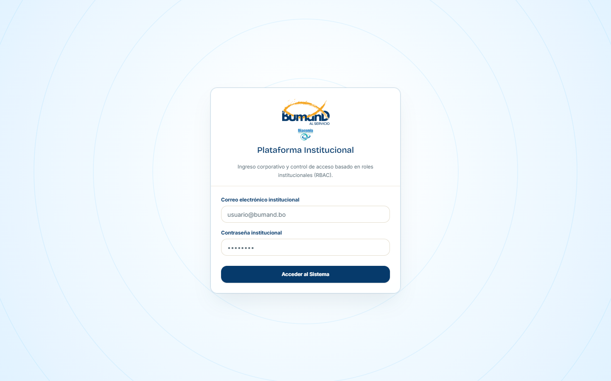

### 2.2. Propósito y Funcionalidad Operativa
La pantalla de inicio de sesión (`/inicio-sesion`) es el punto de entrada único y seguro a la plataforma web corporativa. Dispone de un formulario reactivo con validación estricta de credenciales, autenticación desacoplada con el backend NestJS vía JSON Web Tokens (JWT) y un mecanismo de contingencia para pruebas locales basado en cuentas semilla corporativas.

#### Elementos presentes:
1. **Identidad Institucional Dual:** Despliegue de los logotipos vectoriales de **BUMAND** y de la **Fundación Diaconía FRIF-IFD**.
2. **Formulario de Credenciales:** Campos validados para correo electrónico corporativo (`@bumand.bo` o `@wscrt.com`) y contraseña encriptada.
3. **Manejo de Errores Reactivo:** Notificaciones contextuales en color coral institucional (`#E2694B`) y toasts con **Sonner** en caso de credenciales inválidas (`ERR-1001`) o cuenta inhabilitada (`ERR-1004`).
4. **Selector Rápido de Cuentas Semilla RBAC:** Tres accesos directos con un solo clic para alternar rápidamente entre los roles de Administrador General, Supervisor Institucional y Becario Activo.
5. **Animaciones de Alta Factura (High-Craft):** Contenedor envuelto en `TarjetaSpotlight` con proyector perimetral, `BordeLuminoso` dinámico y botón `BotonConEstado` con feedback táctil.
6. **Disparador del Versículo Diario:** Activa la variable `bumand_mostrar_versiculo_inicio` en `sessionStorage` para mostrar el diálogo modal de edificación espiritual una vez autenticado exitosamente.

### 2.3. Análisis Comparativo: Qué Hace vs. Qué NO Hace

| Funcionalidad | Qué Hace | Qué NO Hace |
| :--- | :--- | :--- |
| **Autenticación** | Valida el usuario contra el endpoint `/autenticacion/inicio-sesion` o utiliza la semilla local de contingencia si el servicio está en reposo. | No almacena contraseñas en texto claro en `localStorage`; solo guarda el token JWT firmado y los datos del perfil activo. |
| **Enrutamiento RBAC** | Redirige al Administrador y Supervisor a la pestaña de administración general, y al Becario a su panel personal operativo. | No permite ingresar a rutas internas protegidas sin una sesión activa (redirección automática hacia `/inicio-sesion`). |
| **Recuperación de Clave** | Muestra el estado del sistema corporativo y notificaciones de acceso guiadas. | No incluye un mecanismo de autoservicio de restablecimiento de contraseña por correo público para evitar vectores de ataque externos; las claves son gestionadas por Diaconía IFD. |
| **Tolerancia a Fallos** | Captura estados de red y proporciona retroalimentación visual amigable con códigos `ERR-NNNN`. | No interrumpe la experiencia de usuario si el backend está reiniciando; se apoya en el modo de contingencia institucional. |

---

## 3. Rol: Administrador General (`daniel234.davalos@gmail.com`)

El Administrador General cuenta con el nivel de privilegios más alto dentro del ecosistema, con potestad para auditar, dar de alta sedes, registrar becarios, convocar eventos y convalidar reportes oficiales.

---

### 3.1. Dashboard General Analítico

#### Captura de Pantalla


#### Propósito y Componentes
El panel de control ejecutivo consolida en tiempo real los indicadores clave de desempeño (KPIs) de toda la fundación, incorporando analítica temporal flexible:
- **Selector Interactivo de Rango de Fechas:** Filtro conmutable de fechas (`fecha_inicio` y `fecha_fin`) con 4 preajustes inmediatos:
  - *"Este Mes":* Filtra los últimos 30 días de operación.
  - *"Último Trimestre":* Vista consolidada de los últimos 90 días.
  - *"Semestre Actual":* Ciclo formativo y académico en curso.
  - *"Personalizado":* Selección libre de fechas con calendario reactivo Shadcn UI.
- **Alerta de Cierre Normativo:** Banner superior informativo con el estado del periodo de liquidación activo y la vigencia del proceso de validación geodésica.
- **Tarjetas de KPIs Ejecutivos con `ContadorRodilloAnimado` y `TarjetaSpotlight`:**
  - *Becarios Activos:* Total de estudiantes en programa (25 activos, 100% de retención).
  - *Horas Acumuladas:* Registro agregado de horas prácticas efectivas frente a la meta (1,040 h registradas, superando la meta planificada).
  - *Evaluaciones 360°:* Módulos consolidados completados (4 de 5 completados).
  - *Presupuesto del 80% en Pasajes:* Monto total liquidado en bolivianos (Bs 5,240.00 sobre un presupuesto límite de Bs 10,000.00).
  - *Multas Institucionales Recaudadas:* Tarjeta focalizada en penalidades disciplinarias por retrasos en viernes (Escuela de Líderes), desplegando el total retenido en Bs (a razón de Bs 10/min) y el número de infracciones en el rango seleccionado, fondos que quedan como retención institucional para la empresa.
- **Gráfico de Tendencia de Horas:** Gráfico de área interactivo con selector conmutable entre vista semestral y anual, con degradado turquesa institucional (`#17B4C4`).
- **Gráfico de Ejecución Presupuestaria (Donut):** Desglose del presupuesto en montos reembolsados, pendientes de aprobación y saldos disponibles.
- **Distribución por Unidad Operativa:** Barras de progreso de horas acreditadas en Seguridad Física, Consultorio Médico, Canales y Agencias.
- **Auditoría Reciente:** Historial de eventos y transacciones en tiempo real con avatares, descripción del evento y marcas de tiempo relativas.

#### Qué Hace vs. Qué NO Hace
- **Qué Hace:**
  - Permite filtrar dinámicamente toda la analítica institucional por rangos de fecha personalizados o predefinidos.
  - Computa y transparenta las multas por retrasos de viernes aplicadas a partir de la vigencia normativa.
  - Calcula visualmente las metas de horas académicas en relación con las horas efectivas registradas con geolocalización.
  - Despliega en centavos exactos los saldos de viáticos para control financiero.
- **Qué NO Hace:**
  - No permite aplicar multas de forma retroactiva a reuniones o viernes previos a la entrada en vigencia del cambio.
  - No permite manipular o alterar manualmente los registros históricos de auditoría desde este panel.
  - No permite sobrepasar el techo presupuestario configurado sin una convalidación contable expresa.

---

### 3.2. Directorio General de Becarios

#### Captura de Pantalla
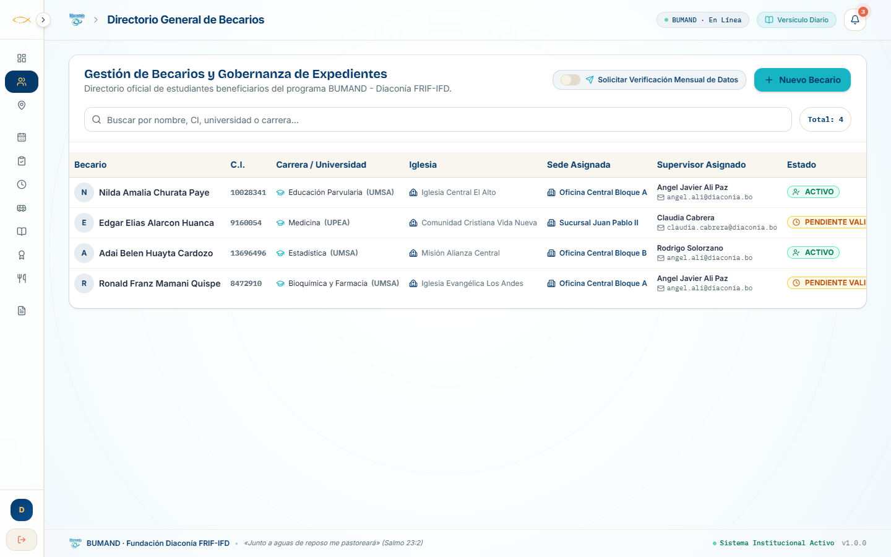

#### Propósito y Componentes
Espacio centralizado para la administración de expedientes académicos de los becarios:
- **Buscador en Tiempo Real:** Filtro rápido por nombre del becario, cédula de identidad o carrera universitaria.
- **Asignación Exclusiva de Supervisores:** Acción y modal restringido estrictamente al Administrador para vincular becarios a su tutor/supervisor responsable, suprimiendo cualquier autoasignación arbitraria.
- **Disparador de Verificación Mensual de Datos:** Switch institucional en cabecera ("Solicitar Verificación Mensual de Datos") que emite la orden de confirmación periódica a las aplicaciones móviles de los becarios.
- **Protección de Atributos Académicos:** Bloqueo estricto de campos sensibles (`Universidad`, `Carrera`, `Iglesia`, `Sede`); estos datos permanecen en modo de solo lectura protegida para el becario y solo pueden ser alterados por el Administrador General.
- **Modal de Registro de Nuevo Becario:** Formulario modal para ingresar nombre completo, C.I., universidad de procedencia (UMSA, UPEA, UCB, UNIVALLE, EMI, Franz Tamayo), carrera y asignación inicial de sede.
- **Tabla Institucional de Expedientes:** Detalle de becario, documento de identidad, universidad, lugar de práctica asignado, tutor supervisor responsable y estado de vigencia (`Activo`, `Pendiente Validación`, `Inactivo`).

#### Qué Hace vs. Qué NO Hace
- **Qué Hace:**
  - Garantiza que únicamente el Administrador General pueda asignar o reasignar supervisores a los becarios.
  - Bloquea la edición de Universidad o Carrera por parte del estudiante, previniendo alteraciones no autorizadas en convenios.
  - Habilita la orden mensual de confirmación de datos de contacto bajo demanda administrativa.
  - Normaliza la nomenclatura de universidades del sistema educativo boliviano.
- **Qué NO Hace:**
  - No permite que un supervisor se autoasigne becarios.
  - No permite al becario modificar su universidad o facultad desde su perfil.
  - No elimina físicamente registros históricos para preservar la integridad referencial y las auditorías de periodos previos.

---

### 3.3. Catálogo de Sedes y Geocercas Institucionales

#### Captura de Pantalla
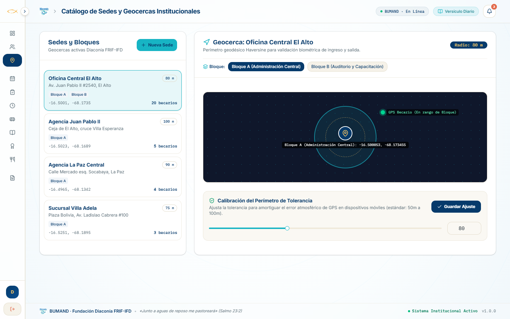

#### Propósito y Componentes
Módulo geodésico encargado de registrar y calibrar los puntos físicos donde se autoriza la marcación de horas:
- **Gobernanza de Sedes Exclusiva:** La creación, modificación perimétrica y baja de sedes institucionales queda reservada de manera exclusiva al Administrador General.
- **Soporte de Edificios por Bloques:** Estructuración de sub-ubicaciones edilicias (ej. *Oficina Central - Bloque A Administrativo*, *Bloque B Capacitación / Aulas*) con identificación geodésica para validar la presencia en recintos específicos.
- **Visualizador Cartográfico Digital:** Representación espacial de las sedes institucionales con radios perimétricos y marcadores de tolerancia.
- **Listado de Sedes Registradas:** Oficina Central Bloque A, Bloque B, Agencia Juan Pablo II, Agencia La Paz Central, etc., con sus coordenadas WGS84 (Latitud/Longitud) y cantidad de becarios vinculados.
- **Configuración de Tolerancia Métrica con `Slider` Shadcn:** Ajuste continuo del radio de geocerca (60 a 100 metros) basado en la fórmula geodésica de Haversine.

#### Qué Hace vs. Qué NO Hace
- **Qué Hace:**
  - Reserva la creación de nuevas sedes institucionales únicamente al Administrador General.
  - Permite configurar y etiquetar bloques independientes dentro de un mismo predio institucional.
  - Define las coordenadas GPS oficiales contra las cuales se validarán los registros móviles y web de los becarios.
- **Qué NO Hace:**
  - No permite que supervisores o becarios creen o alteren sedes o radios de tolerancia.
  - No admite radios de tolerancia menores a 30 metros ni mayores a 300 metros, previniendo falsos positivos o accesos fraudulentos fuera de las instalaciones.

---

### 3.4. Auditoría y Control de Asistencia

#### Captura de Pantalla
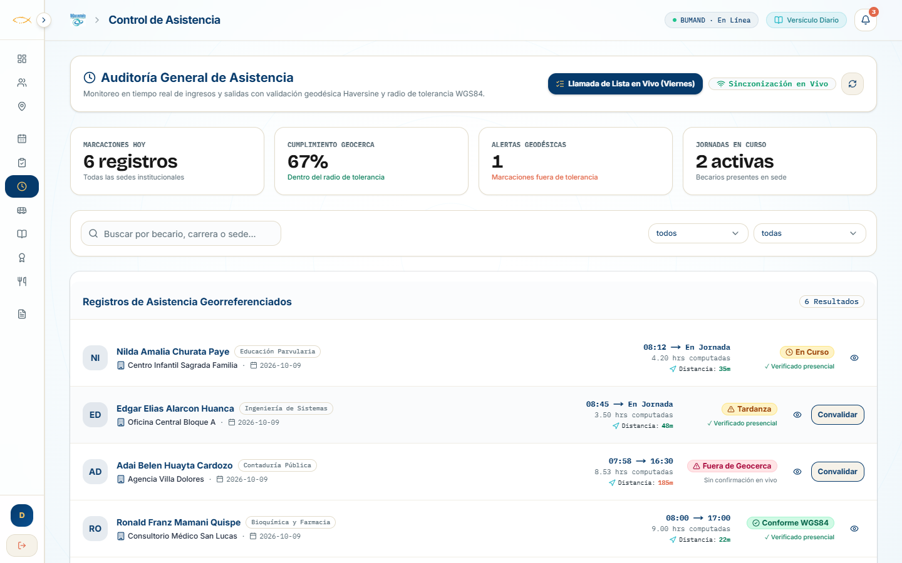

#### Propósito y Componentes
Herramienta de control temporal, georreferenciado y disciplinario para registrar y auditar jornadas de prácticas:
- **Visualizador Satelital Google Maps Embebido:** Despliegue interactivo del mapa geográfico mostrando las coordenadas de la sede/bloque y el punto GPS exacto de la marcación del becario.
- **Doble Confirmación y Llamada de Lista en Vivo:** Modal interactivo para que el supervisor u organizador presencial llame lista en eventos de viernes (Escuela de Líderes), conmutando los registros de `pendiente_confirmacion_organizador` a `confirmado` en un solo toque.
- **Motor Transparente de Multas de Viernes:** Detección de tardanzas en Escuela de Líderes (ingreso oficial 14:30 con tolerancia hasta las 14:35). A partir de las 14:36, computa automáticamente Bs 10 por cada minuto de retraso sobre la hora prevista; el monto queda registrado como retención institucional para la empresa y se transparenta en la ficha del estudiante.
- **Selectores de Fecha y Hora (`SeleccionadorFechaHora` Shadcn):** Entrada y salida con control de precisión horaria y validación cruzada.
- **Indicador de Geolocalización Activa:** Verificación visual de adjunción de coordenadas GPS a la constancia de asistencia.
- **Confirmación Reactiva con `BotonConEstado`:** Transición fluida de estados (reposo, cargando, éxito con confeti) tras completar la transacción.

#### Qué Hace vs. Qué NO Hace
- **Qué Hace:**
  - Acredita jornadas laborales de prácticas preprofesionales con fecha, hora formal y bloque específico.
  - Permite al organizador del evento realizar la llamada de lista presencial que valida la asistencia satelital del becario.
  - Calcula y notifica multas transparentes de Bs 10/minuto en días viernes aplicables desde la entrada en vigencia del cambio.
  - Despliega mapas satelitales interactivos con Google Maps para auditoría perimétrica.
- **Qué NO Hace:**
  - No permite computar horas como válidas en eventos de viernes si falta la confirmación de lista del organizador.
  - No aplica multas retroactivas a asistencias pasadas.
  - No autoriza registros sin confirmación de coordenadas espaciales.

---

### 3.5. Supervisión y Aprobación de Pasajes (80%)

#### Captura de Pantalla


#### Propósito y Componentes
Módulo financiero para la verificación y liquidación de viáticos mensuales:
- **Regla Normativa del Día 24:** Panel que detalla la política de activación de solicitudes a partir del 24 de cada mes.
- **Cálculo de Devolución en Centavos Enteros:** Desglose del total erogado y del 80% exacto a reembolsar (evitando discrepancias de redondeo).
- **Tarjetas de Solicitudes Pendientes:** Información de estudiante, carrera, periodo, fecha de envío, desglose de tramos urbanos (ida/vuelta), verificación GPS por tramo y actividad desarrollada.
- **Acciones Resolutivas:** Botones para **Aprobar** con `BotonConEstado` y confeti, u **Observar** con diálogo modal accesible `AlertDialog` y justificación obligatoria en `Textarea`.

#### Qué Hace vs. Qué NO Hace
- **Qué Hace:**
  - Liquida los montos aplicando estrictamente la tasa del 80% sobre los gastos de transporte declarados.
  - Exige una justificación textual explicativa si el supervisor u administrador decide observar la solicitud.
- **Qué NO Hace:**
  - No permite aprobar solicitudes con justificaciones vacías al momento de observar.
  - No admite la declaración de viáticos fuera del calendario reglamentario habilitado.

---

### 3.6. Matriz de Evaluación 360° y Convalidación

#### Captura de Pantalla
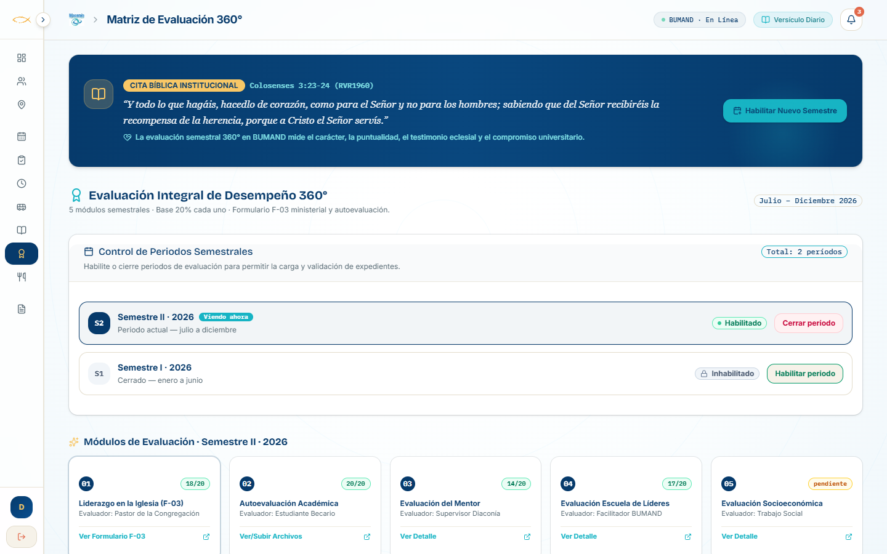

#### Propósito y Componentes
Instrumento integral de medición formativa en las 5 dimensiones diaconales con acompañamiento bíblico y flexibilidad administrativa:
- **Cabecera Devocional Inspiradora:** Cita bíblica destacada desde el inicio de la navegación con **Colosenses 3:23-24**: *"Y todo lo que hagáis, hacedlo de corazón, como para el Señor y no para los hombres; sabiendo que del Señor recibiréis la recompensa de la herencia, porque a Cristo el Señor servís"*.
- **Matriz de Ponderación Dinámica (Base 20%):** Esquema inicial donde los 5 módulos formativos parten con una base equitativa del 20% cada uno (100% total):
  1. *Liderazgo en la Iglesia (Formulario F-03):* Base 20% (Evaluador: Pastor).
  2. *Autoevaluación Académica:* Base 20% (Evaluador: Becario).
  3. *Evaluación del Mentor / Prácticas:* Base 20% (Evaluador: Supervisor).
  4. *Evaluación Escuela de Líderes:* Base 20% (Evaluador: Facilitador Pastoral).
  5. *Evaluación Socioeconómica:* Base 20% (Evaluador: Trabajador Social).
- **Panel Administrativo de Ajuste Ponderado:** Sliders e inputs numéricos exclusivos para el Administrador para ajustar las ponderaciones semestrales, con validación reactiva que exige suma exactamente igual al 100% para habilitar el guardado.
- **Habilitación de Nuevo Semestre:** Modal exclusivo para Administrador para dar de alta nuevos períodos evaluativos (ej. *2026-II*), definiendo vigencias y congelando notas de períodos cerrados.
- **Resumen Ponderado Superior:** Puntuación global calculada automáticamente (escala 0 a 100 y vigesimal 0 a 20) y categoría de rendimiento (Sobresaliente / Muy Bueno / En Observación).
- **Firma Digital Canvas:** Botón modal que despliega un lienzo de captura gráfica para estampar la rúbrica manuscrita del administrador o supervisor con sello de tiempo criptográfico.

#### Qué Hace vs. Qué NO Hace
- **Qué Hace:**
  - Expone la cita bíblica directriz en la cabecera fija de la vista desde el primer acceso.
  - Permite al Administrador redistribuir libremente las ponderaciones porcentuales partiendo de la base del 20%.
  - Habilita la apertura y clausura de semestres académicos de forma centralizada.
  - Aplica la fórmula dinámica ponderada: **Nota Total = ∑ (Puntaje<sub>i</sub> × Peso<sub>i</sub>) / 100**.
  - Captura y vectoriza firmas digitales en Base64 para adjuntarlas a las actas oficiales.
- **Qué NO Hace:**
  - No permite que la suma de las ponderaciones de los 5 módulos sea diferente al 100%.
  - No permite alterar notas ni registrar evaluaciones en semestres cerrados.
  - No permite calificaciones fuera del rango numérico válido [0, 100].

---

### 3.7. Emisión y Descarga de Reportes PDF Oficiales

#### Captura de Pantalla
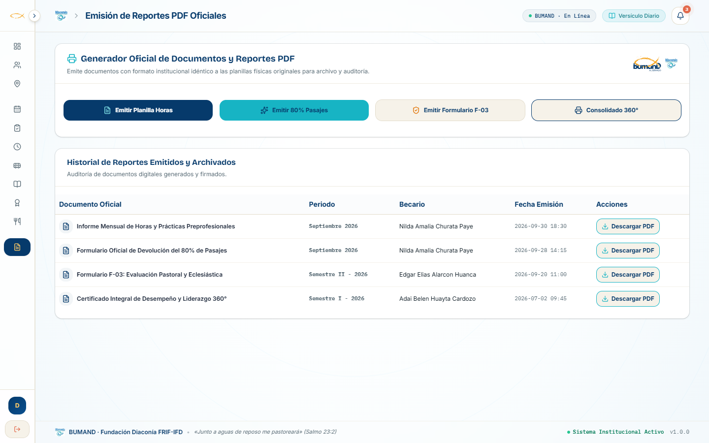

#### Propósito y Componentes
Centro de emisión de documentos oficiales en formato imprimible:
- **Botones de Emisión Inmediata:** Generación rápida de informe mensual de horas, planilla de pasajes, evaluación pastoral F-03 y certificado 360°.
- **Tabla de Documentos Emitidos:** Registro de títulos, tipos de informe, periodo fiscal, fecha/hora de generación, estudiante asociado, peso del archivo en KB y estado de emisión.
- **Descarga Directa:** Descarga de archivos PDF certificados listos para impresión institucional.

#### Qué Hace vs. Qué NO Hace
- **Qué Hace:**
  - Genera documentos formalizados con logotipos institucionales, tablas de auditoría y casillas de firma reglamentarias.
  - Registra el historial de documentos descargados y generados por usuario.
- **Qué NO Hace:**
  - No genera documentos con datos incongruentes o sin periodo académico asignado.

---

### 3.8. Centro Corporativo y Globo de Notificaciones

#### Captura de Pantalla
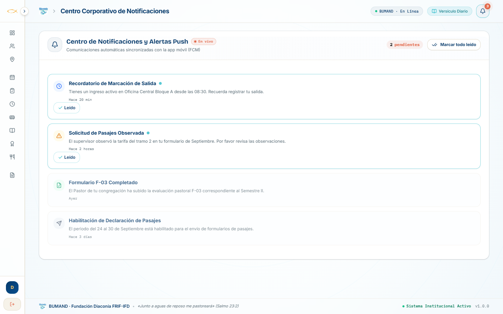

#### Propósito y Componentes
Bandeja reactiva unificada para alertas y avisos del sistema:
- **Globo de Notificaciones Flotante (`GloboNotificaciones`):** Mini diálogo interactivo anclado a la campana del header universal, visible en toda la navegación.
- **Contador de Notificaciones Pendientes:** Badge visual `InsigniaPulsoVivo` con onda viva continua que alerta sobre elementos sin leer.
- **Filtrado y Marcación Global:** Botón `BotonConEstado` para marcar todos los avisos como leídos con micro-latencia de confirmación.
- **Integración WebSocket:** Actualizaciones en tiempo real ante eventos de ingreso/salida, aprobación de pasajes y resoluciones de justificaciones.

#### Qué Hace vs. Qué NO Hace
- **Qué Hace:**
  - Centraliza las comunicaciones transaccionales emitidas por el backend y la app móvil.
  - Mantiene persistencia del estado leído/no leído por cuenta institucional.
- **Qué NO Hace:**
  - No satura al usuario con correos spam externos; opera como una bandeja in-app orientada a la gobernanza operativa.

---

### 3.9. Gestión de Eventos Geolocalizados y Actas Oficiales

#### Propósito y Componentes
Módulo integral para la convocatoria y auditoría de eventos institucionales de la fundación:
- **Alta de Convocatorias con Geocerca:** Definición de nombre del evento, fecha, lugar físico, coordenadas geodésicas WGS84 y radio de tolerancia en metros.
- **Nómina de Asistentes y Distancia Calculada:** Listado de becarios con cálculo de distancia métrica en tiempo real respecto al epicentro del evento.
- **Generación de Actas PDF:** Exportación inmediata de actas certificadas con firma digital de los asistentes.

#### Qué Hace vs. Qué NO Hace
- **Qué Hace:**
  - Calcula la distancia de los asistentes mediante la fórmula de Haversine.
  - Asigna estado `PRESENTE` si está dentro del perímetro o `FUERA_DE_RADIO` si supera el margen asignado.
- **Qué NO Hace:**
  - No permite modificar los datos del evento una vez que ha concluido o ha sido cancelado formalmente.

---

### 3.10. Bandeja Centralizada de Justificaciones

#### Propósito y Componentes
Flujo de apelación y descargo ante inasistencias o retrasos de becarios:
- **Bandeja de Casos Pendientes:** Clasificación por tipo de incidencia (médica, académica, fuerza mayor, transporte).
- **Dictamen Motivado del Supervisor / Administrador:** Diálogo de resolución donde es mandatario fundamentar por escrito la aprobación o el rechazo de la solicitud.
- **Sincronización Automática con Asistencia:** Al aprobar una justificación vinculada a un evento o jornada de práctica, el sistema actualiza automáticamente el registro de asistencia a estado `JUSTIFICADO`.

#### Qué Hace vs. Qué NO Hace
- **Qué Hace:**
  - Exige fundamentación escrita en cada dictamen emitido.
  - Conmuta de forma inmediata el estado en las actas de asistencia y reportes PDF.
- **Qué NO Hace:**
  - No permite aprobar justificaciones sin motivo o con dictámenes vacíos (`ERR-4004`).

---

### 3.11. Control de Refrigerios Institucionales y Planilla de Reposición

#### Captura de Pantalla
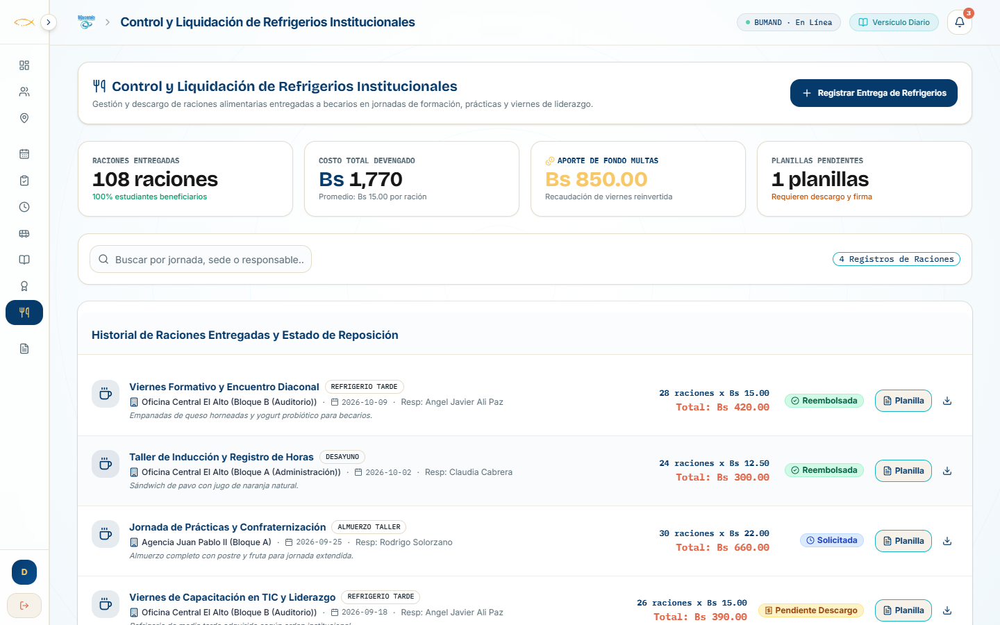

#### Propósito y Componentes
Módulo administrativo independiente para el control logístico, contable y de reposición de refrigerios provistos por la Fundación Diaconía FRIF-IFD en jornadas de capacitación, Escuela de Líderes y prácticas:
- **Registro Logístico de Raciones:** Formulario para registrar fecha, sede o evento convocante, cantidad exacta de raciones entregadas, costo unitario en bolivianos (ej. Bs 12.00) y costo total devengado.
- **Financiamiento Cruzado Institucional:** Panel que visualiza el saldo de fondos requeridos y el porcentaje compensado mediante el fondo de multas recaudadas por retrasos.
- **Firmas de Conformidad y Asistencia:** Registro digital (`jsonb`) de los becarios que recibieron el beneficio con estado de recepción conforme.
- **Generador de Planilla Oficial de Reposición (Código `REP-REF-0000X`):** Emisión y visor HTML imprimible del documento contable oficial con membrete de Diaconía FRIF-IFD, detalle de raciones, cálculo de desembolso y casillas de firma del Supervisor de Sede y el Administrador General para el reembolso formal por caja chica.

#### Qué Hace vs. Qué NO Hace
- **Qué Hace:**
  - Registra y audita la entrega de raciones de refrigerio por evento institucional.
  - Genera la planilla oficial contable lista para impresión y trámite de desembolso institucional.
  - Asocia de forma transparente los gastos de refrigerio con los eventos de asistencia.
- **Qué NO Hace:**
  - No permite emitir planillas de reposición con costos unitarios negativos o raciones vacías.
  - No transfiere fondos de forma unilateral sin la convalidación de firma del Administrador General.

---

## 4. Rol: Supervisor Institucional (`angel.ali@bumand.bo`)

El **Supervisor Institucional** (encarnado en la cuenta de prueba oficial por **Angel Javier Ali Paz**, Jefe de Seguridad Física y Tutor General de Prácticas de Diaconía FRIF-IFD) personifica el eslabón táctico de acompañamiento, mentoría presencial y control operativo de los estudiantes becarios.

A diferencia del Administrador General (que ostenta control estructural y de gobierno institucional) y de la Estudiante Becaria (acotada a su propio kardex operativo), el entorno web del Supervisor opera con un aislamiento de jurisdicción basado en **RBAC estricto a nivel de token JWT** y vistas filtradas por tutoría.

---

### 4.1. Panel de Supervisión Operativo

#### Captura de Pantalla en Alta Resolución (1440x900)


#### Propósito, Arquitectura y Métricas Visibles
El Panel de Supervisión (`PanelControlVista`, pestaña `administracion`) sintetiza el estado de la cohorte asignada al tutor sin exponer datos de gobernanza global ajenos a su competencia:
1. **Encabezado y Alerta de Cohorte Reactiva:**
   - Despliega la tarjeta institucional: `Panel de Supervisión Institucional — Cohorte Angel Javier Ali Paz`.
   - Subtexto rector: *"Monitoreo en tiempo real de asistencia, puntualidad y cumplimiento de prácticas geocercadas."*
   - Indicador de estado en cabecera: `BUMAND · En Línea`, botón de consulta de *Versículo Diario (RVR60)* y campana con insignia interactiva de notificaciones sin leer.
2. **Selector Analítico Temporal:**
   - Permite acotar el análisis mediante filtros rápidos: *Este Mes*, *Último Trimestre*, *Semestre Actual* y *Personalizado* (01/07/2026 al 31/12/2026 sincronizado en tiempo real).
3. **Cuadro de Mando de KPIs Tutoriales:**
   - **Becarios Activos:** `21` estudiantes universitarios bajo seguimiento (100% matriculados en la gestión 2026).
   - **Asistencia Semanal:** `87%` de asistencia neta con alerta visual de *5 con retraso esta semana*.
   - **Evaluaciones 360°:** `21 / 21` estudiantes habilitados en el período formativo *Semestre II · 2026*.
   - **Presupuesto 80% Pasajes:** `Bs 5.240,00` liquidados acumulados sobre una partida institucional de `Bs 10.000,00`.
4. **Spotlight de Multas Reglamentarias (Escuela de Líderes):**
   - Refleja la recaudación transparente de penalizaciones por retrasos no justificados: `Bs 850,00` recaudados en `17` casos, fondos destinados a los refrigerios institucionales de confraternización diaconal.
5. **Panel de Seguimiento Semanal (Semana 32):**
   - **Bandeja de Becarios con Retraso (5 incidencias):** Notifica desviaciones horarias (ej. *Carlos Oscar Luna Lizarraga*, ingreso 08:24 vs. previsto 08:00 en Oficina Central Bloque A, +24 min).
   - **Control de Asistencia Semanal:** Segmentación dinámica en 3 pestañas: *Todos (21)*, *Asistieron (17)*, *No asistieron (4)*, con insignias de estado y horario pactado.

---

### 4.2. Directorio de Becarios Asignados a Supervisión

#### Captura de Pantalla en Alta Resolución (1440x900)
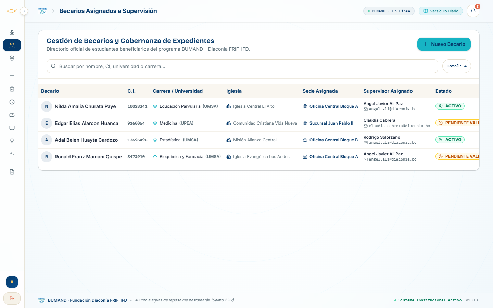

#### Propósito, Datos Expuestos y Blindaje RBAC
El módulo de Becarios Asignados (`GestionBecarios`, pestaña `becarios`) presenta los expedientes académicos e institucionales bajo la jurisdicción tutorial del supervisor:
- **Datos Visibles en Tabla:** Nombre completo del becario, C.I., carrera universitaria (UMSA, UPEA, UNIFRANZ), congregación eclesiástica, sede de práctica asignada (con discriminación de bloques), supervisor responsable asignado y estado del expediente (`ACTIVO` o `PENDIENTE VALIDACIÓN`).
- **Casos de Seguimiento Directo:**
  - *Nilda Amalia Churata Paye* (CI: 10028341, Educación Parvularia - UMSA, Oficina Central Bloque A, Tutor: Angel Javier Ali Paz, Estado: ACTIVO).
  - *Ronald Franz Mamani Quispe* (CI: 8472910, Bioquímica y Farmacia - UMSA, Oficina Central Bloque A, Tutor: Angel Javier Ali Paz, Estado: PENDIENTE VALIDACIÓN).
  - *Adai Belen Huayta Cardozo* (CI: 13696496, Estadística - UMSA, Oficina Central Bloque B, Tutor: Rodrigo Solorzano, Estado: ACTIVO).
  - *Edgar Elias Alarcon Huanca* (CI: 9160054, Medicina - UPEA, Sucursal Juan Pablo II, Tutora: Claudia Cabrera, Estado: PENDIENTE VALIDACIÓN).
- **Gobernanza y Restricciones Visuales Estrictas:**
  - El interruptor de control *Solicitar Verificación Mensual de Datos* está **completamente oculto** (exclusivo para `es_admin`).
  - Los botones de acción rápida *Asignar Supervisor* y el botón verde de aprobación ejecutiva *Validar* están deshabilitados y ocultos en las filas.
  - Al abrir el modal *Nuevo Becario*, se visualiza el banner de protección: *"Gobernanza activa: Los campos Universidad, Carrera, Iglesia y Sede están bloqueados para roles no administradores."*

---

### 4.3. Supervisión, Aprobación y Observación de Pasajes (80%)

#### Captura de Pantalla en Alta Resolución (1440x900)
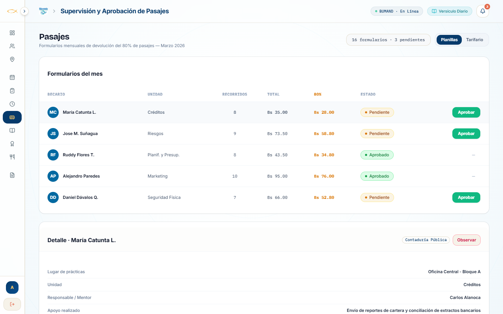

#### Auditoría Técnica del Reembolso Exacto al 80%
El módulo (`AprobacionPasajes`, pestaña `pasajes`) materializa la política reglamentaria del BUMAND mediante la cual Diaconía reintegra exactamente el **80% del gasto de transporte público urbano e interurbano** en centavos de boliviano:
1. **Resumen y Cómputo del Mes (Marzo 2026):**
   - Muestra el indicador consolidado: `16 formularios · 3 pendientes`, con pestañas de alternancia entre *Planillas* y *Tarifario*.
2. **Tabla de Planillas Mensuales Declaradas:**
   - *María Catunta L.* (Créditos): 8 recorridos, Gasto Total Bs 35,00, **80% a Reembolsar: Bs 28,00**, Estado: `Pendiente`, Acción: Botón verde interactivo **[Aprobar]**.
   - *Jose M. Suñagua* (Riesgos): 9 recorridos, Gasto Total Bs 73,50, **80% a Reembolsar: Bs 58,80**, Estado: `Pendiente`, Acción: Botón verde **[Aprobar]**.
   - *Daniel Dávalos Q.* (Seguridad Física): 7 recorridos, Gasto Total Bs 66,00, **80% a Reembolsar: Bs 52,80**, Estado: `Pendiente`, Acción: Botón verde **[Aprobar]**.
   - *Ruddy Flores T.* (Planificación y Presupuesto): 8 recorridos, Total Bs 43,50, **80%: Bs 34,80**, Estado: `Aprobado` (Acción inactiva con guion).
   - *Alejandro Paredes* (Marketing): 10 recorridos, Total Bs 95,00, **80%: Bs 76,00**, Estado: `Aprobado` (Acción inactiva con guion).
3. **Bandeja de Detalle de Planilla y Botón [Observar]:**
   - Al seleccionar la solicitud de *María Catunta L.*, el panel inferior expone la unidad (*Créditos*), la sede (*Oficina Central - Bloque A*), el tutor (*Carlos Alanoca*) y la glosa técnica de tareas ejecutadas (*"Envío de reportes de cartera y conciliación de extractos bancarios"*).
   - El botón **[Observar]** abre un diálogo modal que exige obligatoriamente registrar una fundamentación técnica detallada (mínimo 10 caracteres) para revertir la planilla a borrador editable por el becario.
4. **Flujo de Convalidación con Firma Digital:**
   - La aprobación individual o masiva permite estampar la **Firma Digital Canvas del Supervisor**, generando un hash criptográfico único que queda registrado en la base de datos PostgreSQL (`firma_supervisor: "HASH_VERIFICADO_..."`), garantizando la inmutabilidad de la planilla previo al desembolso contable.

---

### 4.4. Matriz de Evaluación 360° Semestral y Firma Digital Canvas

#### Captura de Pantalla en Alta Resolución (1440x900)
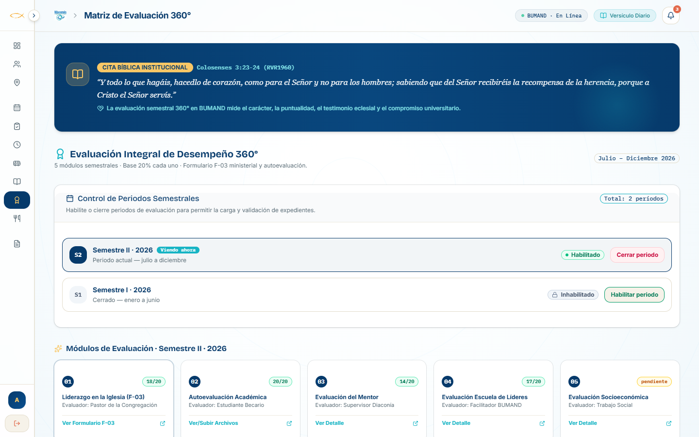

#### Evaluación Integral y Desglose de los 5 Módulos Formativos
El módulo de Evaluación 360° (`EvaluacionesVista` y `MatrizEvaluacion360`, pestaña `evaluacion_360`) canaliza la ponderación del desempeño integral del estudiante:
1. **Lema Bíblico Institucional:**
   - Banner de cabecera con *Colosenses 3:23-24 (RVR1960)*: *"Y todo lo que hagáis, hacedlo de corazón, como para el Señor y no para los hombres; sabiendo que del Señor recibiréis la recompensa de la herencia, porque a Cristo el Señor servís."*
   - Subtexto: *"La evaluación semestral 360° en BUMAND mide el carácter, la puntualidad, el testimonio eclesial y el compromiso universitario."*
2. **Control de Períodos Semestrales:**
   - *Semestre II · 2026* (Estado: `Habilitado`, Viendo ahora).
   - *Semestre I · 2026* (Estado: `Inhabilitado`, Cerrado).
3. **Estructura Canónica de los 5 Módulos Evaluativos (Base 20% cada uno / Escala Vigesimal 0-20 pts):**
   - **Módulo 01: Liderazgo en la Iglesia (Formulario Pastoral F-03):** Puntuación `18/20`. Evaluador: Pastor de la Congregación. Permite al supervisor consultar las respuestas ministeriales, testimonio eclesial y acreditación pastoral.
   - **Módulo 02: Autoevaluación Académica:** Puntuación `20/20`. Evaluador: Estudiante Becario. Permite revisar el avance curricular y certificados de notas adjuntos.
   - **Módulo 03: Evaluación del Mentor / Prácticas Institucionales:** Puntuación `14/20`. **Evaluador: Supervisor Diaconía.** Este es el módulo donde el supervisor califica de forma directa las competencias profesionales, puntualidad, trabajo en equipo y observancia de protocolos en la agencia asignada.
   - **Módulo 04: Evaluación Escuela de Líderes:** Puntuación `17/20`. Evaluador: Facilitador BUMAND (seguimiento de talleres y liderazgo cristiano).
   - **Módulo 05: Evaluación Socioeconómica:** Estado: `Pendiente`. Evaluador: Trabajo Social.
4. **Convalidación con Firma Digital Canvas:**
   - Incluye el disparador interactivo: *"Convalidar con Firma Digital Canvas"* (`FirmaDigital`), que permite al supervisor estampar su rúbrica con puntero o pantalla táctil sobre un lienzo HTML5 Canvas, convirtiendo el trazo en Base64 para adjuntarlo al acta oficial exportable en PDF.

---

### 4.5. Matriz Exhaustiva de Capacidades vs. Restricciones Estrictas de Rol

Para garantizar el cumplimiento de los estándares de seguridad y gobernanza diaconal, a continuación se detallan las atribuciones explícitas y las prohibiciones operativas del Supervisor:

| Dominio Operativo | Lo que el Supervisor PUEDE HACER (Atribuciones) | Lo que el Supervisor NO PUEDE HACER (Restricciones Estrictas) |
| :--- | :--- | :--- |
| **Gobernanza de Sedes y Geocercas** | Consultar el listado georreferenciado de las 72 agencias y sucursales (`GET /lugares-practica`). | **PROHIBIDO:** No puede crear (`POST`), actualizar coordenadas WGS84, direcciones o radios geodésicos (`PUT /lugares-practica/:id`), ni eliminar sedes (`DELETE`). |
| **Expedientes de Becarios** | Consultar el directorio de los estudiantes asignados a su cohorte (`GET /becarios`). Visualizar horarios de apoyo, carreras e iglesias. | **PROHIBIDO:** No puede modificar universidades, carreras ni congregaciones (`PUT /becarios/:id`). No puede transferir ni reasignar supervisores (`PUT /becarios/:id/asignar-supervisor`). No puede validar expedientes (`PUT /becarios/:id/validar-datos`). |
| **Control de Verificación Mensual** | Consultar si los becarios de su cohorte confirmaron sus datos (`GET /becarios/estado-confirmacion-datos`). | **PROHIBIDO:** No puede emitir la orden institucional global de verificación de datos (`POST /becarios/orden-confirmacion-datos`). El switch de control está oculto. |
| **Aprobación de Pasajes (80%)** | Auditar planillas mensuales, verificar correlación de tramos con agencias asignadas, aprobar el 80% (`PATCH /pasajes/:id/aprobar`) y observar devolviendo a borrador (`PATCH /pasajes/:id/rechazar`). | **PROHIBIDO:** No puede alterar las tarifas oficiales del catálogo (`POST /pasajes/tarifas`, `PATCH /pasajes/tarifas/:id`). No puede sembrar paradas maestras (`POST /pasajes/paradas/sembrar`). No puede editar montos declarados arbitrariamente sin observar la planilla completa. |
| **Evaluación 360° Semestral** | Calificar el Módulo 3 (*Evaluación del Mentor*) sobre 20 puntos (`POST /evaluaciones`, `PATCH /evaluaciones/:id/estado`). Convalidar con Firma Digital Canvas. Consultar el F-03 pastoral. | **PROHIBIDO:** No puede crear nuevos periodos semestrales (`POST /evaluaciones/periodos`). No puede alterar las ponderaciones porcentuales de la matriz (`PUT /evaluaciones/periodos/:id`). No puede modificar la nota pastoral del F-03 ni la autoevaluación del becario. |
| **Control de Asistencia e Incidencias** | Monitorear el registro biométrico-satelital de su cohorte en tiempo real (`GET /asistencia`). Dictaminar solicitudes en la Bandeja de Justificaciones (`GET/PATCH /justificaciones`). | **PROHIBIDO:** No puede manipular directamente los timestamps de entrada o salida para encubrir retrasos o faltas no amparadas en una justificación formal aprobada. |
| **Configuraciones Globales** | Visualizar reportes consolidados en formato PDF de su jurisdicción (`GET /reportes/visor`). | **PROHIBIDO:** No tiene acceso al módulo de administración global de usuarios ni a los roles de sistema (`/usuarios`). |

---

### 4.6. Especificación de Endpoints y Estados de API del Supervisor

A continuación se resumen las operaciones RESTful consumidas por el perfil Supervisor bajo la guardia `JwtGuardia` y `RolesGuardia(Rol.SUPERVISOR, Rol.ADMINISTRADOR)`:

```
[MÓDULO: BECARIOS]
GET    /becarios                      -> Retorna estudiantes filtrados automáticamente por tutor_id en sesión.
GET    /becarios/:id                  -> Detalle completo del expediente si pertenece a su jurisdicción.
GET    /becarios/estado-confirmacion  -> Verifica si los estudiantes han cumplido con la confirmación de datos.

[MÓDULO: PASAJES Y VIÁTICOS 80%]
GET    /pasajes                       -> Obtiene el catálogo de solicitudes de viáticos para auditoría.
GET    /pasajes/:id                   -> Desglose de tramos, paradas, tarifas declaradas y cálculo del 80%.
PATCH  /pasajes/:id/aprobar           -> Dictamina aprobación formal, estampa hash de firma digital y pasa a liquidación.
PATCH  /pasajes/:id/rechazar          -> Devuelve la solicitud a borrador editable, exigiendo motivo obligatorio.
GET    /pasajes/tarifas               -> Consulta del catálogo oficial de tarifas vigentes en La Paz y El Alto.
GET    /pasajes/paradas               -> Nodos y paradas georreferenciadas frecuentes.

[MÓDULO: EVALUACIÓN 360° Y MINISTERIAL]
GET    /evaluaciones                  -> Listado general de evaluaciones semestrales.
GET    /evaluaciones/becario/:id      -> Calificaciones desagregadas por módulo del becario.
POST   /evaluaciones                  -> Registro de nota del Módulo 3 (Mentor Diaconía).
PATCH  /evaluaciones/:id/estado       -> Transición de estado: pendiente -> completada -> convalidada.
GET    /evaluaciones/:id/formulario-f03 -> Consulta de la evaluación pastoral del ministro de congregación.
GET    /evaluaciones/becario/:id/periodo/:periodo_id/calificacion-total -> Nota consolidada ponderada (0-20 pts).

[MÓDULO: ASISTENCIA Y JUSTIFICACIONES]
GET    /asistencia                    -> Registros de marcación con distancia geodésica Haversine y bloque.
GET    /justificaciones               -> Bandeja de solicitudes de justificación médica, académica o pastoral.
PATCH  /justificaciones/:id/dictamen  -> Aprobación o rechazo motivado de la incidencia reportada.
```

---

## 5. Rol: Becario (`nilda.churata@bumand.bo`)

El Becario es el usuario operativo del sistema. Su interfaz web está diseñada para ser ágil, intuitiva y plenamente reactiva para el registro de sus obligaciones cotidianas, formación espiritual y justificaciones.

---

### 5.1. Mi Panel Operativo & Radar de Geocerca

#### Captura de Pantalla
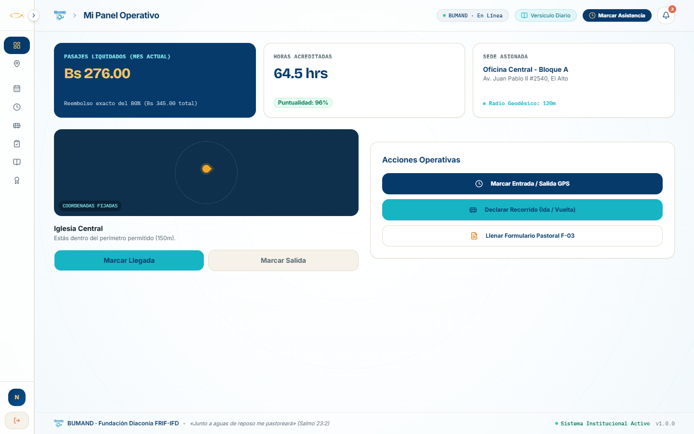

#### Propósito y Componentes
Página de bienvenida personal del estudiante becario:
- **Métricas Personales Inmediatas:**
  - *Pasajes Liquidados (Mes Actual):* Monto acumulado a favor (ej. Bs 276.00 correspondiente al 80% de Bs 345.00).
  - *Horas Acreditadas:* Avance del mes (ej. 64.5 hrs) y porcentaje de puntualidad (96%).
  - *Sede Asignada:* Dirección física y denominación oficial de su lugar de práctica.
- **Radar de Geocerca Satelital:** Componente visual con animación de ondas concéntricas que simula la fijación de coordenadas GPS y valida si el estudiante se encuentra dentro del radio permitido (150 m) para habilitar los botones de **Marcar Llegada** y **Marcar Salida**.
- **Acciones Operativas Principales:** Botones destacados para abrir los diálogos modales de **Declarar Recorrido (Ida / Vuelta)**, **Llenar Formulario Pastoral F-03** y **Consultar Versículo del Día**.

#### Qué Hace vs. Qué NO Hace
- **Qué Hace:**
  - Muestra en tiempo real el saldo acumulado por viáticos y el progreso hacia la meta horaria reglamentaria.
  - Impide la marcación si el sensor GPS detecta que el usuario está fuera de la geocerca permitida.
- **Qué NO Hace:**
  - No permite al becario modificar su sede asignada ni alterar su porcentaje de tolerancia geodésica.

---

### 5.2. Marcación de Horas de Práctica

#### Captura de Pantalla
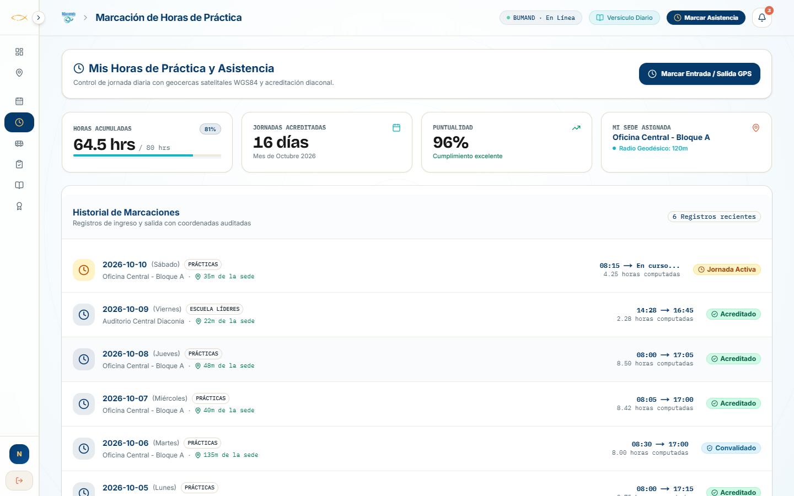

#### Propósito y Componentes
Formulario reactivo para la acreditación diaria de prácticas preprofesionales:
- Selección de fecha y hora exacta de ingreso con `SeleccionadorFechaHora`.
- Selección de fecha y hora estimada o efectiva de salida.
- Indicador de respaldo de geolocalización satelital WGS84.
- Envío directo a la base de datos central con `BotonConEstado` y confeti celebratorio.

#### Qué Hace vs. Qué NO Hace
- **Qué Hace:**
  - Registra las horas en la cuenta del estudiante y notifica a su supervisor asignado vía WebSocket.
- **Qué NO Hace:**
  - No permite registrar asistencias de días futuros.
  - No autoriza horas si la fecha de entrada es posterior a la de salida.

---

### 5.3. Declaración de Recorrido y Pasajes (80%)

#### Captura de Pantalla
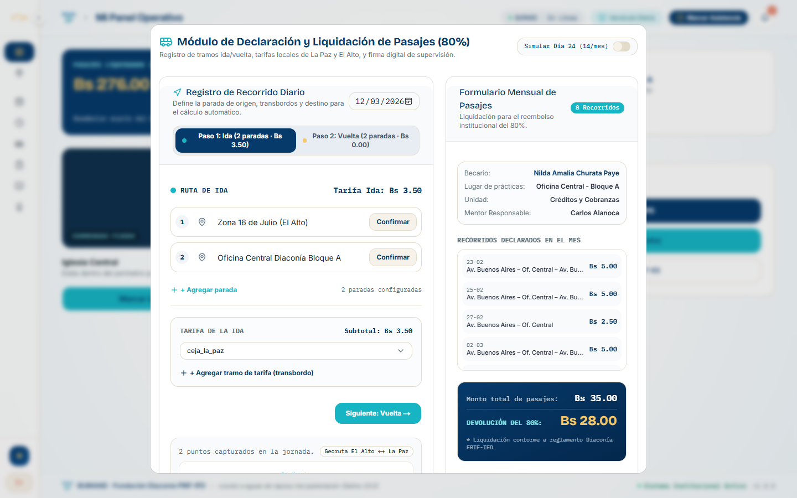

#### Propósito y Componentes
Diálogo modal con flujo guiado de dos etapas para declarar viajes urbanos:
- **Etapa 1 (Ida):** Fecha del viaje, punto de partida (domicilio/universidad), punto de llegada (sede/iglesia) y tarifa en bolivianos.
- **Transición Automática:** Al presionar "Continuar con Vuelta", el destino del tramo de ida se convierte automáticamente en el punto de partida del tramo de retorno.
- **Etapa 2 (Vuelta):** Ingreso de tarifa de retorno y cálculo automático del gasto global y del **80% exacto de devolución**.
- **Envío Protegido:** Envío respaldado con token JWT a la tabla de recorridos del mes.

#### Qué Hace vs. Qué NO Hace
- **Qué Hace:**
  - Calcula automáticamente en vivo: **Devolución = (Tarifa<sub>ida</sub> + Tarifa<sub>vuelta</sub>) × 0.80**.
  - Encadena los tramos geográficos para evitar saltos ilógicos de ubicación.
- **Qué NO Hace:**
  - No permite ingresar montos negativos o nulos.
  - No permite enviar la solicitud antes del día 24 del mes en curso según el reglamento normativo.

---

### 5.4. Formulario Pastoral F-03 Digitalizado

#### Captura de Pantalla
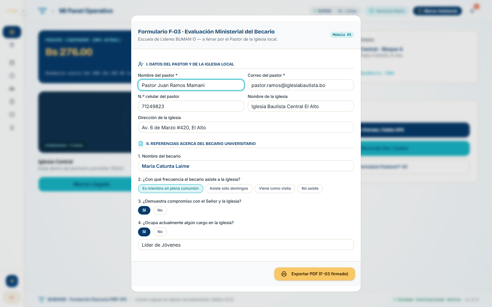

#### Propósito y Componentes
Digitalización del Formulario Pastoral F-03 para la evaluación del compromiso eclesiástico y diaconal:
- **Checklist de Competencias:** Cuestionario estandarizado con preguntas evaluativas:
  - *Puntualidad en asignaciones.*
  - *Responsabilidad en tareas delegadas.*
  - *Actitud de servicio y disposición cristiana.*
  - *Trabajo en equipo y compañerismo.*
- **Pastillas de Selección Rápida (Pills):** Opciones de selección única en formato botón: `Siempre`, `Casi Siempre`, `A veces`, `Nunca`.
- **Área Cualitativa:** Cuadro de texto para observaciones pastorales, testimonios y recomendaciones formativas.

#### Qué Hace vs. Qué NO Hace
- **Qué Hace:**
  - Recolecta las apreciaciones del pastor o del becario para alimentar el 25% de la Matriz 360°.
  - Valida que todas las preguntas del checklist cuenten con una opción seleccionada.
- **Qué NO Hace:**
  - No permite enviar formularios incompletos sin respuestas en los 4 criterios fundamentales.

---

### 5.5. Vida Devocional y Versículo del Día (RVR60)

#### Propósito y Componentes
Módulo de acompañamiento espiritual y formación del carácter diaconal:
- **Modal de Versículo Diario (`ModalVersiculoDiario`):** Diálogo interactivo emergente con cita bíblica, texto Reina-Valera 1960 (RVR60), tema formativo y reflexión de servicio diaconal.
- **Auto-Llenado Inteligente ("Usar para mi Devocional"):** Botón de acción rápida que transfiere la cita y el texto bíblico directamente al formulario de nuevo devocional.
- **Registro de Reflexión y Petición de Oración:** Formulario validado con `useFormularioValidado` para plasmar la meditación personal y necesidades de oración.
- **Respuesta y Retroalimentación Pastoral:** Visor de comentarios emitidos por el mentor o pastor de la congregación con señalización eclesiástica verde.

#### Qué Hace vs. Qué NO Hace
- **Qué Hace:**
  - Conecta con el backend en `/biblia/versiculo-diario` con respaldo de contingencia garantizado.
  - Premia el registro con confeti animado (`RafagaCelebracion`).
- **Qué NO Hace:**
  - No es una biblia interactiva completa; provee las lecturas y citas asignadas a la formación diaria.

---

## 6. Suite de Micro-Animaciones y Componentes Cult UI / Watermelon UI

La plataforma web incorpora primitivas de interacción de alta factura visual para transformar la experiencia administrativa en un entorno fluido y agradable:

1. **`BotonConEstado`:** Botón inteligente de 4 fases (`reposo`, `cargando`, `exito`, `error`) con halo radial reactivo al puntero, compresión táctil y ráfaga de confeti.
2. **`BotonHalo`:** Proyector de luz de fondo concéntrica que sigue el movimiento del ratón con precisión milimétrica.
3. **`InsigniaPulsoVivo`:** Badge semántico con onda concéntrica continua en 5 variantes cromáticas (azul, turquesa, esmeralda, ámbar, coral).
4. **`IslaDinamica`:** Banner flotante superior adaptable con física de resorte (`spring`) para notificaciones contextuales y avisos del sistema.
5. **`TarjetaSpotlight`:** Contenedor de tarjeta con iluminación focalizada perimetral.
6. **`BordeLuminoso`:** Efecto Border Beam canónico que recorre el contorno de tarjetas clave con degradado continuo.
7. **`ContadorRodilloAnimado`:** Number ticker numérico que rueda con suavidad hasta alcanzar el valor numérico exacto de KPIs.
8. **`TextoRevelado`:** Efecto cinematográfico de revelación letra por letra para títulos y migas de pan.

---

## 7. Resumen de Seguridad, Validaciones Técnicas y Cumplimiento

1. **Anti-Spoofing y Geocercas:** La plataforma integra validaciones geodésicas en el frontend y backend mediante la fórmula de Haversine sobre el elipsoide WGS84, contrastando la posición declarada con las coordenadas registradas de las sedes de Diaconía con un radio de tolerancia de 60 a 100 metros.
2. **Cálculo Financiero Exacto:** Todos los cálculos del 80% de viáticos se gestionan internamente en centavos enteros (`INTEGER`) para evitar imprecisiones de coma flotante en bases de datos financieras y auditorías bancarias.
3. **Firmas y Trazabilidad:** Las actas de evaluación se convalidan mediante firmas manuscritas digitalizadas en formato Canvas HTML5, codificadas en Base64 e inmutables una vez archivadas.
4. **Catálogo Unificado de Errores `ERR-NNNN`:** Mensajes amigables y remediación orientada al usuario en 6 dominios de fallo (Autenticación, Asistencia, Pasajes, Eventos, Red y Sistema).
5. **Comunicación Reactiva WebSocket:** Canal en tiempo real con Socket.IO para sincronizar asistencias, pasajes, justificaciones y notificaciones sin recargas de página.
6. **Respeto a las Normas de Código:** Toda la plataforma se encuentra programada en español riguroso, observando la convención de nomenclatura corporativa (`snake_case` para variables y atributos, `camelCase` para métodos, `PascalCase` para componentes y clases, y `kebab-case` para archivos del proyecto).

---
*Fin del Documento Técnico — Ecosistema BUMAND 2026*
