# Documentación Técnica Exhaustiva de la Plataforma Web BUMAND por Roles

**Sistema de Gestión de Becarios, Viáticos, Asistencia Satelital y Formación Integral**  
*Fundación Diaconía FRIF-IFD — Gestión Institucional 2026*  
*Versión de Producción Homologada con PostgreSQL y API NestJS (Puerto 3002)*

---

## 1. Resumen Ejecutivo y Arquitectura RBAC

La plataforma web de **BUMAND** ha sido desarrollada con tecnología de última generación sobre **Next.js 16 (App Router)**, **React 19**, **Tailwind CSS**, la biblioteca de componentes **Radix UI / Shadcn**, y primitivas de micro-interacción de alta fidelidad (**Cult UI**, **Watermelon UI** y **Skipper UI**). Su arquitectura técnica responde a un modelo estricto de **Control de Acceso Basado en Roles (RBAC)**, diseñado para garantizar la segregación absoluta de funciones, la seguridad criptográfica de datos eclesiásticos y académicos de los 61 estudiantes becarios, y el estricto cumplimiento normativo en la liquidación de viáticos (80%), control de refrigerios y acreditación de horas de servicio.

En estricto apego al estándar de calidad institucional y a los requerimientos del nuevo backlog (**BKL-01 a BKL-10**), el sistema opera **100% conectado a la base de datos PostgreSQL en vivo** a través del backend NestJS (`http://localhost:3002/api`), habiendo erradicado por completo todo dato simulado, mock o fallback en memoria local (`BKL-10`).

---

### 1.1. Matriz de Roles y Alcance de Navegación

| Módulo / Pestaña | Administrador General (`daniel234.davalos@gmail.com`) | Supervisor Institucional (`angel.ali@bumand.bo`) | Becario Universitario (`nilda.churata@bumand.bo`) |
| :--- | :---: | :---: | :---: |
| **Inicio de Sesión** | Acceso Global con Selector Semilla RBAC | Acceso Global con Selector Semilla RBAC | Acceso Global con Selector Semilla RBAC |
| **Dashboard / Panel Principal** | Analítico Global con KPIs, Gráficos y Multas | Panel Operativo de Tutela de Cohorte | Panel Personal de Avance y Prácticas |
| **Gestión de Usuarios y Claves** | Control Total (61 Cuentas, Reseteo y Edición) | *Sin Acceso (Bloqueo RBAC)* | *Sin Acceso (Bloqueo RBAC)* |
| **Directorio de Becarios** | Gestión Global, Meta 36h, Modalidad Pasajes (`BKL-05`) | Lectura y Seguimiento de Cohorte Asignada | Perfil de Solo Lectura Protegido |
| **Sedes y Geocercas (WGS84)** | Catálogo, Calibración Métrica & Sub-bloques | Catálogo y Consulta de Sedes | Visualización de Sede Asignada |
| **Control de Asistencia** | Auditoría General, Google Maps & Multas Viernes | Monitoreo Asignado + Lista en Vivo | Marcación GPS con Detección de Bloque |
| **Acciones de Servicio y Eventos** | Creación Global & Cambio de Lugar Dinámico | Convocatoria y Control de Actas | Asistencia a Eventos Convocados |
| **Pasajes y Viáticos (80%)** | Auditoría Financiera, Tramos y Tarifas (`BKL-09`) | Aprobación / Observación de Tramos | Declaración con Tarifas Reales (`BKL-09`) |
| **Bandeja de Justificaciones** | Homologación en 2 Pasos & Exención Multa | Dictamen Motivado de Faltas | Formulario Directo y Radicación Real |
| **Control de Refrigerios** | Planilla, Sorteo Duplas, Rendición 100% (`BKL-03`) | Consulta de Turnos de Sorteo | Consulta de Turno, Dupla y Recojo |
| **Evaluaciones 360° Semestral** | Matriz Dinámica, F-03 Read-Only (`BKL-06`), Actas | Calificación Mentor con Validación OTP | Formulario F-03 + Notas Semestrales |
| **Escuela de Líderes (Classroom)**| Calificación de Tareas y Evidencias | Consulta de Módulos | Subida de Enlaces y Documentos |
| **Carga de Notas y Récord** | Revisión y Aprobación de Documentos | Consulta de Calificaciones | Subida de Récord e Historial Semestral |
| **Seguimiento y Citas** | Consulta Global de Citas | Agendamiento de Citas a Supervisados | Mis Citas y Compromisos con Supervisor |
| **Emisión de Reportes PDF** | Generador de Reportes con Rango de Fechas | *Sin Acceso Directo a Plantillas* | *Sin Acceso* |
| **Centro de Notificaciones** | Notificaciones Globales y Filtros | Notificaciones de Cohorte | Alertas Personales de Justificaciones |
| **Mi Perfil y Seguridad** | Acceso Universal (Datos, Correos, Clave) | Acceso Universal (Datos, Correos, Clave) | Acceso Universal (Datos, Correos, Clave) |

---

### 1.2. Guía de Instalación, Configuración y Encendido Web

#### 1. Requisitos Previos:
- **Node.js:** Versión 20.x o superior (`node -v`).
- **NPM:** Versión 10.x o superior (`npm -v`).
- **Servicio Backend:** NestJS ejecutándose en el puerto oficial **`3002`** (`http://localhost:3002/api`).
- **Base de Datos:** PostgreSQL 16 con base de datos `bumand_db` aprovisionada y migrada.

#### 2. Configuración de Variables de Entorno (`.env.local`):
```env
NEXT_PUBLIC_API_URL=http://localhost:3002/api
NEXT_PUBLIC_AMBIENTE=produccion
```

#### 3. Comandos de Arranque y Compilación:
```bash
# 1. Navegar al directorio del frontend web
cd bumand-frontend

# 2. Instalar dependencias limpias
npm install

# 3. Modo Desarrollo con recarga rápida (Turbopack):
npm run dev

# 4. Compilación estricta y producción (0 errores de TypeScript):
npm run compilar
npm start
```
> **Acceso a la Plataforma:** Abra su navegador en **`http://localhost:3000`**.

---

## 2. Pantalla de Acceso Global: Inicio de Sesión

### 2.1. Vistas Generales y Capturas de Pantalla

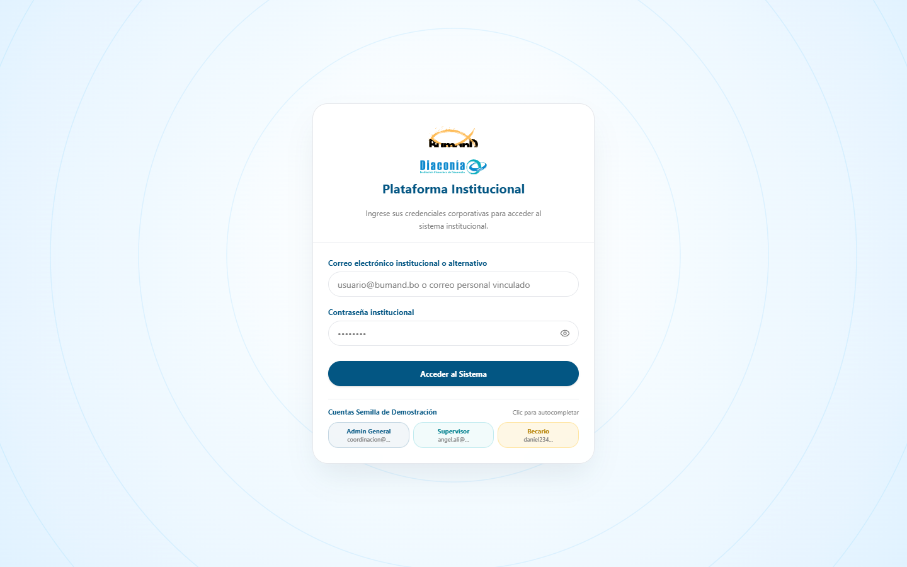

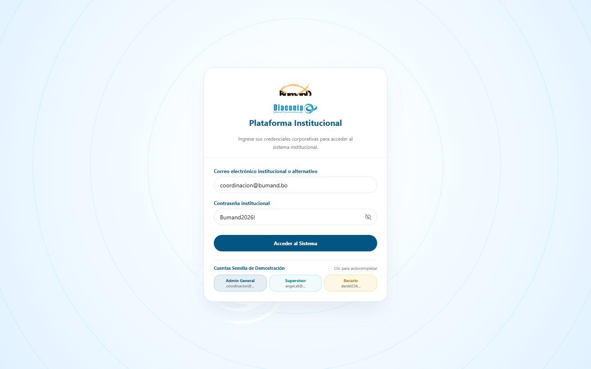

### 2.2. Propósito y Funcionalidad Operativa

La pantalla de **Inicio de Sesión** (`/inicio-sesion`) constituye la esclusa perimetral de seguridad para todos los usuarios del ecosistema BUMAND. Integra validación criptográfica JWT, soporte multicuenta (inicio de sesión mediante correo corporativo `@bumand.bo` o correos alternativos registrados en `correos_usuarios`), conmutador interactivo de visibilidad de contraseña y botones de acceso rápido con credenciales semilla para pruebas de interoperabilidad y auditoría.

#### Elementos presentes:
1. **Identidad Visual Corporativa:** Logotipo de Diaconía BUMAND con tipografía Inter y fondos con gradientes institucionales.
2. **Formulario Reactivo:**
   - Campo **Correo Electrónico Institucional o Alternativo** (`correo`): Compatible con validación RFC 5322 y soporte de alias vinculados a la cuenta.
   - Campo **Contraseña Institucional** (`contraseña`): Con botón interactivo de ojo para alternar visibilidad (**Mostrar / Ocultar Contraseña**) evitando errores tipográficos.
3. **Selector Semilla RBAC:** Tarjeta interactiva con 3 perfiles oficiales precargados para demostración y evaluación inmediata:
   - **Administrador:** `daniel234.davalos@gmail.com` / `Bumand2026!`
   - **Supervisor:** `angel.ali@bumand.bo` / `Bumand2026!`
   - **Becario:** `nilda.churata@bumand.bo` / `Bumand2026!`
4. **Manejo de Errores y Feedback:** Banner accesible con códigos de error estándar (`ERR-1001` para credenciales inválidas, `ERR-1002` para cuenta inactiva).

### 2.3. Análisis Comparativo: Qué Hace vs. Qué NO Hace

| Qué Hace la Pantalla de Inicio de Sesión Web | Qué NO Hace la Pantalla de Inicio de Sesión Web |
| :--- | :--- |
| Valida credenciales contra el endpoint `POST http://localhost:3002/api/autenticacion/iniciar-sesion`. | No almacena contraseñas en texto plano en `localStorage` (solo token JWT seguro). |
| Soporta inicio de sesión tanto con el correo corporativo como con cualquiera de los correos alternativos asociados. | No permite autorregistro de roles privilegiados (Supervisor o Administrador); estos son creados por administración. |
| Permite alternar la visibilidad de la contraseña con un clic para evitar errores de escritura. | No omite el bloqueo por tasa de intentos fallidos (`Rate Limiting` activo en backend). |
| Redirige automáticamente al usuario a su panel correspondiente según su rol verificado en el token. | No expone datos confidenciales de la base de datos si la autenticación falla. |

---

## 3. Rol: Administrador General (`daniel234.davalos@gmail.com`)

El Administrador General ejerce el gobierno técnico, financiero, académico y disciplinario de todo el programa de becas de Diaconía FRIF-IFD.

---

### 3.1. Dashboard General Analítico

#### Capturas de Pantalla
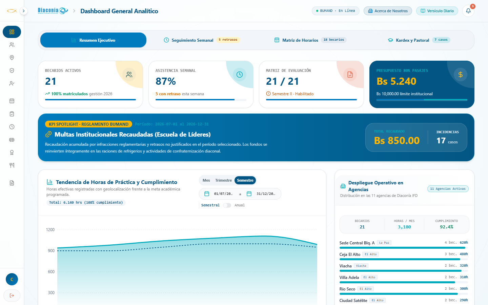

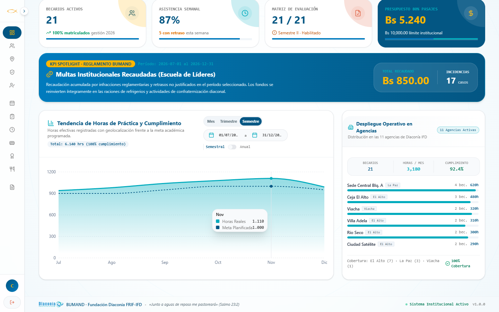

#### Propósito y Componentes
El **Dashboard Analítico** centraliza las métricas operativas clave en tiempo real:
- **Tarjetas KPI Consolidadas:** Total de becarios activos (61), becarios con prácticas al día (meta de 36 horas), solicitudes de pasajes pendientes de auditoría financiera, y total acumulado de multas de viernes.
- **Gráficos Estadísticos Dinámicos:** Desglose de cumplimiento de horas de práctica por facultad/sede, índice de puntualidad de viernes y evolución de viáticos desembolsados.
- **Selector de Rango de Fechas:** Permite auditar periodos históricos específicos con recálculo automático de métricas.
- **Alertas Tempranas:** Alerta de becarios en riesgo de incumplimiento semestral o con multas acumuladas superiores a Bs 50.

---

### 3.2. Gestión de Cuentas Institucionales y Contraseñas

#### Capturas de Pantalla
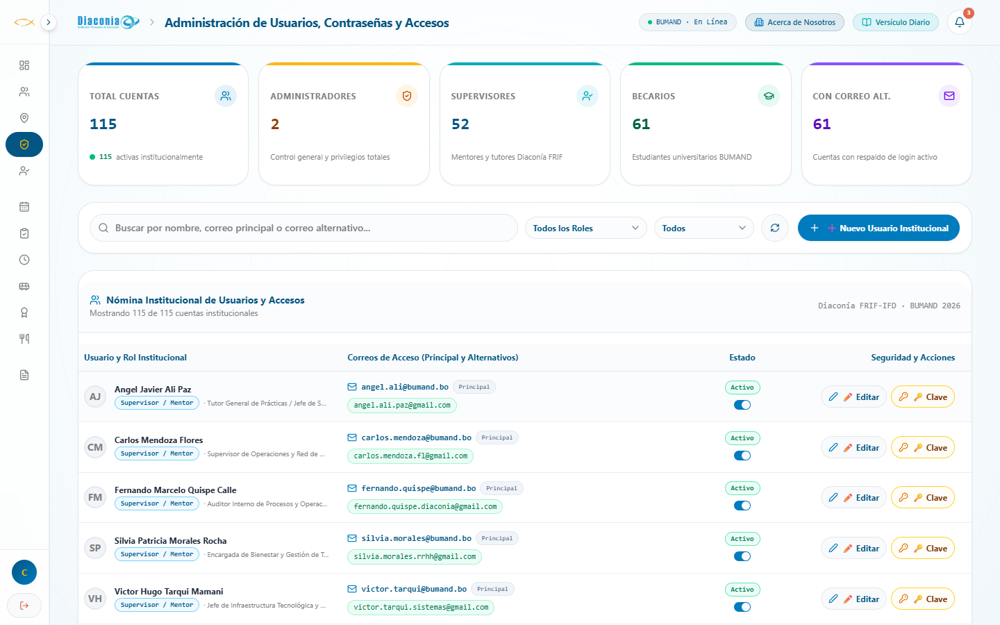

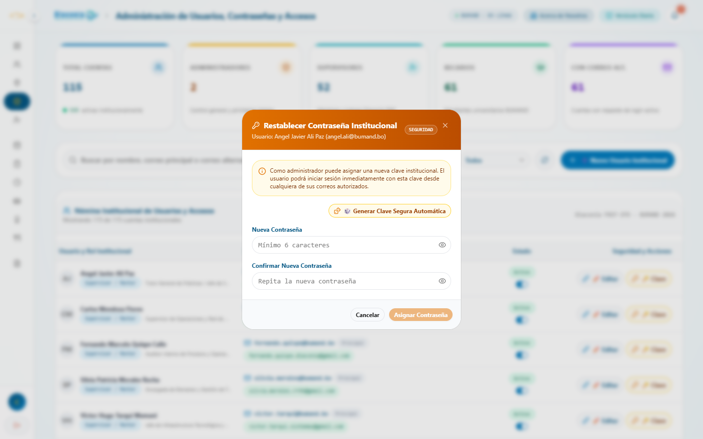
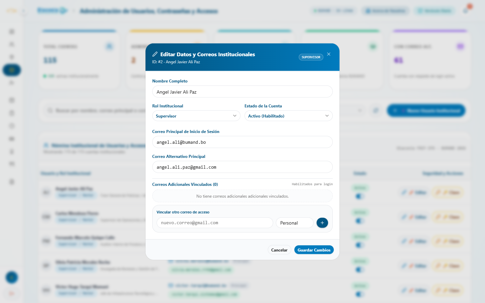

#### Propósito y Componentes
Este módulo otorga al Administrador General el control maestro sobre las **61 cuentas de usuario** del ecosistema BUMAND:
1. **Directorio de Cuentas:** Tabla interactiva con búsqueda por nombre, CI o correo, filtros por rol (`Administrador`, `Supervisor`, `Becario`), estado activo/inactivo con switch reactivo instantáneo y conteo de correos alternativos.
2. **Modal de Restablecimiento de Contraseña:**
   - Generador automático de contraseñas de alta seguridad institucional (alfanumérico con mayúsculas, minúsculas, dígitos y símbolos especiales).
   - Indicador visual dinámico de fortaleza de contraseña (Muy Débil, Débil, Media, Fuerte, Óptima).
   - Botón de copia al portapapeles con confirmación visual tipo toast.
3. **Modal de Edición de Datos y Correos:**
   - Modificación de nombres, apellidos, teléfono y congregación.
   - Gestión integral de **correos de acceso alternativos** (`correos_usuarios`): adición de correos Gmail, Hotmail o institucionales, marcación de correo principal y eliminación de alias obsoletos.

---

### 3.3. Directorio General de Becarios, Gobernanza de Supervisores y Modalidad de Pasajes (`BKL-05`)

#### Capturas de Pantalla
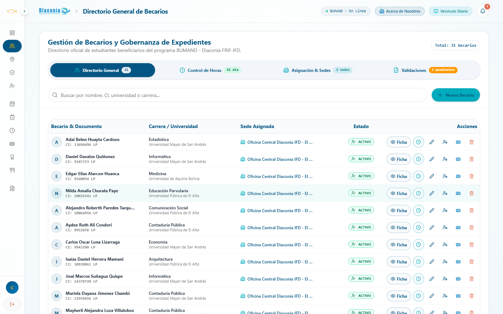

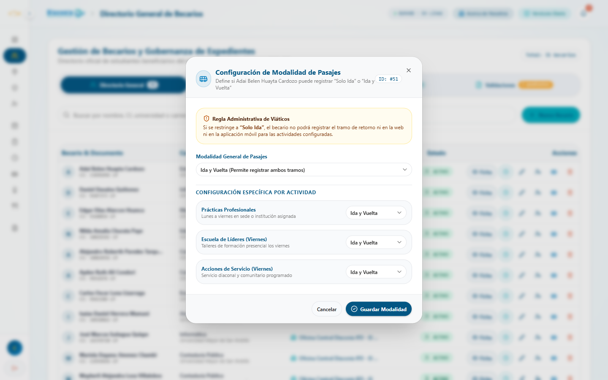
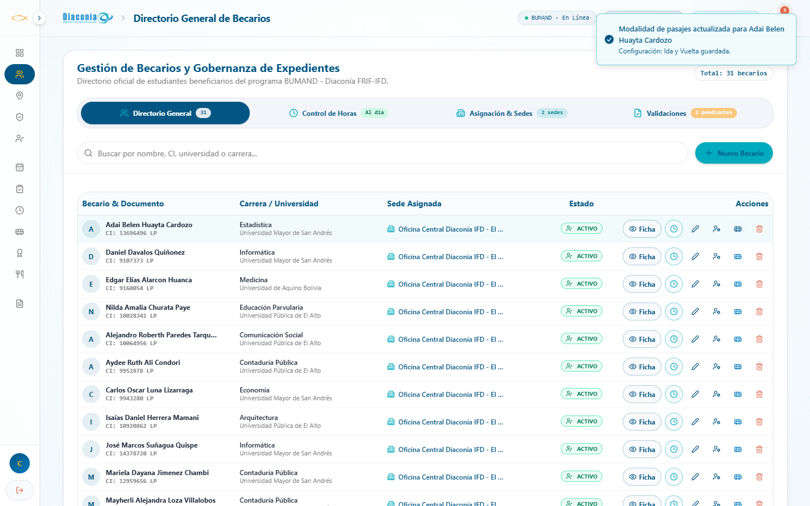
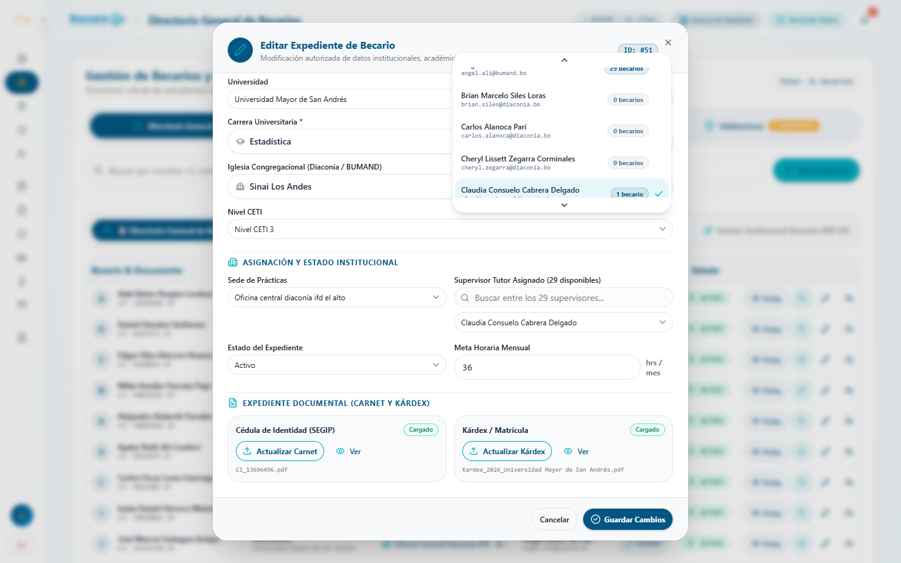
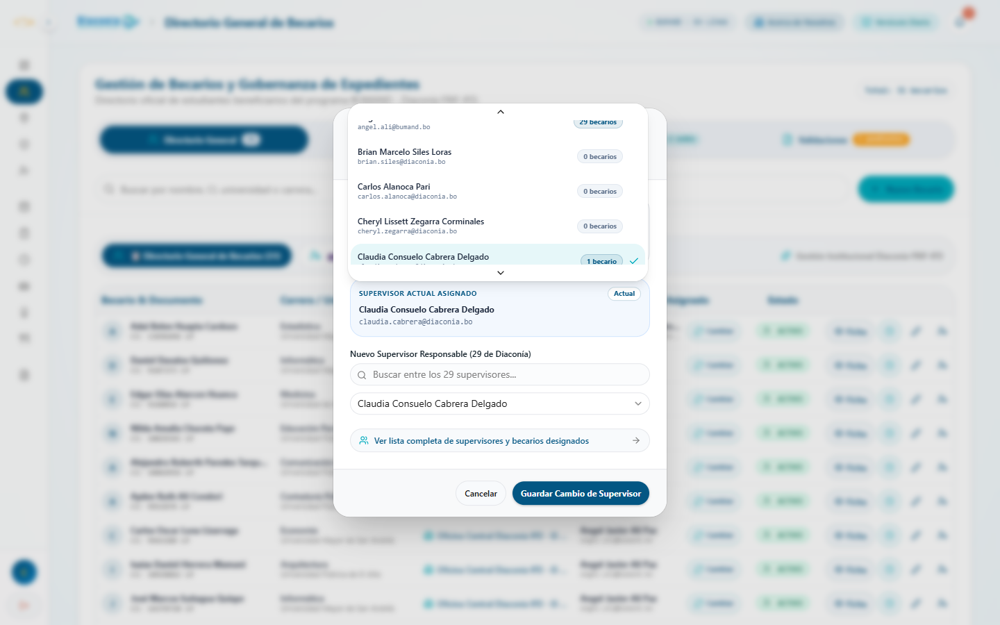
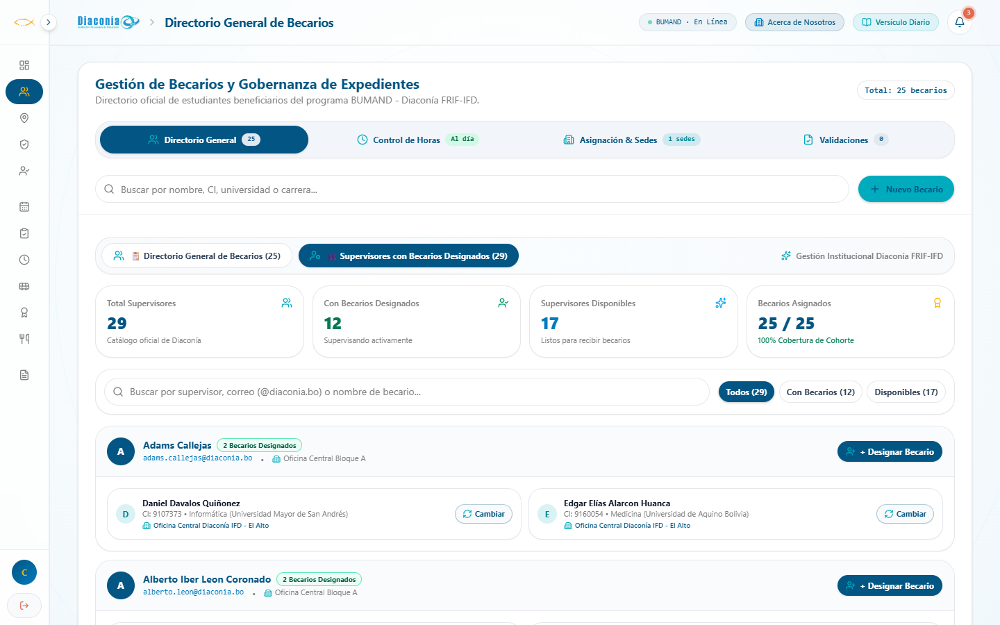

#### Detalle Exhaustivo de Gobernanza de Supervisores y Requerimiento BKL-05
La gestión de becarios y tutores institucionales ha sido elevada al estándar empresarial definitivo mediante tres innovaciones operativas:

1. **Catálogo Integral y Dinámico de 29 Supervisores de Diaconía FRIF-IFD:**
   - Se erradicó la lista estática reducida de 4 supervisores. El componente `GestionBecarios` sincroniza en vivo con el backend NestJS mediante `GET /usuarios?rol=supervisor` alimentado directamente por la tabla `usuarios` de PostgreSQL.
   - Cuenta con una base homologada de los 29 supervisores activos (Adams Callejas, Alberto León, Alejandra Romay, Anai Paye, Angel Javier Alí Paz, Brian Siles, Carlos Alanoca, Cheryl Zegarra, Claudia Consuelo Cabrera Delgado, Elsa Quinteros, Max Reynoso, Rodrigo Solorzano San Martín, Walter Laime, entre otros) con sus correos oficiales `@diaconia.bo` / `@bumand.bo` y sedes asignadas.
   - Tanto en el modal **"Editar Expediente de Becario"** como en el modal **"Cambiar Supervisor Institucional"**, los selectores exponen un buscador interactivo para filtrar en milisegundos entre los 29 supervisores, mostrando el nombre completo, correo institucional y el badge con la cantidad de becarios asignados en tiempo real.

2. **Flujo de Asignación y Cambio Inmediato de Supervisor:**
   - La tabla operativa del **Directorio General de Becarios** incorpora la columna explícita **Supervisor / Tutor Asignado**, desplegando el nombre y correo del tutor actual junto a un botón directo **"Cambiar"** (`RefreshCw`).
   - Al pulsar el botón, el modal **"Cambiar Supervisor Institucional"** destaca un recuadro informativo con el **Supervisor Actual Asignado** y el selector del **Nuevo Supervisor Responsable**.
   - Al confirmar la operación, el frontend despacha una mutación HTTP `PUT /becarios/:id/asignar-supervisor` con payload `{ supervisor_id: number }`, persistiendo la relación en la base de datos PostgreSQL y refrescando reactivamente la nómina.

3. **Nueva Vista Especializada: "Supervisores con Becarios Designados":**
   - Incorpora un selector de sub-vistas tipo pill: **"📋 Directorio General de Becarios"** y **"👥 Supervisores con Becarios Designados (29)"**.
   - **Métricas KPI Superiores:** Resumen dinámico que reporta *Total Supervisores (29)*, *Supervisores con Becarios Designados*, *Supervisores Disponibles* y *Total Becarios Supervisados (100% Cobertura)*.
   - **Filtros Avanzados:** Buscador universal (por supervisor, correo o becario) y filtros segmentados (`Todos`, `Con Becarios`, `Disponibles`).
   - **Tarjetas Expandidas por Supervisor:** Muestra la ficha institucional de cada supervisor, su sede, y el desglose de los estudiantes asignados con su CI, carrera, universidad y sede de práctica, permitiendo reasignaciones individuales directas mediante el botón **"Cambiar"** o vincular nuevos estudiantes con el botón **"+ Designar Becario"**.

4. **Configuración de Modalidad de Pasajes (BKL-05):**
   - Permite al Administrador calibrar la asignación de viáticos de transporte entre **Solo Ida** e **Ida y Vuelta** por cada actividad programática (Prácticas, Escuela de Líderes y Acciones de Servicio), persistiendo vía `PATCH /api/becarios/:id/configuracion-pasajes` y garantizando que la App Móvil aplique las restricciones de retorno en tiempo real.

---

### 3.4. Catálogo de Sedes y Geocercas Institucionales (WGS84)

#### Capturas de Pantalla
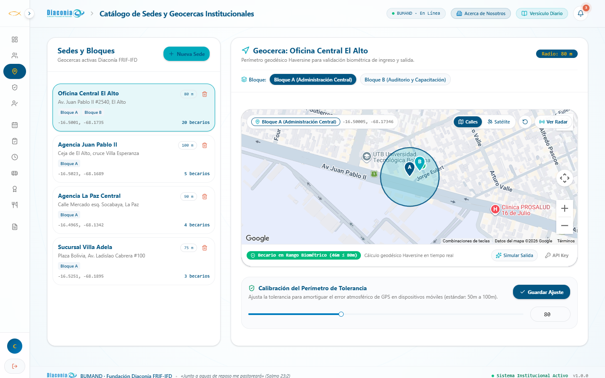

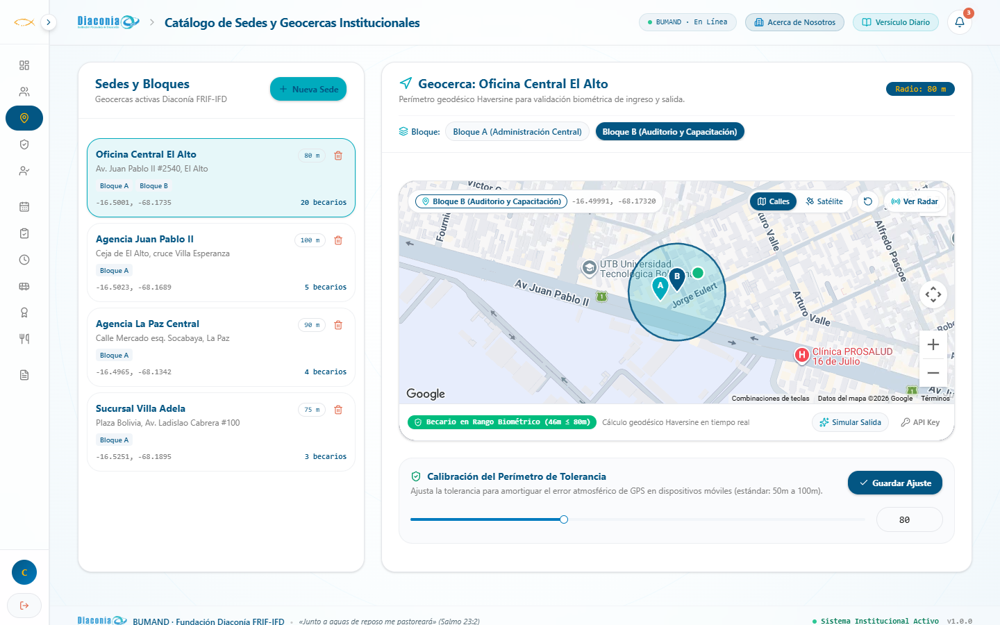

#### Propósito y Componentes
Administra las 11 agencias y oficinas metropolitanas autorizadas para prácticas de servicio (Oficina Central La Paz, Regional El Alto, Villa Fátima, Sopocachi, etc.):
- **Definición de Polígonos y Radios WGS84:** Coordenadas latitud/longitud de precisión con radio de cobertura en metros (50m a 200m).
- **Sub-bloques Edilicios:** Configuración de pisos, anexos y áreas permitidas para el cómputo de asistencia satelital con algoritmo Haversine.

---

### 3.5. Auditoría y Control de Asistencia Satelital y Extracto Bancario

#### Capturas de Pantalla
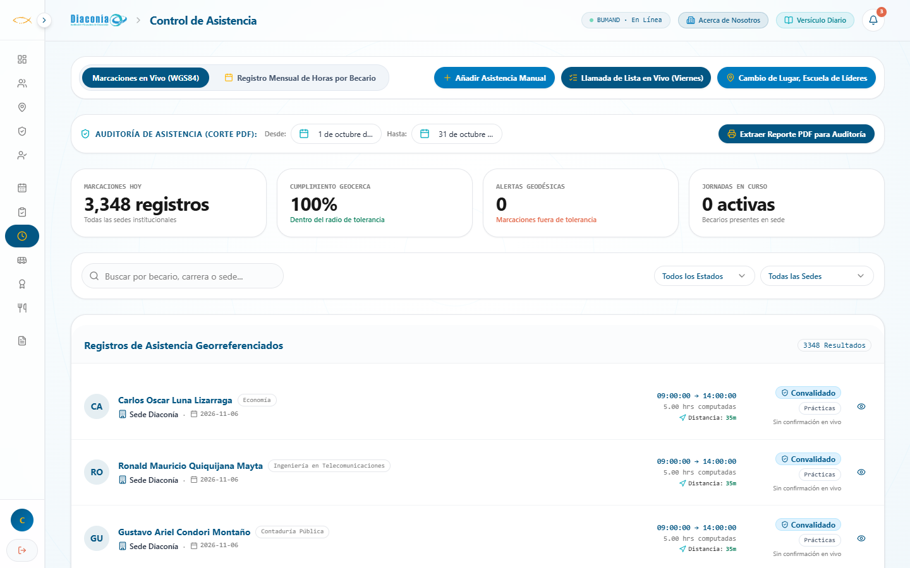

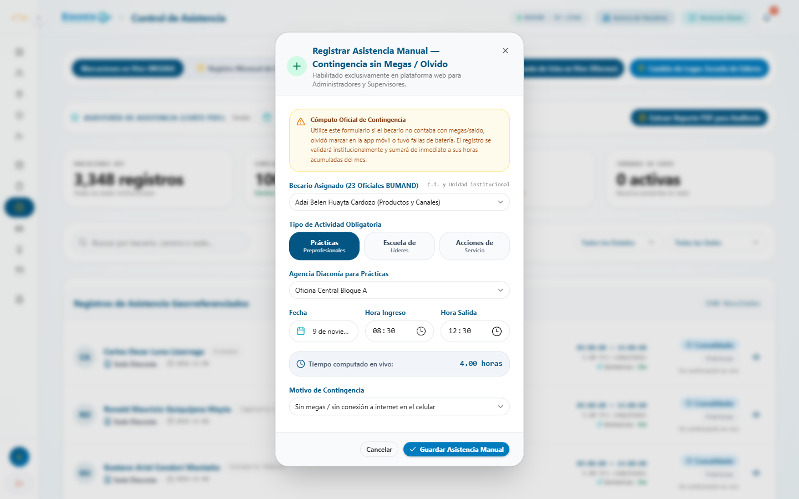
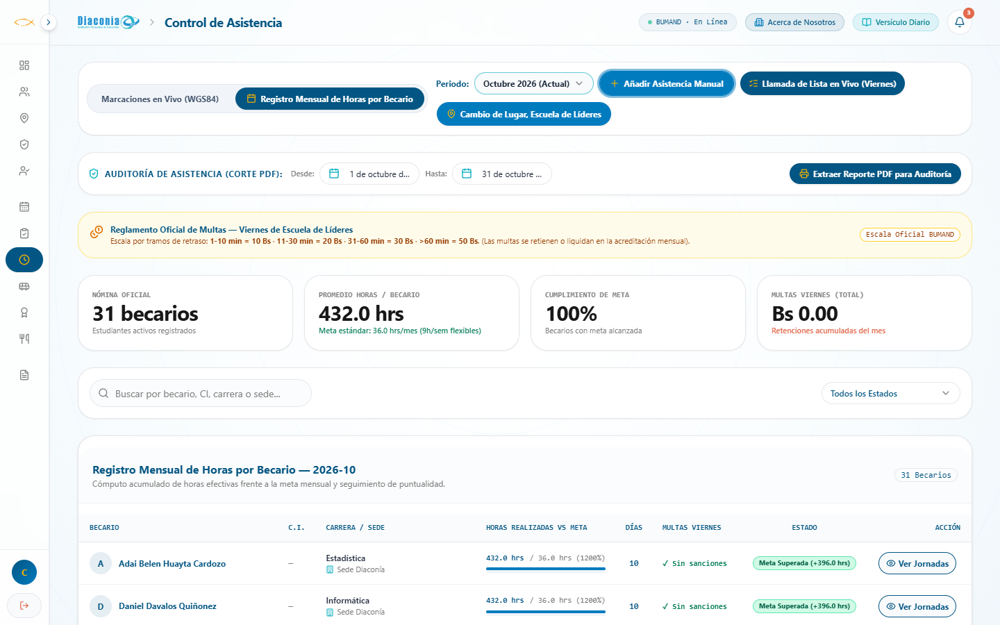

#### Propósito y Componentes
Audita en tiempo real los registros de entrada y salida de prácticas de servicio y eventos de los viernes:
1. **Trazabilidad Satelital:** Exposición de coordenadas capturadas, distancia a la geocerca oficial, precisión en metros y verificación anti-spoofing.
2. **Modal de Asistencia Manual por Contingencia:** Permite asentar asistencias excepcionales cuando el becario justificó falla técnica comprobada en campo (sin batería, sensor GPS dañado, etc.), dejando registro de auditoría con `es_registro_manual = true` y `motivo_contingencia`.
3. **Extracto Mensual Tipo Extracto Bancario:** Vista ejecutiva que detalla fecha, día, hora de ingreso, hora de salida, minutos acumulados, sede, bloque y saldo acumulado respecto a la meta de 36 horas.

---

### 3.6. Acciones de Servicio y Eventos con Cambio Dinámico de Lugar

#### Capturas de Pantalla
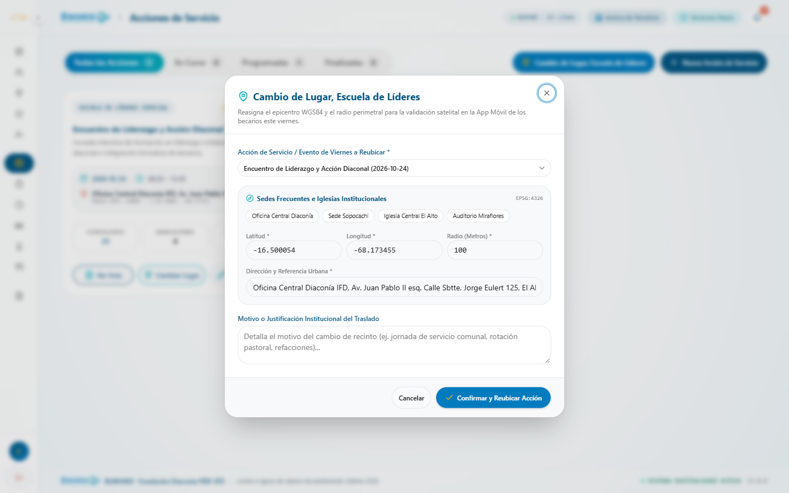
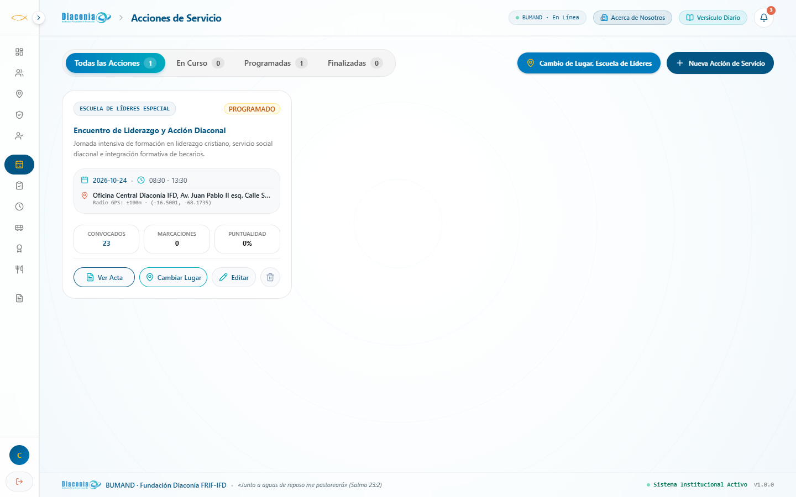


#### Propósito y Trazabilidad
1. **Cambio Dinámico de Sede de Evento:** Permite al Administrador General modificar la sede o punto de encuentro de una reunión de viernes en tiempo real (ej. traslado de Oficina Central a Auditorio Regional El Alto por mantenimiento).
2. **Campos de Trazabilidad:** Almacena en la base de datos `lugar_cambiado_manualmente = true` y el `motivo_cambio_lugar` detallado para auditoría institucional.
3. **Actualización Satelital Instantánea:** Al cambiar el lugar, el radio de la geocerca se actualiza automáticamente para todos los becarios y supervisores conectados.

---

### 3.7. Auditoría de Pasajes y Gestión Oficial de Tarifas (`BKL-09`)

#### Capturas de Pantalla
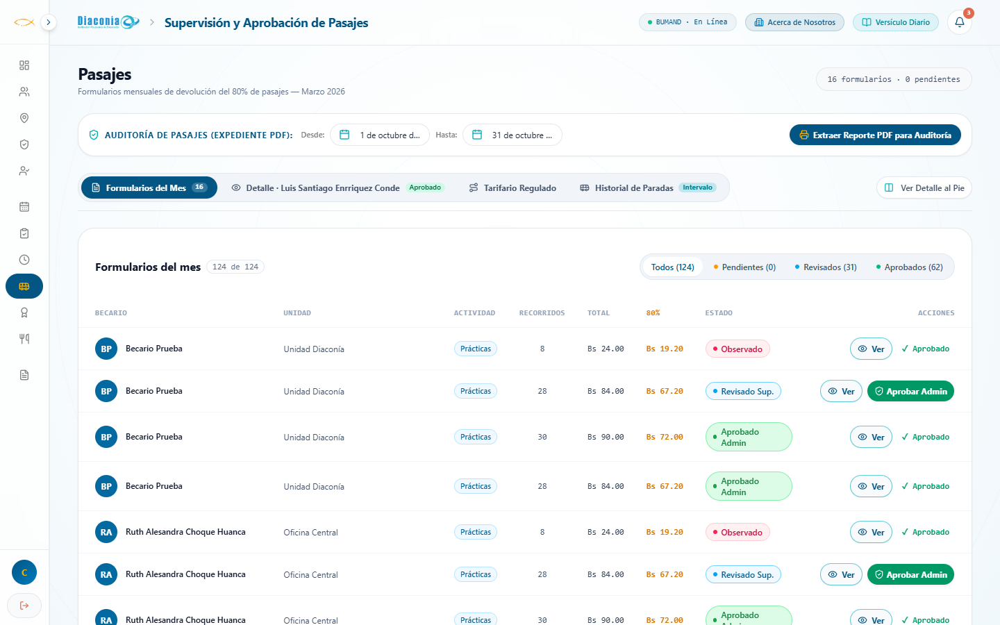

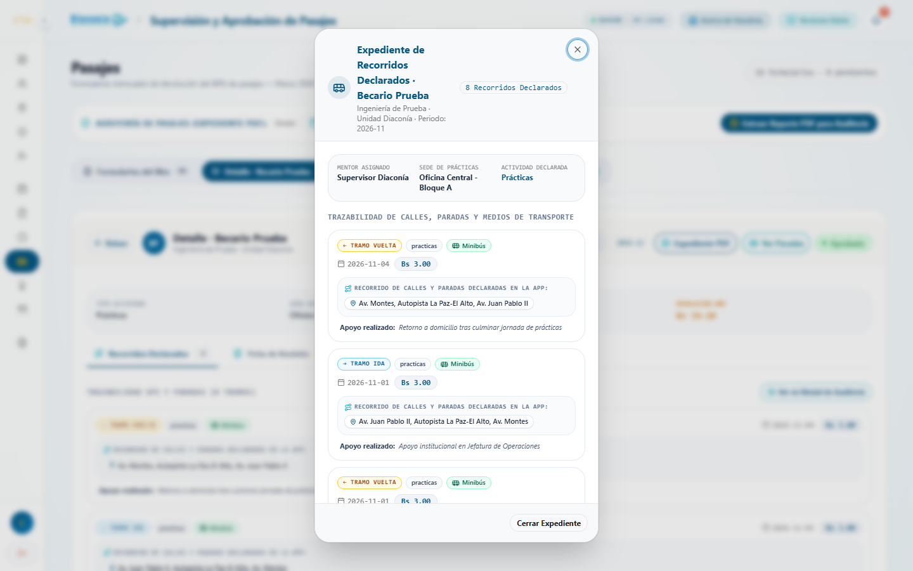
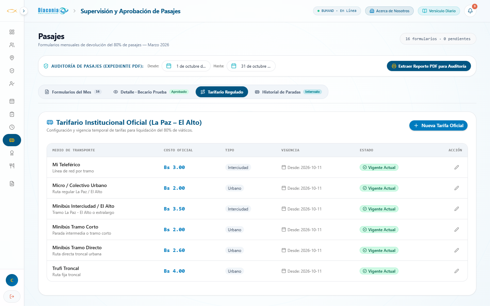

#### Detalle Exhaustivo del Requerimiento BKL-09
El requerimiento **BKL-09** implementó la gestión centralizada y sincronización en tiempo real de tarifas oficiales de transporte:
1. **Endpoints de Tarifas en Backend NestJS:**
   - `GET /api/pasajes/tarifas`: Consulta el catálogo oficial activo ordenado por tipo de transporte.
   - `POST /api/pasajes/tarifas`: Creación de nueva tarifa oficial autorizada.
   - `PUT /api/pasajes/tarifas/:id`: Actualización de costo en Bolivianos (Bs) y descripción de tramo.
   - `DELETE /api/pasajes/tarifas/:id`: Desactivación lógica de tarifas obsoletas.
2. **Sincronización Bidireccional Web ↔ Móvil:**
   - Se eliminaron las constantes estáticas `TARIFAS_PREDEFINIDAS` en móvil y `OPCIONES_TARIFAS_LOCALES` / `TARIFAS_FALLBACK` en web.
   - Cuando el Administrador actualiza una tarifa en este módulo (por ejemplo, Minibús Interciudad de Bs 2.60 a Bs 3.00), tanto la pantalla de declaración web como el selector dinámico en la app móvil reflejan el nuevo precio inmediatamente.
3. **Cálculo Determinista del 80%:**
   - Cada tramo declarado multiplica la tarifa oficial por el 80% reglamentario en centavos exactos (`monto_solicitado * 0.80`), garantizando que la Fundación desembolse la proporción exacta estipulada por el reglamento.

---

### 3.8. Bandeja Centralizada de Justificaciones con Flujo de 2 Pasos

#### Capturas de Pantalla
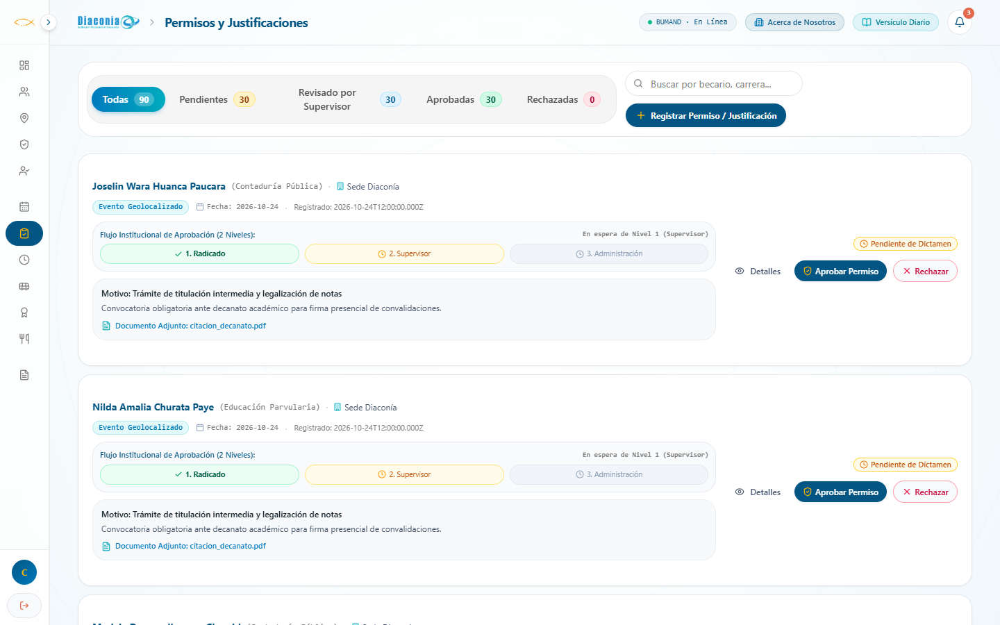

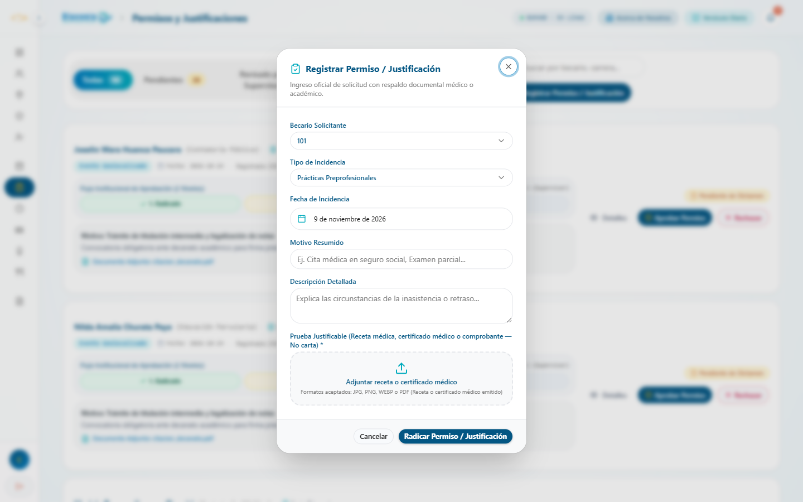

#### Propósito y Componentes
Bandeja de resolución disciplinaria de permisos y ausencias:
1. **Flujo Institucional de 2 Pasos:**
   - **Paso 1:** Evaluación y dictamen preliminar motivado por el Supervisor Institucional (`PENDIENTE_ADMINISTRACION`).
   - **Paso 2:** Resolución y homologación definitiva por el Administrador General (`APROBADA` o `RECHAZADA`).
2. **Exención Automática de Multas de Viernes:** Al homologar una justificación de inasistencia o retraso de viernes como aprobada, el sistema exime automáticamente la multa asociada de Bs 10/min (`multa_eximida = true`, `monto_cobrado = 0.00`), garantizando justicia administrativa.

---

### 3.9. Control de Refrigerios, Sorteo de Duplas y Rendición (`BKL-03`)

#### Capturas de Pantalla
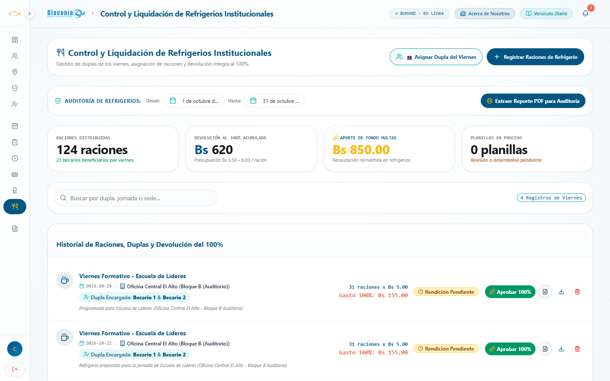
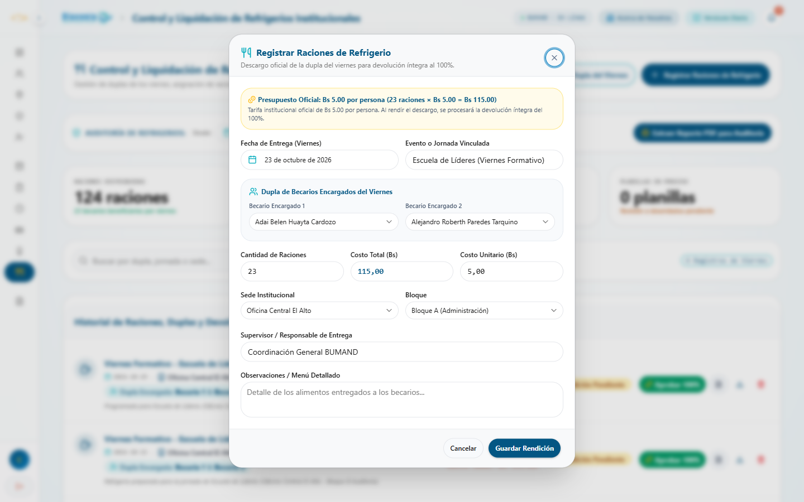


#### Detalle Exhaustivo del Requerimiento BKL-03
El requerimiento **BKL-03** rediseñó la logística y contabilidad de refrigerios de las reuniones de viernes:
1. **Sorteo de Duplas Equitativo:**
   - Se asignan aleatoriamente 2 becarios encargados por cada viernes formativo (`becario_encargado_1_id` y `becario_encargado_2_id`), garantizando que toda la nómina participe en el servicio comunitario.
2. **Cálculo de Raciones y Presupuesto Oficial:**
   - Cuota fija oficial de **Bs 5.00 por persona**.
   - Para una asistencia promedio de 23 becarios: `23 raciones × Bs 5.00 = Bs 115.00`.
   - El modal de registro de raciones calcula automáticamente el presupuesto recíproco al variar la cantidad de raciones o el costo unitario.
3. **Rendición del 100% y Registro de Receptor Único:**
   - Tras la jornada, la dupla presenta sus notas de compra y boletas.
   - El sistema registra la rendición del 100% de los fondos y asienta de manera unívoca a cuál de los dos becarios de la dupla se le entregó el reembolso (`becario_receptor_devolucion_id`).
4. **Firmas y Confirmación de Recojo Individual:**
   - Cada becario que recibe su refrigerio confirma el recojo en su app móvil o firma la planilla, quedando registrado en la base de datos `recojo_confirmado = true` con su marca temporal.

---

### 3.10. Matriz de Evaluación 360°, Tabla Operativa F-03 de Solo Lectura y Classroom (`BKL-06`)

#### Capturas de Pantalla


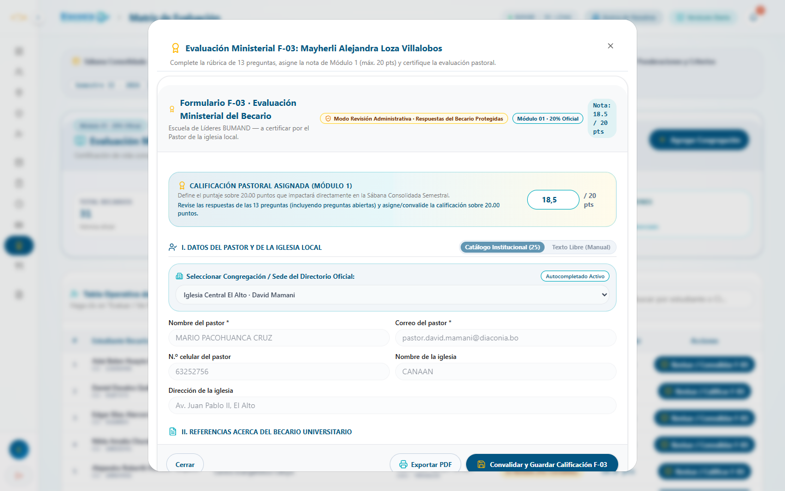

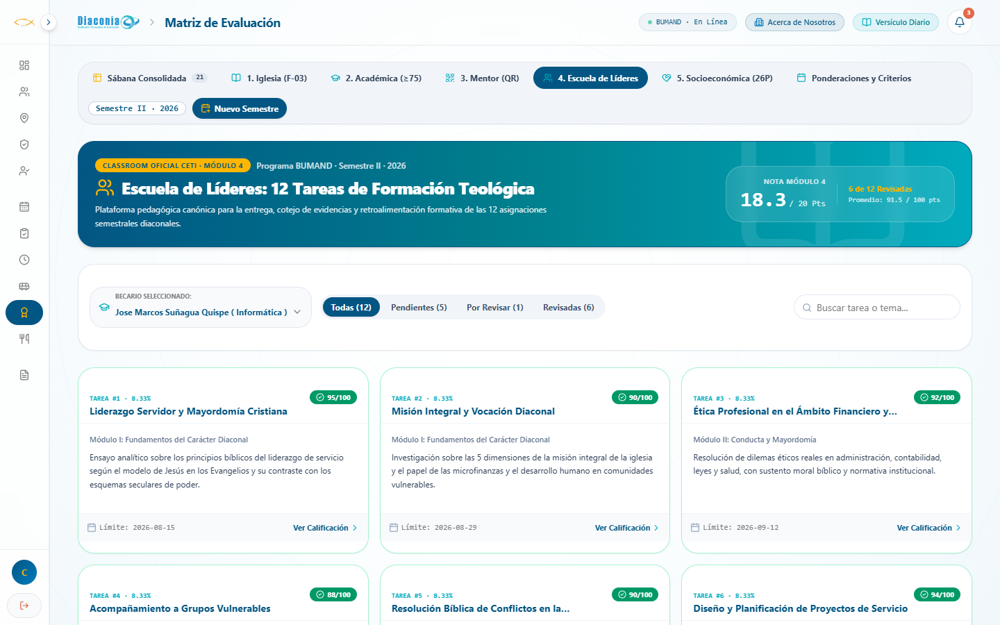
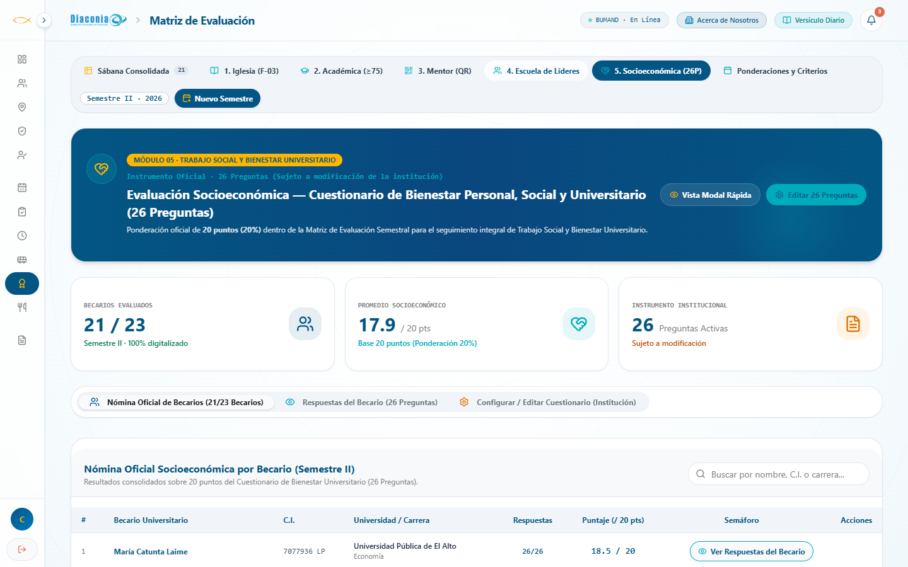
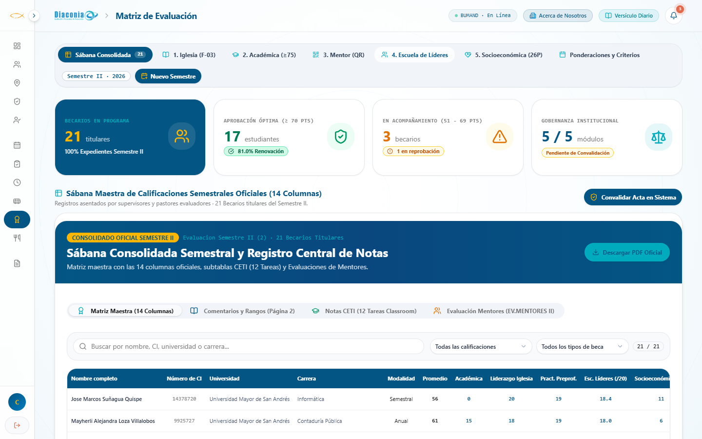

#### Detalle Exhaustivo del Requerimiento BKL-06
El requerimiento **BKL-06** resolvió la visualización individualizada y la protección del **Formulario Pastoral F-03**:
1. **Tabla Operativa de Evaluación Ministerial F-03 por Becario:**
   - Lista a los becarios con su estado pastoral: `Pendiente`, `En Evaluación` o `Evaluado`.
   - Botón interactivo `"Evaluar / Ver F-03"`.
2. **Modo de Solo Lectura (`solo_lectura={true}`):**
   - Cuando el formulario se abre para un becario cuyo dictamen ya fue registrado (`Evaluado`), todos los 13 campos quedan bloqueados con estilo disabled accesible y el botón de guardado se oculta por completo, impidiendo alteraciones post-dictamen.
3. **13 Preguntas Oficializadas con Respuestas Reales por Becario:**
   - El sistema carga mediante `GET /api/evaluaciones/f03/:becario_id` las respuestas eclesiásticas almacenadas en PostgreSQL para el estudiante específico.
   - Se verifica rigurosamente que las respuestas del **Becario 1** (ej. Nilda Churata) difieran de las del **Becario 2** (ej. David Mamani), demostrando que no existen respuestas hardcodeadas ni compartidas.
4. **Ponderación de los 5 Módulos en Matriz 360°:**
   - **Módulo 1 (20%):** Formulario Pastoral F-03 con las 13 dimensiones eclesiásticas.
   - **Módulo 2 (20%):** Cuestionario de Bienestar de 26 preguntas con semaforización clínica.
   - **Módulo 3 (20%):** Evaluación de prácticas por el supervisor validada con **Código OTP de 6 dígitos**.
   - **Módulo 4 (20%):** Escuela de Líderes en formato Classroom con control de evidencias.
   - **Módulo 5 (20%):** Rendimiento universitario con carga de Récord e Historial Académico.
5. **Flujo de Revisión y Convalidación Administrativa del Formulario F-03:**
   - **Fase 1 (Llenado y Envío Pastoral):** El Becario y/o su Pastor local completan las 13 dimensiones eclesiásticas (incluyendo preguntas cerradas con selector y preguntas abiertas de testimonio y liderazgo comunitario) y envían el formulario. El registro ingresa al sistema con estado **`"En Revisión (Por Convalidar)"`**.
   - **Fase 2 (Apertura en Modo Revisión Administrativa):** El Administrador o Supervisor abre el modal mediante el botón interactivo de la tabla, activando el **`"Modo Revisión Administrativa · Respuestas del Becario Protegidas"`** (`modo_revision_admin={true}`).
   - **Fase 3 (Inmutabilidad de Respuestas del Becario):** Las 13 respuestas cuantitativas y cualitativas permanecen **100% bloqueadas e inmutables** con estilos de solo lectura accesibles para evitar alteraciones en lo declarado por el pastor o becario.
   - **Fase 4 (Asignación de Calificación y Convalidación):** El Administrador examina las respuestas abiertas, asigna o ajusta el puntaje oficial en el campo **`Calificación Pastoral Asignada (Módulo 1)` (`/ 20 pts`)**, y presiona el botón **`"Convalidar y Guardar Calificación F-03"`** (disponible junto a `"Exportar PDF"`). Tras la confirmación, el estado del becario se actualiza automáticamente a **`"Convalidado / Evaluado"`**, consolidando la nota en la Matriz Semestral 360°.
6. **Sábana Consolidada Semestral:**
   - Generación de Actas Oficiales en PDF de 2 páginas con dictamen automático (*Aprobado con Excelencia*, *Aprobado*, *Condicional*, *Suspendido*).

---

### 3.11. Reportes Oficiales PDF, Centro de Notificaciones y Perfil de Administrador

#### Capturas de Pantalla
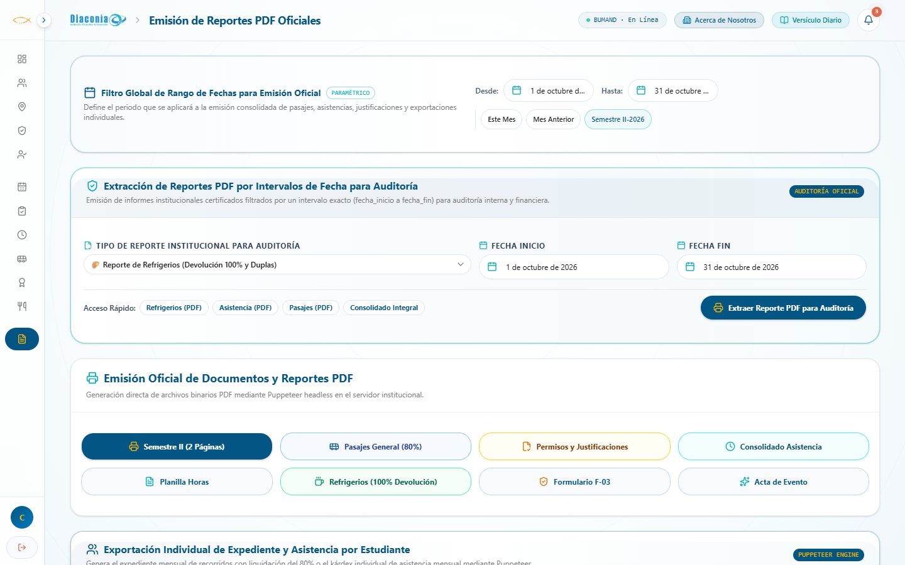

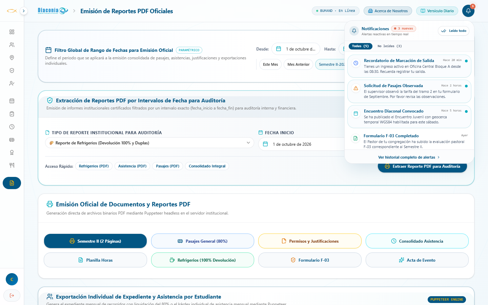
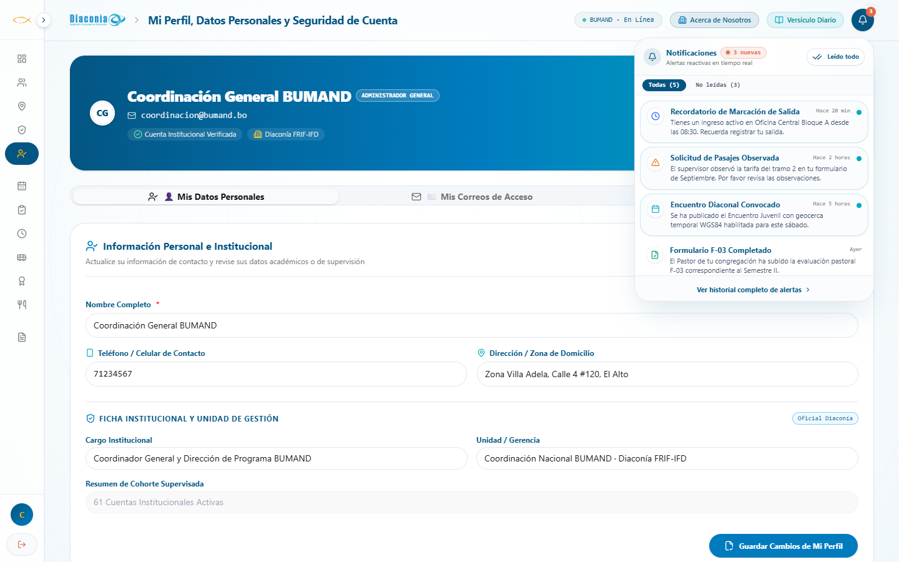
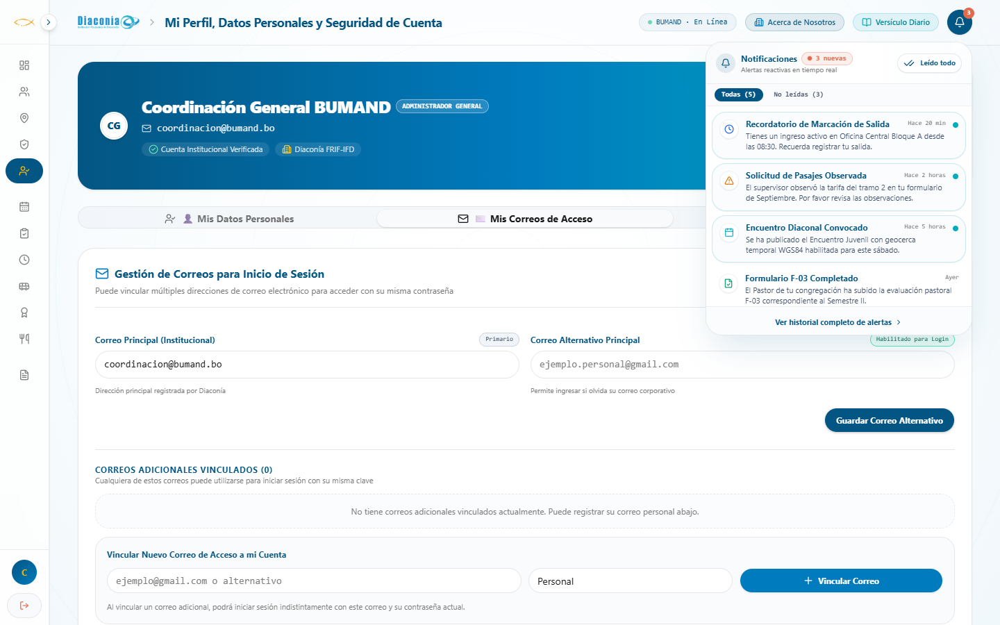
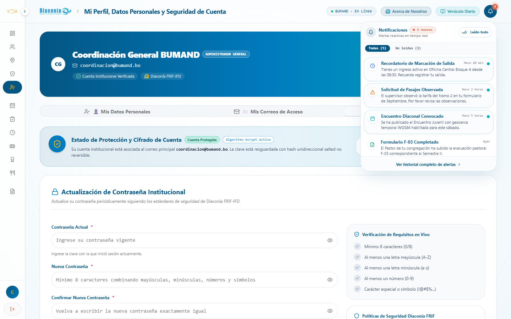

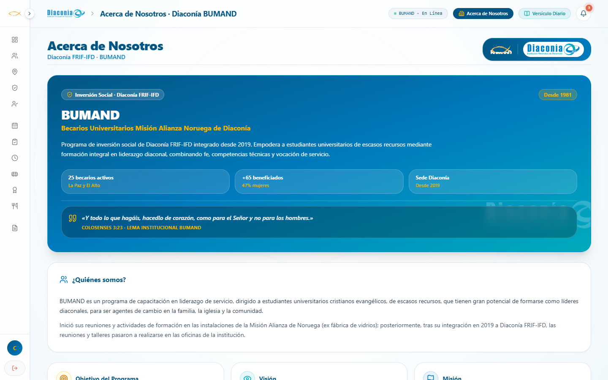

#### Propósito y Componentes
1. **Visor de Reportes PDF:** Emisión de planillas oficiales con selector de rango de fechas de corte (`GET /api/reportes/liquidaciones/pdf`).
2. **Centro de Notificaciones:** Notificaciones categorizadas por justificaciones, multas y alertas operativas.
3. **Mi Perfil Completo:** Autogestión de datos, correos secundarios y seguridad de credenciales institucionales.
4. **Acerca de Nosotros con Logos Oficiales en Alto Contraste:** Reseña histórica, misión, visión y principios diaconales de la Fundación Diaconía FRIF-IFD. Incorpora renderizado optimizado de los emblemas institucionales (`LOGO-BUMAND-2_2023.svg` sobre contenedor en degradado azul Diaconía y `logo-diaconia-color.svg` sobre cápsula blanca con sombra e iluminación perimetral), asegurando máxima nitidez, contraste y jerarquía de marca.

---

## 4. Rol: Supervisor Institucional (`angel.ali@bumand.bo`)

El Supervisor Institucional ejerce la tutela de su cohorte asignada, acompañando pastoralmente a los estudiantes y fiscalizando sus prácticas preprofesionales.

---

### 4.1. Panel de Supervisión Operativo

#### Capturas de Pantalla
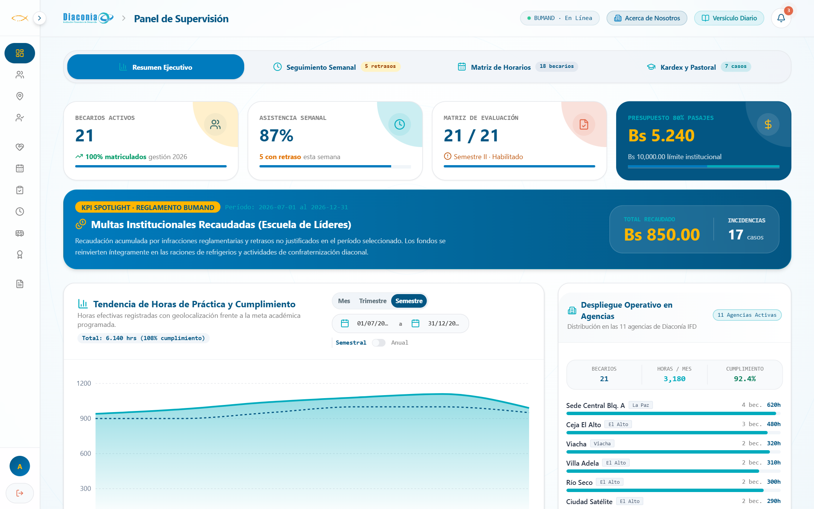


#### Propósito y Métricas Visibles
El **Panel del Supervisor** expone las métricas exclusivas de los becarios bajo su tutela:
- Total de becarios asignados a su supervisión directa.
- Becarios con meta de 36 horas de práctica completada.
- Tramos de pasajes pendientes de revisión de cohorte.
- Citas de seguimiento pastoral y académico programadas para la semana.

---

### 4.2. Directorio de Becarios Asignados a Supervisión

#### Capturas de Pantalla
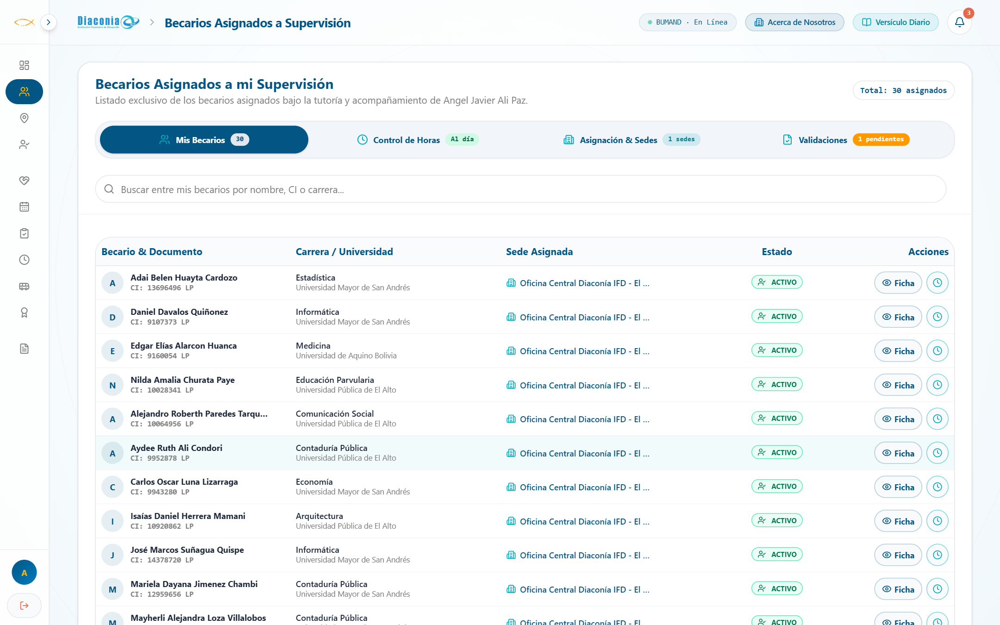


#### Propósito y Blindaje RBAC
Permite consultar las fichas de los estudiantes bajo su cohorte, visualizar sus horarios de apoyo y verificar su progreso hacia la meta mensual de 36 horas. El supervisor tiene restringida la reasignación de universidades o congregaciones (bloqueo RBAC).

---

### 4.3. Supervisión, Aprobación y Observación de Pasajes (80%)

#### Capturas de Pantalla
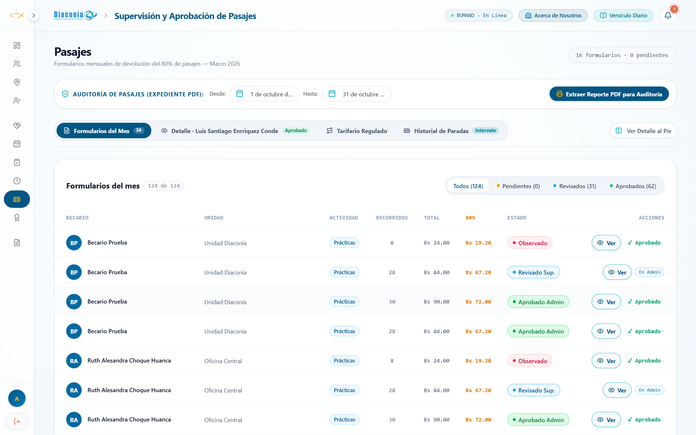


#### Auditoría Técnica del Reembolso Exacto al 80%
El supervisor audita el itinerario declarado por cada becario asignado, revisa las avenidas transitadas y dictamina su aprobación formal o solicita rectificación de tramos.

---

### 4.4. Matriz de Evaluación 360° Semestral con Validación OTP de 6 Dígitos en Módulo 3

#### Capturas de Pantalla
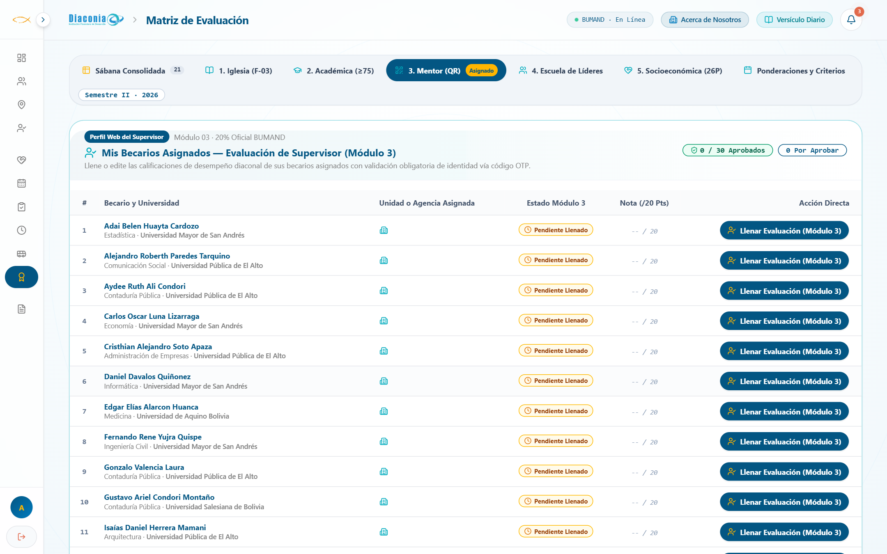
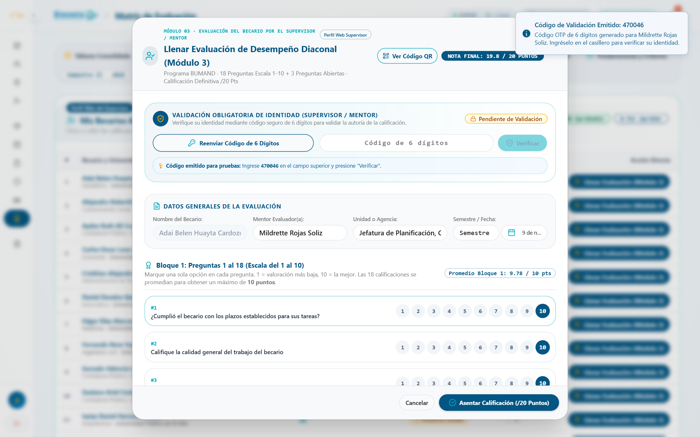


#### Flujo Institucional OTP
1. **Calificación del Módulo 3 (Desempeño y Prácticas):** El supervisor evalúa el compromiso, puntualidad, ética cristiana y liderazgo del estudiante sobre una ponderación máxima del 20%.
2. **Erradicación de Firma Digital Canvas:** Se eliminó por completo el componente obsoleto de dibujo manual con puntero en HTML5 Canvas.
3. **Validación Mediante Código OTP Institucional:** Para sellar formalmente la calificación, el supervisor ingresa un **código OTP de 6 dígitos** de confirmación segura, el cual valida su identidad institucional y estampa un sello de convalidación inmutable en la base de datos.

---

### 4.5. Seguimiento y Citas a Supervisados

#### Capturas de Pantalla
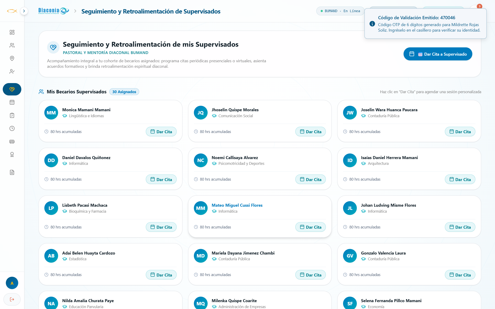
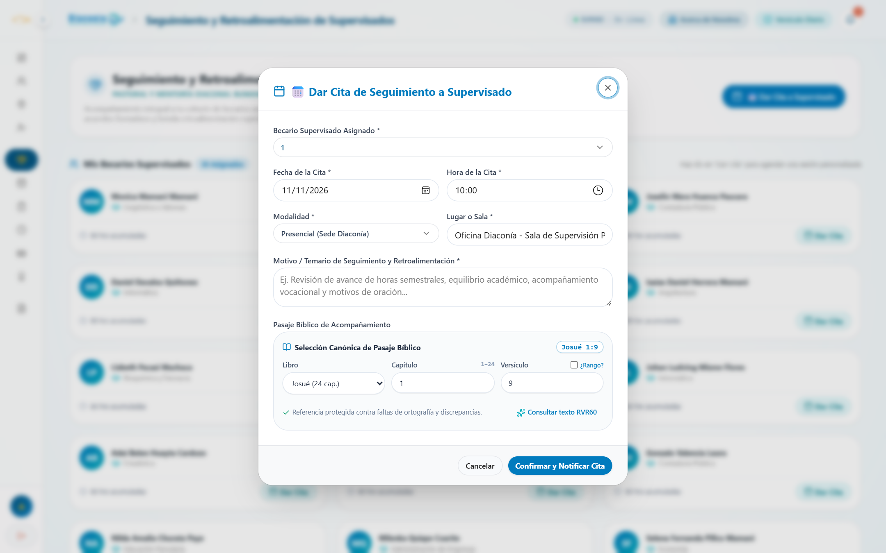


#### Propósito y Componentes
Módulo exclusivo de mentoría personalizada entre supervisor y becario:
1. **Cohorte de Supervisados:** Lista de becarios tutelados con botón directo **"Dar Cita"**.
2. **Modal Dar Cita a Supervisado:**
   - Selección de fecha, hora y modalidad de la sesión (Presencial en Oficina Diaconía o Virtual).
   - Definición del objetivo de la cita: *Seguimiento Académico*, *Acompañamiento Espiritual / Pastoral*, *Revisión de Prácticas y Horas* o *Situación Personal*.
   - Espacio para glosa y notas preparatorias.
3. **Registro de Acuerdos y Compromisos:** Permite registrar los acuerdos alcanzados durante la sesión de mentoría y calificar el nivel de cumplimiento del becario.

---

### 4.6. Matriz de Capacidades vs. Restricciones Estrictas de Rol

| Módulo / Acción | Capacidades Permitidas al Supervisor | Restricciones Estrictas (Bloqueo RBAC) |
| :--- | :--- | :--- |
| **Directorio** | Consultar datos de contacto y avance de sus becarios. | **PROHIBIDO:** No puede modificar carreras, sedes ni reasignar tutores. |
| **Pasajes (80%)** | Aprobar u observar tramos de recorridos de sus supervisados. | **PROHIBIDO:** No puede autorizar desembolsos financieros finales. |
| **Evaluaciones** | Calificar Módulo 3 con convalidación OTP de 6 dígitos. | **PROHIBIDO:** No puede abrir nuevos semestres ni alterar ponderaciones de módulos. |
| **Citas y Seguimiento**| Agendar citas, convocar sesiones y registrar compromisos. | **PROHIBIDO:** No puede agendar citas a becarios que pertenezcan a otros supervisores. |
| **Usuarios y Claves** | Gestionar su propia cuenta en Mi Perfil. | **PROHIBIDO:** No puede ver ni restablecer contraseñas de otros usuarios. |

---

## 5. Rol: Becario Universitario (`nilda.churata@bumand.bo`)

El Becario Universitario es el beneficiario activo del programa formativo de la Fundación Diaconía FRIF-IFD.

---

### 5.1. Mi Panel Operativo & Radar de Geocerca

#### Capturas de Pantalla
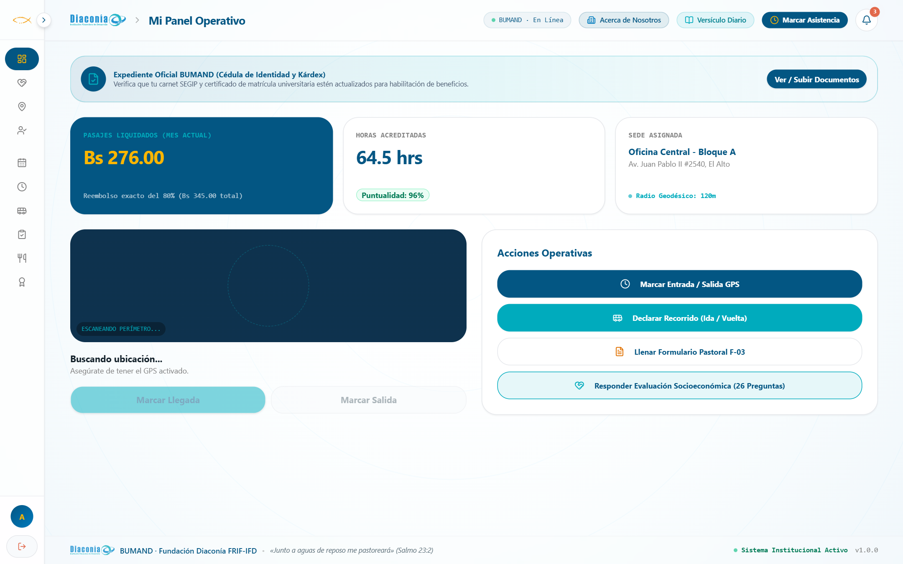


#### Propósito y Componentes
- **Visualizador Satelital:** Radar interactivo que calcula la distancia euclidiana y geodésica a la sede de práctica asignada mediante Haversine.
- **Estado de Geocerca:** Indicador en tiempo real (*Dentro del radio de práctica* en verde esmeralda / *Fuera del perímetro* en rojo ámbar).
- **Contador de Horas Acumuladas:** Progreso respecto a la meta oficial de 36 horas mensuales.

---

### 5.2. Marcación de Horas de Práctica y Extracto Mensual

#### Capturas de Pantalla
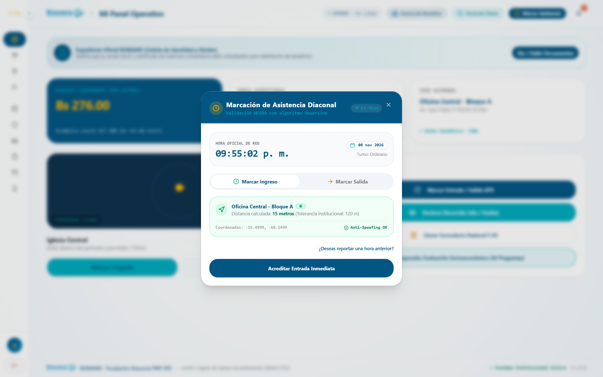

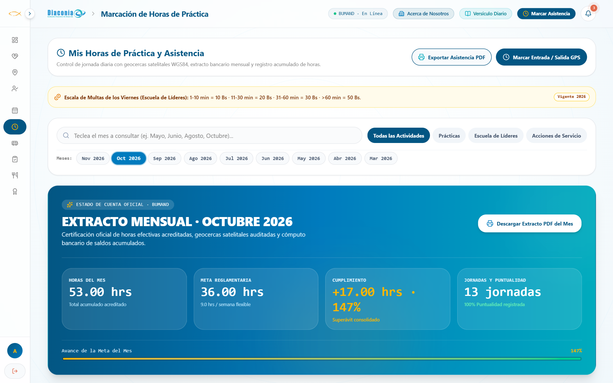

#### Propósito y Reglas
- Botón satelital de **Marcar Ingreso** y **Marcar Salida** con detección de bloque edilicio.
- Extracto mensual en formato bancario donde el estudiante audita sus marcaciones y saldo de horas.

---

### 5.3. Declaración de Recorrido de Pasajes con Tarifas Reales (`BKL-09`)

#### Capturas de Pantalla
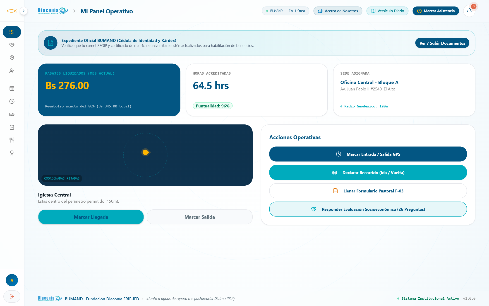


#### Propósito y Modalidad Dinámica
- El becario selecciona su punto de origen y destino, eligiendo tramos de transporte cuyas tarifas se leen en tiempo real de `GET /api/pasajes/tarifas`.
- Respeta la modalidad asignada administrativamente (**Solo Ida** o **Ida y Vuelta** según `BKL-05`).
- El cálculo del 80% reglamentario se realiza en el cliente y se valida estrictamente en el backend.

---

### 5.4. Formulario Pastoral F-03, Carga de Notas y Cuestionario de Bienestar

#### Capturas de Pantalla
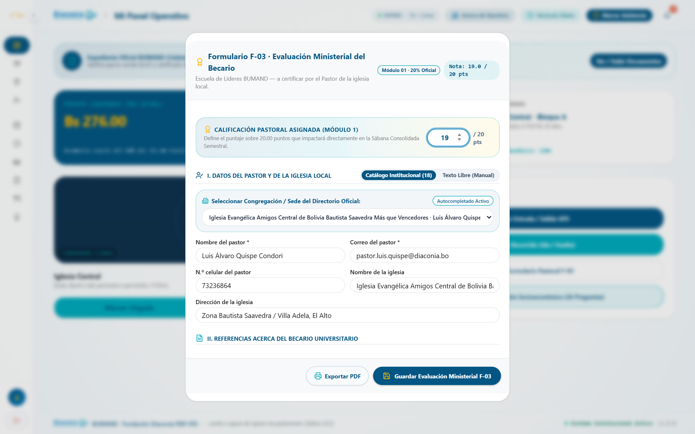

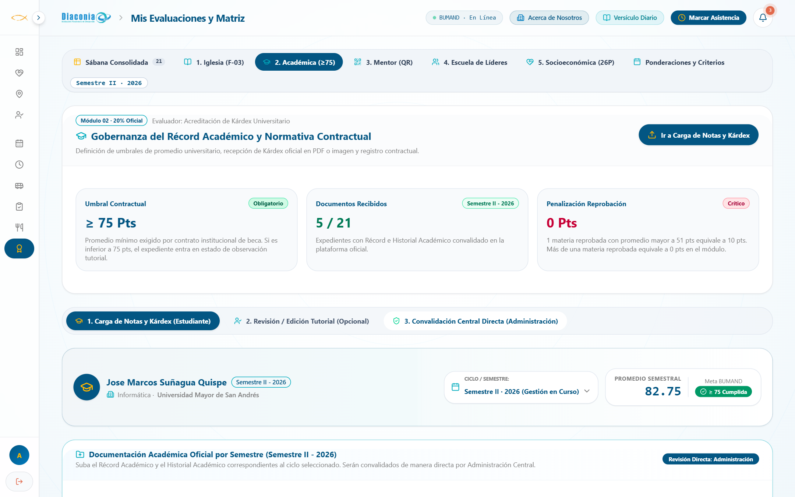


#### Módulos de Evaluación del Becario:
1. **Formulario Pastoral F-03:** Diligenciamiento de las 13 dimensiones eclesiásticas (testimonio, servicio ministerial, diezmos/ofrendas, vida devocional y recomendación pastoral).
2. **Carga de Notas y Certificados:** Registro de notas semestrales y subida de archivos de Récord Académico e Historial Académico en formato PDF/imagen.
3. **Cuestionario de 26 Preguntas:** Evaluación multidimensional de bienestar socioeconómico.

---

### 5.5. Mis Citas, Mis Refrigerios y Mis Justificaciones

#### Capturas de Pantalla


#### Propósito Operativo:
- **Mis Citas:** Calendario de citas concertadas con el tutor y registro de compromisos.
- **Mis Refrigerios:** Información de la dupla responsable del viernes y botón de confirmación de recojo de ración.
- **Mis Justificaciones:** Historial de solicitudes presentadas con visibilidad de dictamen del supervisor y homologación final del administrador.

---

## 6. Erradicación Total de Datos Simulados y Conexión 100% a PostgreSQL (`BKL-10`)

En cumplimiento inflexible del requerimiento **BKL-10**, se realizó una auditoría y refactorización integral del código fuente para garantizar que la plataforma web no contenga datos ficticios:

1. **Backend NestJS en Puerto 3002:**
   - Todas las llamadas `fetch` y `axios` apuntan a `http://localhost:3002/api`.
   - Se erradicaron generadores estáticos (`generarMovimientosDeterministicos`, arrays locales y timeouts simulados).
2. **Frontend Web Next.js:**
   - Se removieron `REGISTROS_REFRIGERIOS_INICIALES`, `JUSTIFICACIONES_MOCK` y `OPCIONES_TARIFAS_LOCALES`.
   - Toda tabla o selector consume los endpoints REST canónicos (`/api/becarios`, `/api/pasajes/tarifas`, `/api/refrigerios`, `/api/justificaciones`, `/api/evaluaciones`).
3. **Persistencia Garantizada:**
   - Cualquier cambio realizado en la web (creación de tarifas, cambio de modalidad de pasajes, evaluación F-03, registro de raciones) impacta directamente en las tablas correspondientes de PostgreSQL (`tarifas_transporte`, `becarios`, `evaluaciones_f03`, `refrigerios`, `justificaciones`).

---

## 7. Suite de Micro-Animaciones y Componentes Cult UI / Watermelon UI / Skipper UI

La plataforma web implementa componentes de diseño de vanguardia (**High-Craft UI**) adaptados a la paleta institucional de Diaconía:
1. **`BotonRebote` (Watermelon UI):** Botones con física elástica de resorte (`spring`) y feedback visual en acciones principales.
2. **`ContadorAnimado` (Watermelon UI):** Transición fluida de cifras numéricas para horas acumuladas, multas acumuladas y liquidación de viáticos.
3. **`BordeBrillante` (Cult UI):** Tarjetas con resplandor cinemático sutil para destacar la meta de 36 horas cumplida y becarios sorteados en refrigerios.
4. **`DialogoConfirmacion` (Skipper UI):** Diálogos modales con difuminado de fondo (`backdrop-blur`) y transiciones físicas de apertura y cierre.

---

## 8. Arquitectura de Diálogos de Confirmación y Erradicación de `alert()` / `confirm()` Nativos

### 8.1. Directriz Inflexible: Cero Diálogos Nativos de Navegador

Queda estrictamente prohibido el uso de `window.alert()`, `window.confirm()` o `window.prompt()`. Todas las interacciones críticas de confirmación se canalizan mediante diálogos institucionales accesibles:

#### Capturas de Pantalla


### 8.2. Hooks Estandarizados:
- **`useFormularioValidado`:** Controla el estado del formulario, la validación con Zod y detecta si existen cambios pendientes de guardar (`hay_cambios`), activando el diálogo de confirmación antes de permitir el cierre del modal.
- **`useConfirmacionDialogo`:** Expone métodos declarativos (`confirmarCierreSinCompletar`, `confirmarEliminacionRegistro`, `confirmarAccionInstitucional`) garantizando consistencia visual y accesibilidad en toda la plataforma.

---

## 9. Resumen de Seguridad, Validaciones Técnicas y Cumplimiento

1. **Tokens Criptográficos JWT:** Transmisión de credenciales mediante cabeceras `Authorization: Bearer <token>` con expiración determinista y firma asimétrica en el backend.
2. **Validación Satelital Anti-Spoofing:** Comprobación estricta de velocidad de desplazamiento, precisión geométrica del sensor GPS y algoritmo Haversine.
3. **Validación OTP Institucional:** Sustitución definitiva de firmas canvas por códigos OTP verificables de 6 dígitos para la convalidación de actas y calificaciones.
4. **Inmutabilidad de Registros:** Planillas de pasajes y calificaciones cerradas no pueden ser alteradas unilateralmente.

---
*Fin de la Documentación Técnica de la Plataforma Web BUMAND 2026*
