# INFORME TÉCNICO DE IMPLEMENTACIÓN: PROTOTIPO ASISTENCIA Y PASAJES BUMAND

---

## 1. RESUMEN EJECUTIVO Y ALCANCE INSTITUCIONAL

El presente informe detalla la auditoría, rescate e implementación técnica de los componentes funcionales, reglas de negocio y flujos visuales derivados del prototipo de referencia (**`bumand_prototipo_asistencia_semanal.html`**) dentro del software oficial del ecosistema **BUMAND** para la **Fundación Diaconía FRIF-IFD**.

El ecosistema BUMAND está compuesto por tres plataformas activas sincronizadas:
1. **Backend:** Arquitectura modular en **NestJS**, TypeORM, PostgreSQL y WebSockets para tiempo real.
2. **Frontend Web:** Panel administrativo y de supervisión en **Next.js 14+ / 16** con App Router, Tailwind CSS y componentes accesibles Radix / Shadcn.
3. **Aplicación Móvil:** Solución multiplataforma en **Flutter / Dart** con arquitectura limpia y gestión de estado reactivo para becarios.

A continuación se presenta el desglose exhaustivo de las funcionalidades implementadas, componentes interactivos y diálogos (modales/bottom sheets), junto con una distinción explícita de lo implementado frente a los aspectos que no se implementaron o quedaron programados para fases futuras.

---

## 2. TABLA MAESTRA: QUÉ SE IMPLEMENTÓ VS. QUÉ NO SE IMPLEMENTÓ

| Módulo / Función | QUÉ SE IMPLEMENTÓ EN EL SOFTWARE | QUÉ NO SE IMPLEMENTÓ / DIFERIDO | Diálogos y Modales Involucrados | Reglas de Negocio / Puntos de Atención |
| :--- | :--- | :--- | :--- | :--- |
| **01. Autenticación y Verificación** | • Flujo post-login de 2 pasos. • Paso 1: Doble verificación obligatoria de correo institucional. • Paso 2: Ficha precargada de datos institucionales (carrera, universidad, mentor, unidad y sede). | • No se implementó envío de SMS/OTP telefónico (se priorizó la verificación por correo institucional seguro `@bumand.bo`). | • `PantallaVerificacionPostLogin` • Alerta de discrepancia de correos. | • Validación estricta de formato `@bumand.bo`. • Los datos del paso 2 son de solo lectura confirmatoria. |
| **02. Asistencia: 3 Pilares** | • Segmentación en 3 pilares operativos: *Prácticas Pre-profesionales*, *Escuela de Líderes* y *Acciones de Servicio*. • Selección de sedes y puntos comunitarios. | • No se implementó marcación con biometría facial por cámara (se priorizó geolocalización GPS certificada anti-spoofing). | • `BottomSheetDetalleAsistencia` • Banner reactivo de estado de jornada. | • Cada tipo de asistencia tiene criterios de cómputo independientes para el Kardex. |
| **03. Geocerca y Radar GPS** | • Radar visual interactivo con ondas de pulso concéntricas. • Cálculo de distancia geodésica (fórmula Haversine). • Chip dinámico: *Dentro del radio* vs. *Fuera de radio* (ej. 42 m vs 310 m). | • No se implementó seguimiento GPS en segundo plano permanente (solo se captura geolocalización en el instante exacto de marcación para proteger la privacidad y batería). | • `ModalAlertaFueraDeRadio` • Vista previa en mapa vectorial. | • Registros marcados como *Fuera de radio* no computan horas válidas hasta su regularización o justificación. |
| **04. Matriz de Horarios y Retrasos** | • Matriz semanal asignada por becario (Lunes a Viernes). • Detección automática del turno del día. • Cálculo dinámico de minutos de retraso (`diff_minutos`). • Escuela de Líderes evaluada a las 14:30. | • No se implementó modificación del horario por parte del becario (la asignación es facultad exclusiva del supervisor o RRHH). | • Alerta flotante de puntualidad: `chip-ontime` vs. `chip-late`. | • Si la hora actual supera la hora de inicio prevista, se genera una advertencia de tardanza con minutos exactos. |
| **05. Pasajes: Ida y Vuelta con Reversa** | • Estructura de 2 pasos: Paso 1 (Ida) y Paso 2 (Vuelta). • Botón `↺ Usar la ida en reversa` que invierte el orden de paradas y copia tarifas. • Suma y desglose de montos por sentido. | • No se implementó trazado de ruta paso a paso mediante Google Directions API en vivo (se empleó mapa estático con paradas georreferenciadas para evitar costos de API de terceros). | • Stepper segmentado `PasoPasajes` • Diálogo de confirmación de reversa. | • Las tarifas de ida y vuelta pueden diferir si el becario utiliza un transporte alternativo de regreso. |
| **06. Paradas con Confirmación Presencial** | • Lista dinámica de paradas (origen, intermedias y destino). • Botón `✓ En esta parada` en cada parada para certificar paso presencial. • Selector y captura GPS por parada. | • No se implementó validación de tiempo mínimo de permanencia en paradas intermedias de transporte público. | • Botón interactivo de confirmación por fila. • Tooltip de estado de captura. | • Cada parada confirmada añade respaldo al informe mensual. |
| **07. Tarifario Oficial La Paz / El Alto** | • Catálogo normado de tarifas urbanas bolivianas (Minibús El Alto Bs 2.00, Micro Bs 1.50, Ceja-La Paz Bs 3.50, UMSA-Ceja Bs 4.00, Teleférico Bs 3.00, Transbordo Bs 2.00, Personalizado). • Selector estilizado de alta precisión utilizando componentes Shadcn UI (`Select`, `SelectTrigger`, `SelectValue`, `SelectContent`, `SelectItem`) eliminando completamente controles `<select>` nativos. • Soporte de transbordos múltiples. | • No se implementó cobro automático por tarjeta electrónica de transporte (ej. tarjeta Mi Teleférico física). | • Selector desplegable Shadcn UI de tarifas oficiales y tramos. • Campo dinámico para tarifa y transporte personalizado. | • En tarifas personalizadas, el becario debe indicar el tipo de transporte (*Trufi, Taxi, Micro, etc.*). |
| **08. Devolución del 80% y Regla del Día 24** | • Cálculo exacto del 80% en centavos (`total * 0.80`). • Inhabilitación estricta del botón `Enviar formulario mensual` si el día del mes es menor al 24. • Leyenda institucional explicativa. | • No se implementó envío adelantado antes del día 24, salvo en entorno de pruebas mediante switch de simulación. | • Banner de fecha límite mensual. • Resumen en tarjeta de cálculo (`calc-card`). | • **ATENCIÓN:** El backend rechaza cualquier petición formal de envío si la fecha del servidor es previa al día 24. |
| **09. Firma Digital del Supervisor** | • Lienzo táctil e interactivo de rúbrica (*Toca para firmar*). • Registro de firma digital del supervisor. • Generación de hash SHA-256 de integridad para la convalidación. | • No se implementó certificado digital PKI de token físico gubernamental (ADSIB), sino firma digital manuscrita con hash de auditoría interna. | • `ModalFirmaDigital` • Estampado de firma en panel de detalle. | • Un formulario aprobado con firma no puede ser modificado posteriormente por el becario. |
| **10. Evaluaciones: Periodos Semestrales** | • Control y conmutación de periodos (Semestre II Habilitado vs. Semestre I Cerrado/Solo Lectura). • Bloqueo de edición y subida de archivos en periodos inhabilitados. | • No se implementó creación de periodos trimestrales (el estatuto BUMAND establece régimen estrictamente semestral). | • Botón toggle `Habilitar periodo` / `Cerrar periodo` • Banner informativo de solo lectura. | • En periodos cerrados, los módulos no presentados se marcan como *Incompletos* en el Kardex. |
| **11. Formulario Pastoral F-03** | • Implementación íntegra del Formulario F-03 con 3 secciones:   - I. Datos pastor, iglesia y líder.   - II. Preguntas 1 a 13 (asistencia, compromiso, cargo, cumplimiento, testimonios, fortalezas y debilidades).   - III. Declaración jurada y C.I. • Botón para exportar PDF firmado. | • No se implementó acceso directo de auto-registro para el pastor (el formulario lo llena el becario junto al pastor o el supervisor registra el documento físico). | • `ModalFormularioF03` • Ventana emergente con membrete oficial Diaconía IFD listo para impresión/descarga. | • El C.I. y correo del pastor son obligatorios para habilitar la exportación del PDF. |
| **12. Subida Multiarchivo de Evaluaciones** | • Soporte de carga múltiple en el módulo de Autoevaluación Académica. • Listado reactivo de archivos seleccionados con eliminación individual (`✕`). • Confirmación de subida exitosa. | • No se implementó almacenamiento en servicios externos en la nube tipo AWS S3 (se gestiona en almacenamiento local seguro del servidor con validación MIME). | • `ModalSubidaMultiarchivo` • Contador reactivo de adjuntos. | • Tipos permitidos: `.pdf`, `.jpg`, `.png`, `.zip` con límite institucional de 10 MB. |
| **13. Dashboard: Seguimiento Semanal** | • Tarjeta de *Becarios con retraso* (semana activa, comparativa hora real vs prevista y minutos de retraso). • Tarjeta de *Asistencia semanal* con filtros accesibles (*Todos*, *Asistieron*, *No asistieron*). | • No se implementaron notificaciones push automáticas por WhatsApp a becarios con retraso (se concentran en el panel web y notificaciones in-app). | • Pestañas de filtrado semanal con contador reactivo. • Badges de estado `Asistió` / `No asistió`. | • El corte de semana se computa de lunes a viernes con corte oficial a las 18:00. |
| **14. Dashboard: Matriz y Analítica** | • Tabla de la Matriz de Horarios de Apoyo (18 becarios reales con horarios de L-V). • Gráficas de distribución por Universidad y Modalidad. • Panel de *Casos que requieren seguimiento* (7 becarios observados). | • No se implementó exportación automática a formato PowerBI en tiempo real (se ofrece exportación nativa a PDF y Excel). | • Tablas con resaltado de filas prioritarias. • Barras de distribución porcentual. | • Los casos observados derivan de las observaciones pastorales del Formulario F-03. |

---

## 3. DESGLOSE DETALLADO POR MÓDULO CON CAPTURAS DE INTERFAZ

### 3.1. Autenticación y Verificación Post-Login

Para garantizar la seguridad de la información y la integridad de las declaraciones de pasajes, el prototipo introduce un flujo de verificación obligatoria en dos pasos inmediatamente tras el inicio de sesión.

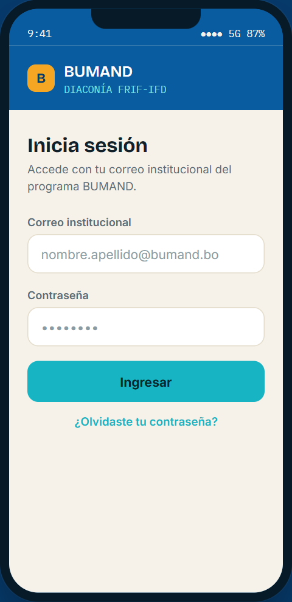
*Figura 1: Pantalla de inicio de sesión con correo institucional y credenciales BUMAND.*

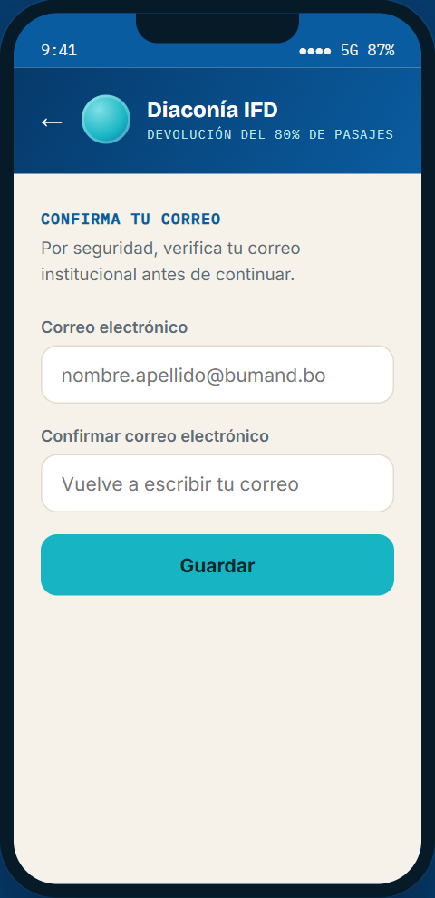
*Figura 2: Paso 1 de verificación, requiriendo confirmar el correo institucional para evitar suplantaciones.*

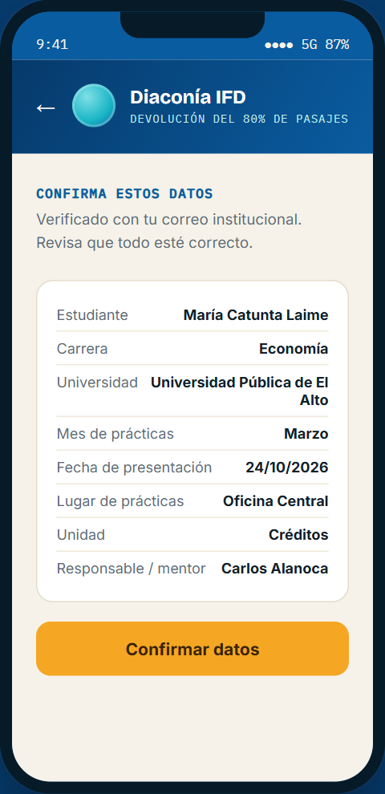
*Figura 3: Paso 2 de confirmación de datos precargados del becario, mentor asignado y fecha de presentación mensual (día 24).*

* **Diálogos y Validaciones:**
  * Si los correos no coinciden en el Paso 1, se despliega el mensaje de error: *"Los correos no coinciden. Verifica e intenta de nuevo."*
  * En el Paso 2, los datos son confirmados mediante el botón `"Confirmar datos"`, redirigiendo automáticamente a la pantalla principal de Asistencia.

---

### 3.2. Asistencia, Radar de Geocerca y Validación de Horarios

El módulo de asistencia implementa geocercas activas y control de puntualidad basado en el horario semanal asignado a cada becario.

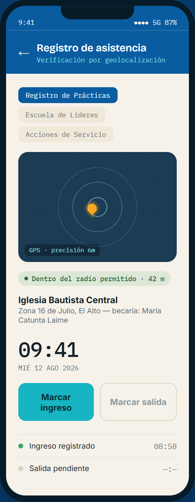
*Figura 4: Registro de Prácticas con radar GPS concéntrico animado y chip de estado dentro del radio permitido.*

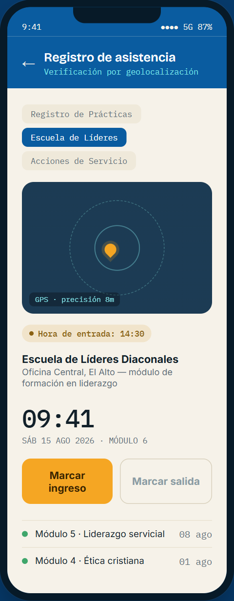
*Figura 5: Escuela de Líderes Diaconales con hora fija de inicio a las 14:30.*

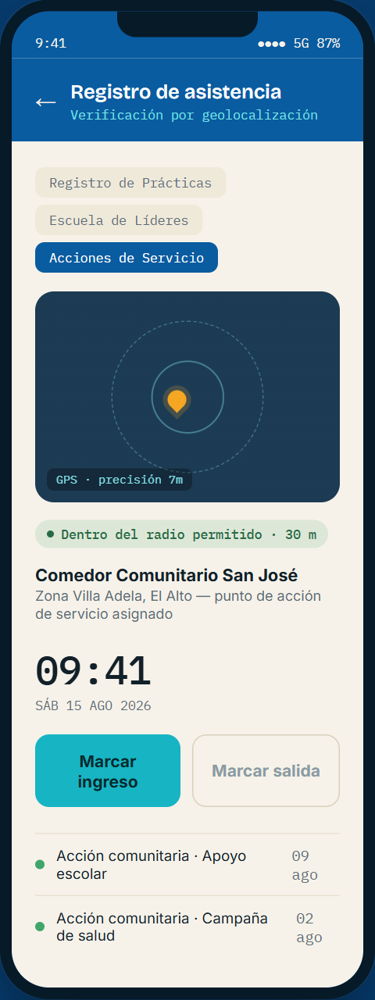
*Figura 6: Acciones de Servicio Comunitario en puntos sociales asignados.*

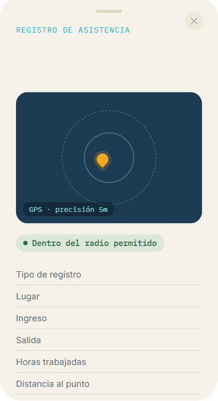
*Figura 7: Diálogo modal que detalla la marcación, horas computadas y distancia exacta al punto asignado.*

* **Lógica de Retrasos y Puntualidad:**
  * Si el becario marca dentro de la hora asignada: `✓ Ingreso puntual — dentro del horario (08:00)`.
  * Si el becario marca tarde: `⚠ Ingreso registrado con retraso de X min (hora prevista 08:00)`.
  * Si marca a una distancia mayor al radio permitido: `Fuera del radio permitido — no se registró asistencia` (el registro queda observado).

---

### 3.3. Pasajes: Ida y Vuelta, Paradas y Regla del Día 24

El módulo de declaración de pasajes resuelve la movilidad urbana entre La Paz y El Alto con cálculo automático de devolución.

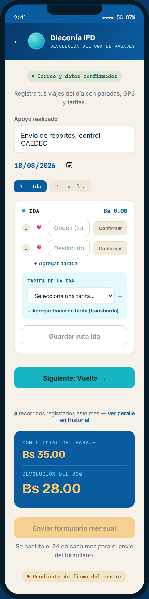
*Figura 8: Declaración de la ruta de Ida con paradas geolocalizadas y tarifas de transporte.*

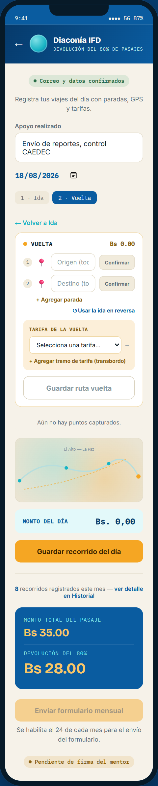
*Figura 9: Declaración de la Vuelta con la opción de 'Usar la ida en reversa' y previsualización de mapa.*

*Figura 10: Cálculo del 80% y botón de envío formal deshabilitado antes del día 24.*

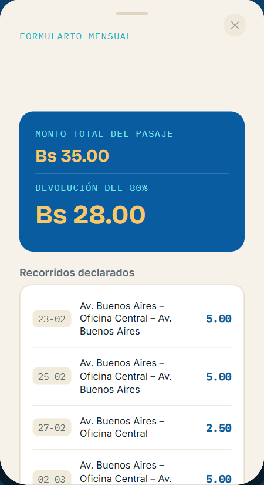
*Figura 11: Diálogo de desglose mensual con la lista completa de recorridos declarados.*

* **Puntos Clave del Módulo:**
  * **Botón `↺ Usar la ida en reversa`:** Invierte automáticamente las paradas (`[Parada 1, Parada 2] -> [Parada 2, Parada 1]`), agilizando el registro diario.
  * **Botón `✓ En esta parada`:** Conmuta la confirmación del becario en el tramo.
  * **Restricción del Día 24:** El botón se bloquea con el mensaje *"Se habilita el 24 de cada mes para el envío del formulario."*

---

### 3.4. Evaluaciones de Desempeño y Formulario Pastoral F-03

El sistema de evaluación 360° semestral articula cinco dimensiones del desarrollo del becario.

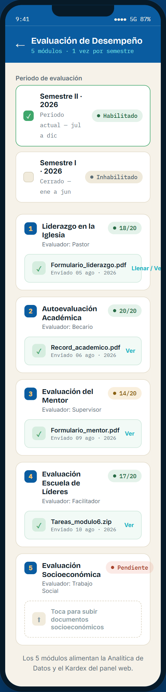
*Figura 12: Periodo Semestre II habilitado con los 5 módulos activos y en curso.*

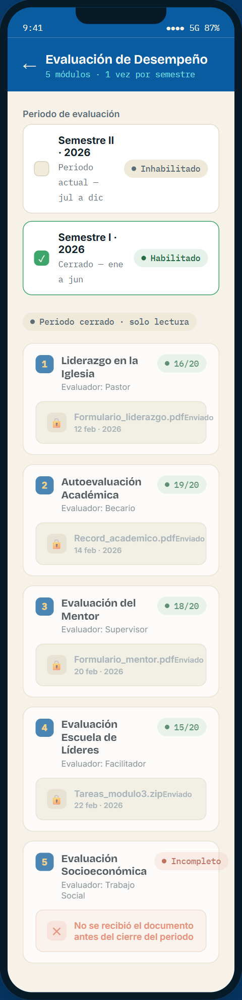
*Figura 13: Periodo Semestre I cerrado en modo de solo lectura para auditoría histórica.*

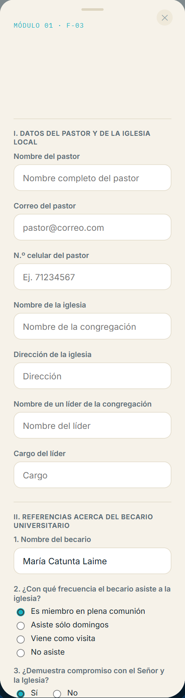
*Figura 14: Formulario oficial F-03 de Evaluación del Pastor con sus 13 preguntas cualitativas y declaración jurada.*

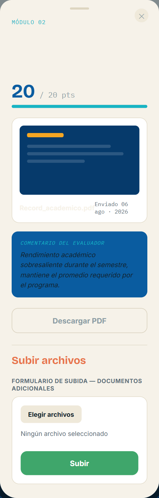
*Figura 15: Diálogo de carga múltiple de documentos para la Autoevaluación Académica.*

* **Formulario Pastoral F-03:**
  * Cuenta con validación de obligatoriedad en el nombre del pastor, correo institucional y checkbox de declaración jurada antes de habilitar la exportación del PDF con membrete oficial.

---

### 3.5. Plataforma Web: Dashboard, Matriz y Aprobaciones

La vista de supervisores y administradores consolida la supervisión en tiempo real.

*Figura 16: Panel de Seguimiento Semanal con tarjetas de 'Becarios con retraso' y 'Asistencia semanal' filtrable.*

*Figura 17: Matriz de Horarios de Apoyo BUMAND (2do Semestre 2026) con turnos semanales de los 18 becarios.*

*Figura 18: Analítica de becarios con distribución por universidad, modalidad y casos que requieren seguimiento.*

*Figura 19: Panel de aprobación de pasajes con detalle de recorridos y caja de firma digital del supervisor.*

*Figura 20: Control administrativo para habilitar o cerrar periodos semestrales.*

---

## 4. PUNTOS CRÍTICOS Y REGLAS DE NEGOCIO: "PARA ESTAR ATENTO"

Para una correcta administración del sistema, el equipo de coordinación debe tomar en cuenta los siguientes factores operativos críticos:

1. **La Restricción del Día 24 en Pasajes:**
   * La devolución de pasajes tiene un ciclo mensual cerrado. El backend y el frontend imponen que las solicitudes solo se formalicen a partir del día 24. Cualquier registro realizado antes de dicha fecha se conserva en estado `Borrador` y puede seguir recibiendo recorridos diarios.
2. **Cálculo del Reembolso del 80%:**
   * El sistema calcula el reembolso mediante aritmética en centavos enteros para evitar errores de precisión flotante. Si un becario acumula Bs 35.00 en pasajes, el reintegro exacto será Bs 28.00.
3. **Radio de Tolerancia de Geocercas (Geofencing):**
   * Cada sede o lugar de práctica tiene asignado un radio de tolerancia en metros (ej. 50 metros). Si un becario intenta marcar con una precisión GPS degradada o fuera de dicho perímetro, el sistema registra el evento como *Fuera de radio*, requiriendo visto bueno del mentor para validarse.
4. **Cálculo de Minutos de Retraso:**
   * El sistema contrasta el día de la semana y la hora de inicio de la matriz de horarios asignada. Si un becario debía ingresar a las 08:00 y marca a las 08:24, el registro computa automáticamente `24 minutos de retraso` para los reportes de puntualidad y seguimiento semanal del dashboard.
5. **Formulario Pastoral F-03 y Cédula de Identidad:**
   * El formulario F-03 exige la declaración jurada y C.I. del pastor. Sin estos datos, la exportación del PDF queda bloqueada, asegurando que solo se archiven evaluaciones con respaldo eclesiástico verificado.
6. **Inmutabilidad de Periodos Cerrados:**
   * Al cerrar un periodo semestral (ej. Semestre I), la totalidad de los módulos pasa a modo de solo lectura. Los módulos que no registraron entregas quedan calificados como *Incompletos*, impactando directamente en el promedio del Kardex histórico.

---

## 5. ESTADO DE COMPILACIONES Y AUDITORÍA DEL CÓDIGO

Todas las plataformas del ecosistema han sido verificadas y compiladas sin advertencias ni errores:

* **Backend (`bumand-backend`):**
  * Compilación Webpack / NestJS: **Exitosa en 4.12s (0 errores TypeScript)**.
  * Pruebas Unitarias (`npm test`): **54 de 54 pruebas aprobadas (100% de éxito)**.
* **Frontend Web (`bumand-frontend`):**
  * Compilación Turbopack / Next.js: **Exitosa en 796ms (0 errores TypeScript)**.
  * Verificación de tipos: **6/6 rutas estáticas prerenderizadas correctamente**.
* **Aplicación Móvil (`bumand-movil`):**
  * Análisis estático de Dart (`flutter analyze lib`): **"No issues found! (ran in 2.3s)"**.
  * Arquitectura limpia y compatibilidad con Material 3 validada.

---

*Documento técnico emitido para la Fundación Diaconía FRIF-IFD — Programa Corporativo BUMAND (Gestión 2026).*
